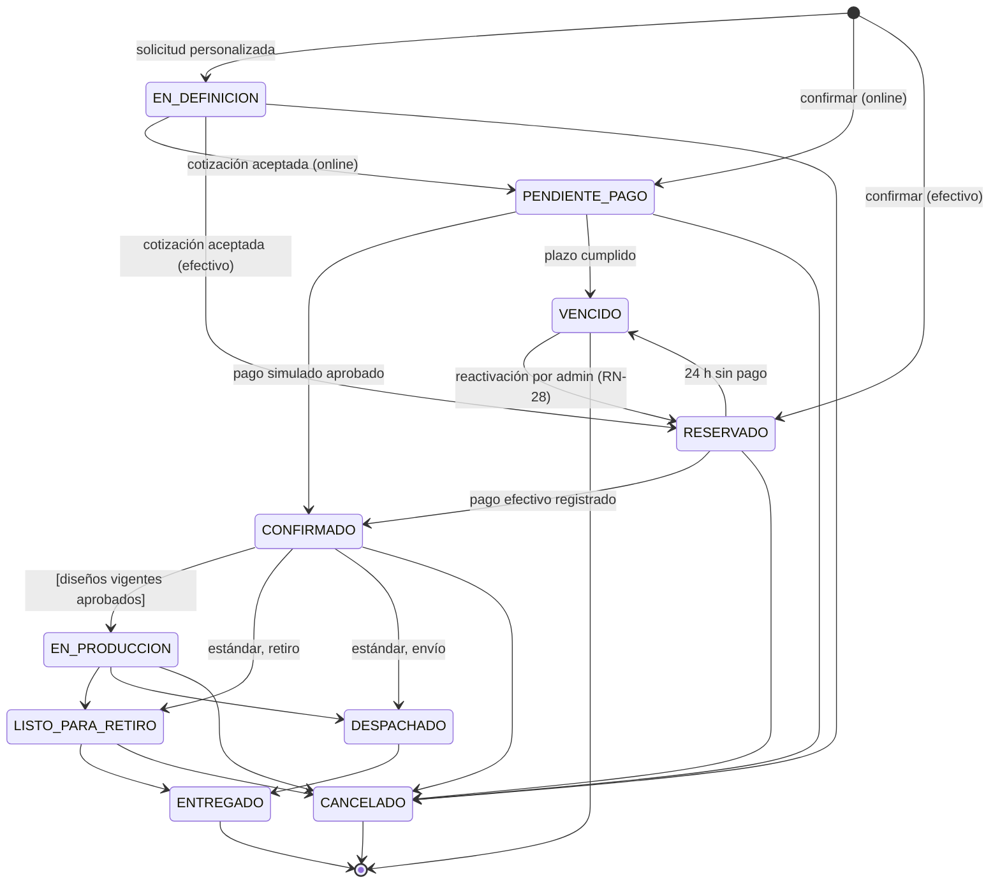
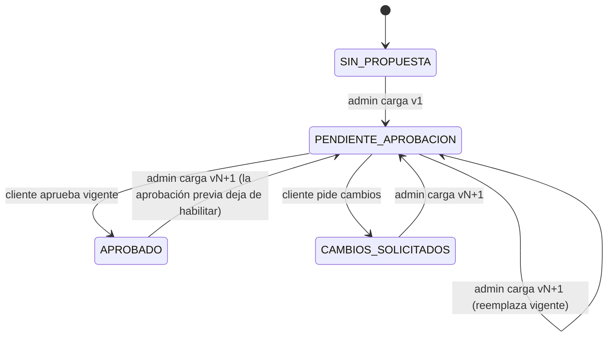
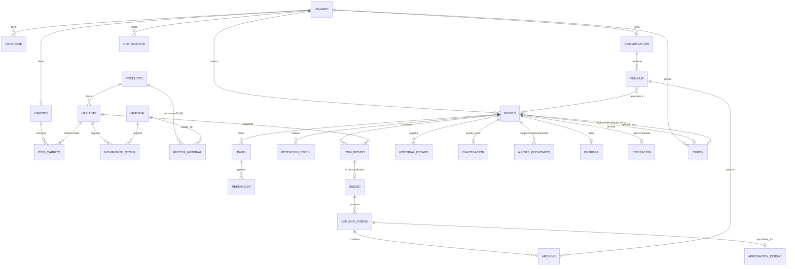

# Especificación funcional y técnica — Sistema de gestión y ventas para tienda de sublimaciones

| Campo | Valor |
|---|---|
| Documento | `especificacion_sistema_sublimaciones_v1.md` |
| Versión | 1.13 (borrador para revisión) |
| Fecha | 2026-10-14 |
| Estado | **En revisión.** Las versiones 1.1 a 1.7 incorporan las decisiones D-01 a D-04, D-05 (modo piloto), D-11, D-15 a D-17, D-20 a D-25, D-28, D-30 y D-31 a D-43. Quedan decisiones pendientes (sección 22) que bloquean partes concretas de la implementación. |
| Alcance | Primera versión (v1) para un piloto con usuarios reales. Sin pagos reales. |
| Responsable del desarrollo | Un único desarrollador |

### Registro de cambios

| Versión | Fecha | Cambios |
|---|---|---|
| 1.0 | 2026-10-13 | Versión inicial. |
| 1.1 | 2026-10-13 | Decisiones de la tienda incorporadas como reglas acordadas: D-01 → RN-17, D-02 → RN-16, D-03 → RN-15 (cargo del 15 %), D-15 → RN-13, D-21 → RN-14, D-22 → RN-18; R-08/D-25 → Next.js. Nuevas decisiones pendientes D-31 a D-33. Ajustes en requisitos, flujos, estados, modelo, arquitectura, endpoints, pruebas (T-70 a T-80), criterios (CA-17, CA-18), riesgos y roadmap. |
| 1.2 | 2026-10-13 | Cancelación por la tienda con devolución total y cupón del 10 % (RN-19, RN-20); seña del 20 % en personalizados (RN-21); plazo de pago online de 30 min (RN-22); estados cancelables por el cliente (RN-23); devoluciones en efectivo arregladas por el admin (RN-18); porcentaje del cargo guardado en cada pedido y registro opcional del costo real (R-15). Nuevo flujo F-08, RF-50 a RF-54, T-81 a T-97, CA-19 a CA-23, incremento de cupones (INC-11). Nuevas decisiones pendientes D-34 a D-38. |
| 1.3 | 2026-10-13 | D-34 a D-38 aprobadas y D-05 en modo manual para el piloto. Nueva regla de precedencia en cancelaciones (RN-24) y sección de dependencias entre reglas (7.4). Desglose auditable de cancelaciones (RF-55). Vencimientos de pagos online (30 min) y de reservas (24 h) como mecanismos independientes (14.5). Restauración única del cupón con vencimiento original. INC-08 dividido en INC-08.1 (solicitud y cotización) e INC-08.2 (seña y saldo). Nuevas pruebas T-98 a T-108 y criterios CA-24 a CA-26. Pendientes nuevos D-39 (contradicción sobre el importe retenido de la seña) a D-42. |
| 1.4 | 2026-10-13 | D-39: si el cliente cancela un personalizado dentro de las últimas 48 h, se retiene la seña completa (nuevo tipo de ajuste `RETENCION_SENA`). D-40: la seña se calcula después del descuento del cupón. D-41: sin límite adicional de restauraciones del cupón. D-42: reemisión de una cotización vencida en un pedido nuevo. Nuevas pruebas T-109 y T-110 y criterio CA-27. Corrección: la lista de decisiones abiertas incluye las originales que siguen sin respuesta. Revisión de consistencia: el cargo del 15 % ya no se menciona como aplicable a personalizados con seña (RN-15, RN-03, RF-39, RF-41, RF-42, 9.3, CA-04, T-74); desglose con seña y saldo; vista previa de cancelación consistente con el resultado (T-111). |
| 1.5 | 2026-10-14 | D-11: cuenta obligatoria para comprar, con registro dentro del checkout (RN-25). D-24: pesos argentinos, precios finales con impuestos incluidos y facturación fuera del sistema con registro del comprobante; la tienda es monotributista (RN-26). Nuevos RF-56 y RF-F05, entidad `ComprobanteExterno`, pruebas T-112 a T-116, criterios CA-28 y CA-29, riesgo R-18. |
| 1.6 | 2026-10-14 | D-28: el checkout usa el precio vigente (RN-27, antes RN-P-02). D-20: solo el admin puede extender una reserva o reactivar una vencida (RN-28). D-30: el plazo de 24 h de las reservas no corre fines de semana ni feriados cargados por el admin (RN-29). R-18 aceptado por la tienda. Nuevos RF-57 y RF-58, entidades `ExtensionReserva` y `Feriado`, transición `VENCIDO → RESERVADO`, pruebas T-117 a T-129, criterios CA-30 a CA-32. INC-06 dividido en INC-06.1 a INC-06.3. Nuevo pendiente D-43. |
| 1.7 | 2026-10-14 | D-43: la ventana de 48 h para cancelar con cargo cuenta fines de semana y feriados; el admin puede excluir fechas puntuales y el sistema avisa a los clientes afectados (RN-30). Cálculo de plazos en una utilidad compartida con RN-29 para que excluir fines de semana sea un cambio de una sola función. Nuevos RF-59, entidades `DiaExcluidoVentana` y `CambioVentanaCargo`, campo `inicio_ventana_cargo`, flujo F-09, pruebas T-130 a T-136, criterios CA-33 y CA-34. INC-10 dividido en INC-10.1 e INC-10.2. |
| 1.8 | 2026-10-14 | Avance de implementación: INC-01 implementado y verificado en local (sección 23.1). Se documentan las versiones elegidas (11.2), el ambiente local real (11.4), los endpoints de salud (13), las pruebas de fundamentos T-137 a T-142 (19.2) y el riesgo R-19. Sin cambios en reglas de negocio. |
| 1.9 | 2026-10-14 | Avance: INC-02 (autenticación) implementado y verificado (23.1). Se documenta la implementación de la autenticación (17.1), las entidades `Sesion`, `TokenUsuario` y `LimiteSolicitud` (10.2), los endpoints y códigos de error nuevos (13), las pruebas T-143 a T-152 (19.2), los riesgos R-20 a R-22 y la decisión técnica pendiente D-44 (proveedor de correo). Sin cambios en reglas de negocio. |
| 1.10 | 2026-10-14 | Decisiones de INC-03: las imágenes de productos se implementan en INC-07; los personalizables muestran «Consultá el precio» hasta definir D-10 (RN-31). Avance: INC-03 (catálogo) implementado y verificado (23.1). Modelo `Categoria`/`Producto`/`Variante`, endpoints del catálogo, pruebas T-153 a T-164. |
| 1.11 | 2026-10-14 | Avance: INC-04 (inventario) implementado y verificado (14.9, 23.1). Stock por variante y por material, retención/liberación/consumo atómicos e idempotentes, movimientos con deltas, conciliación, alerta de stock bajo, disponibilidad en el catálogo. Revisión del orden de las migraciones: sin riesgo (23.1). Pruebas T-165 a T-171. Sin cambios en reglas de negocio. |
| 1.12 | 2026-10-14 | D-06: confirmada la opción B (el admin cotiza el envío después del pedido); flujo propuesto F-10 y decisiones pendientes D-45 a D-49. INC-05 dividido en INC-05.1 (carrito), INC-05.2 (checkout y pedidos) e INC-05.3 (datos operativos). Avance: INC-05.1 implementado y verificado. Pruebas T-172 a T-177. |
| 1.13 | 2026-10-14 | Avance: INC-05.2 implementado para retiro en el local (checkout con pago online simulado y reserva en efectivo, pedidos, transiciones, historial, registro del efectivo, notificaciones en la cola). El checkout con envío sigue pendiente de D-45, D-46, D-47 y D-49. Pruebas T-178 a T-183. Sin cambios en reglas de negocio. |

---

## Índice

1. [Convenciones del documento](#1-convenciones-del-documento)
2. [Resumen ejecutivo](#2-resumen-ejecutivo)
3. [Contexto y problemas del negocio](#3-contexto-y-problemas-del-negocio)
4. [Objetivos y alcance](#4-objetivos-y-alcance)
5. [Actores y permisos](#5-actores-y-permisos)
6. [Requisitos funcionales (RF)](#6-requisitos-funcionales-rf)
7. [Reglas de negocio (RN)](#7-reglas-de-negocio-rn)
8. [Flujos principales](#8-flujos-principales)
9. [Estados y transiciones](#9-estados-y-transiciones)
10. [Modelo conceptual de datos](#10-modelo-conceptual-de-datos)
11. [Arquitectura recomendada](#11-arquitectura-recomendada)
12. [Organización modular del backend y frontend](#12-organización-modular-del-backend-y-frontend)
13. [Grupos de endpoints REST sugeridos](#13-grupos-de-endpoints-rest-sugeridos)
14. [Inventario, concurrencia y vencimientos](#14-inventario-concurrencia-y-vencimientos)
15. [Diseños: versionado y aprobación](#15-diseños-versionado-y-aprobación)
16. [Archivos, chat y notificaciones](#16-archivos-chat-y-notificaciones)
17. [Seguridad y privacidad](#17-seguridad-y-privacidad)
18. [Requisitos no funcionales (RNF)](#18-requisitos-no-funcionales-rnf)
19. [Plan de pruebas y criterios de aceptación](#19-plan-de-pruebas-y-criterios-de-aceptación)
20. [Matriz de trazabilidad de reglas de negocio](#20-matriz-de-trazabilidad-de-reglas-de-negocio)
21. [Riesgos técnicos y comerciales](#21-riesgos-técnicos-y-comerciales)
22. [Decisiones pendientes y preguntas para la tienda](#22-decisiones-pendientes-y-preguntas-para-la-tienda)
23. [Roadmap de implementación](#23-roadmap-de-implementación)
24. [Criterios para considerar la v1 lista para piloto](#24-criterios-para-considerar-la-v1-lista-para-piloto)
25. [Glosario](#25-glosario)

---

## 1. Convenciones del documento

### 1.1 Estado de cada afirmación

Para no mezclar lo decidido con lo propuesto, cada elemento relevante se marca así:

| Marca | Significado |
|---|---|
| **[ACORDADO]** | Decisión tomada por el negocio. No se modifica sin aprobación explícita de la tienda. |
| **[PROPUESTA]** | Recomendación técnica o funcional de este documento. Puede adoptarse, cambiarse o descartarse. |
| **[PENDIENTE D-xx]** | Depende de una decisión todavía no tomada (ver sección 22). No se debe implementar la parte afectada hasta resolverla, salvo como punto de extensión. |

### 1.2 Códigos estables

| Prefijo | Uso |
|---|---|
| `RF-xx` | Requisito funcional |
| `RN-xx` | Regla de negocio (RN-01 a RN-12 son las acordadas; RN-P-xx son reglas propuestas) |
| `RNF-xx` | Requisito no funcional |
| `D-xx` | Decisión pendiente |
| `T-xx` | Caso de prueba |
| `CA-xx` | Criterio de aceptación |
| `R-xx` | Riesgo |
| `INC-xx` | Incremento de implementación del roadmap |

Los códigos no se renumeran: si un requisito se elimina, se marca como **[RETIRADO]** y su código no se reutiliza.

### 1.3 Prioridad

`DEBE` = obligatorio para el piloto. `DEBERÍA` = importante, puede posponerse si compromete plazos. `FUTURO` = fuera de la v1.

### 1.4 Principios de desarrollo acordados con el desarrollador

Estos principios guían todas las decisiones técnicas del documento:

1. **Sin sobreingeniería.** Cada tecnología o capa adicional debe justificarse por una necesidad concreta del negocio.
2. **Incrementos según complejidad y riesgo.** Las funcionalidades complejas o riesgosas (inventario concurrente, vencimientos, aprobación de diseños, cancelaciones con cargos) se implementan **solas**, en un incremento propio, salvo que sea estrictamente necesario acoplarlas a otra.
3. **Código limpio.** Nombres claros, funciones pequeñas, sin abstracciones especulativas.
4. **Mantenible y escalable.** Las reglas que todavía están pendientes se aíslan en un único punto (una función o política) para que cambiarlas tenga un costo bajo.

---

## 2. Resumen ejecutivo

La tienda vende productos sublimados estándar (con stock) y personalizados (que requieren diseño y aprobación previa). Hoy sufre confusiones con los clientes sobre diseños y medidas, pérdidas por cancelaciones tardías y errores, y desorden en pedidos, reservas y stock.

Se propone un **sistema web único** con:

- Catálogo público con disponibilidad real.
- Carrito sin bloqueo de stock y **confirmación con validación atómica en servidor**.
- Dos modalidades de cierre: **pago online simulado** o **reserva para pago en efectivo con retiro en el local**, con vencimiento de 24 h.
- Flujo de **personalización con versiones de diseño y aprobación explícita** asociada a una versión concreta; la fabricación queda bloqueada sin aprobación vigente.
- **Chat persistente** con adjuntos y notificaciones.
- Panel de administración para productos, stock, materiales, pedidos, cancelaciones, cargos, compensaciones y entregas, con historial auditable.

**Arquitectura:** una sola aplicación **Next.js + TypeScript** [ACORDADO] organizada como monolito modular, con la lógica de negocio separada del framework, base de datos **PostgreSQL** gestionada y **almacenamiento compatible con S3** para archivos [PROPUESTA]. Sin microservicios, sin colas externas, sin WebSockets en la v1.

**Decisiones incorporadas (v1.1 a v1.7):** "confirmado" significa pago registrado (el total o, en personalizados, la seña); en personalizados el plazo empieza al aceptar la cotización y se paga una seña del 20 %, que se retiene completa si el cliente cancela dentro de las 48 h previas; el administrador confirma la fecha comprometida de despacho; si el cliente cancela dentro de las 48 h previas paga un cargo por servicio del 15 %; si cancela la tienda, devuelve todo (incluido el envío) y emite un cupón del 10 % válido por un mes; el efectivo solo se acepta con retiro en el local; el pago online retiene stock 30 minutos; el cliente no puede cancelar desde la web un pedido listo, despachado o entregado; para comprar se necesita una cuenta; los precios son finales, en pesos y con impuestos incluidos, y la facturación se hace fuera del sistema; el checkout cobra el precio vigente; el plazo de 24 h de las reservas no corre fines de semana ni feriados, y solo el admin puede extender o reactivar una reserva; la ventana de 48 h para cancelar con cargo cuenta fines de semana, salvo las fechas que el admin excluya avisando a los clientes afectados. **Siguen pendientes** decisiones originales que no cambian el diseño general pero bloquean incrementos concretos: envíos (D-06), canales de notificación (D-07), formatos de archivo (D-08), materiales (D-09, D-14, D-18), precio de los personalizados (D-10), entre otras. La compensación por demora se carga a mano durante el piloto (D-05). Ver sección 22.

---

## 3. Contexto y problemas del negocio

### 3.1 Productos

Tazas, stickers, remeras, carteles y otros artículos personalizados de distintos materiales y tamaños, hasta aproximadamente 90 × 90 cm. Hay dos naturalezas:

| Tipo | Descripción | Stock |
|---|---|---|
| Estándar | Producto terminado listo para vender (o con diseño de catálogo ya fijo). | Stock de producto terminado por variante. |
| Personalizable | Se fabrica a pedido con un diseño acordado con el cliente. | Consume materiales (insumos y bases en blanco). |

### 3.2 Problemas actuales y cómo los aborda el sistema

| Problema | Respuesta del sistema |
|---|---|
| Alcance limitado para atraer clientes | Catálogo público renderizado en servidor con Next.js: navegable, indexable por buscadores y compartible. |
| Confusiones sobre diseños, materiales y medidas | Solicitud de personalización estructurada (producto, medida, material, cantidad, referencias), chat asociado al pedido y aprobación explícita de una versión concreta del diseño. |
| Pérdidas por errores y cancelaciones tardías | Bloqueo de fabricación sin aprobación; fecha comprometida de despacho confirmada por la tienda; cargo por servicio del 15 % en cancelaciones tardías; registro de quién cancela, cuándo y con qué cargo (RN-03, RN-08, RN-15). |
| Desorden en pedidos, reservas, stock y comunicación | Estados explícitos con transiciones validadas, stock físico/reservado/disponible, vencimiento automático de reservas, historial y auditoría. |

---

## 4. Objetivos y alcance

### 4.1 Objetivos

| Código | Objetivo | Indicador sugerido [PROPUESTA] |
|---|---|---|
| OBJ-01 | Reducir errores de producción en personalizados | % de pedidos personalizados rehechos por error de especificación |
| OBJ-02 | Evitar sobreventa | Cantidad de pedidos confirmados sin stock (objetivo: 0) |
| OBJ-03 | Reducir pérdidas por cancelaciones tardías | Importe de trabajo/material perdido sin cargo registrado |
| OBJ-04 | Ordenar la operación | Pedidos con estado actualizado y trazable (objetivo: 100 %) |
| OBJ-05 | Aumentar ventas | Pedidos online y reservas por semana frente a la situación previa |

Los valores objetivo numéricos (salvo los "objetivo: 0/100 %" de integridad) los debe fijar la tienda.

### 4.2 Dentro del alcance de la v1

- Cuentas de cliente y administrador.
- Catálogo, variantes, precios, stock de productos terminados y de materiales.
- Carrito, confirmación, pago online **simulado**, reserva para pago en efectivo con vencimiento.
- Solicitudes de personalización, archivos de referencia, versiones de diseño y aprobación.
- Chat con adjuntos, notificaciones in-app y por correo.
- Pedidos, cancelaciones, registro de cargos y compensaciones, reembolsos **simulados**.
- Retiro en local y envío (gestión de envío manual, ver D-06).
- Historial de estados y auditoría.

### 4.3 Fuera del alcance de la v1

| Elemento | Motivo |
|---|---|
| Pagos y reembolsos reales | [ACORDADO] La v1 no procesa dinero real. |
| Galería pública de diseños de clientes | [ACORDADO] Opcional futura. Ver 4.4. |
| Portal de proveedores | [ACORDADO] No decidido para v1. |
| Integración automática con empresas de envío | No hay definición de logística (D-06). |
| Editor de diseño online para el cliente | No solicitado; alto costo. |
| Emisión de facturas desde el sistema | [ACORDADO] En la v1 la tienda factura fuera del sistema y registra el comprobante en el pedido (RN-26). La integración queda como RF-F05. |
| Aplicación móvil nativa | La web debe ser responsive; no se requiere app. |

### 4.4 Galería pública de diseños — recomendación

**[PROPUESTA] No incluirla en la v1.** Motivos: requiere moderación (RN-11), plantea cuestiones de derechos de autor y de imagen de terceros, y no resuelve ninguno de los problemas críticos (stock, errores, cancelaciones).

Si el objetivo de "alcance para atraer clientes" necesita algo visual antes, una alternativa de bajo costo es una sección **"Trabajos realizados" cargada solo por la administración** (no requiere moderación de contenido de clientes). Es opcional y se decide en D-13; no forma parte de los requisitos obligatorios.

---

## 5. Actores y permisos

### 5.1 Actores

| Actor | Descripción |
|---|---|
| Visitante | Usuario no autenticado. Puede ver el catálogo y la disponibilidad. |
| Cliente | Usuario registrado con rol `CLIENTE`. |
| Administrador | Personal de la tienda con rol `ADMIN`. |
| Sistema | Procesos automáticos (vencimiento de reservas, envío de notificaciones). |
| Proveedor externo | **[FUTURO]** Sin interfaz en v1. |

**[PROPUESTA]** Un solo rol administrativo en v1. Si más adelante hay empleados con permisos reducidos (por ejemplo, solo producción), se agrega un rol `OPERADOR` sin cambiar el modelo, porque los permisos se verifican por acción y no por pantalla.

### 5.2 Matriz de permisos

| Acción | Visitante | Cliente | Admin |
|---|:-:|:-:|:-:|
| Ver catálogo y disponibilidad | ✔ | ✔ | ✔ |
| Gestionar carrito | Carrito local en el navegador [PROPUESTA] | ✔ propio | — |
| Confirmar compra / reservar | — (requiere cuenta, RN-25) | ✔ propio | — |
| Crear solicitud de personalización | — | ✔ propia | ✔ en nombre de un cliente [PROPUESTA] |
| Subir archivos de referencia | — | ✔ a sus pedidos/conversación | ✔ |
| Ver un pedido | — | ✔ solo propios | ✔ todos |
| Descargar un archivo | — | ✔ solo de sus pedidos/conversación | ✔ todos |
| Cargar versión de diseño | — | — | ✔ |
| Aprobar versión de diseño | — | ✔ solo de sus pedidos | — (ver nota) |
| Solicitar cambios a un diseño | — | ✔ | — |
| Chatear | — | ✔ su conversación | ✔ todas |
| Cancelar pedido | — | ✔ propio, según reglas | ✔ cualquiera, según reglas |
| Cambiar estado de pedido | — | — | ✔ según transiciones válidas |
| Registrar pago en efectivo | — | — | ✔ |
| Registrar cargo / compensación / reembolso simulado | — | — | ✔ |
| Gestionar productos, precios, stock, materiales | — | — | ✔ |
| Ver auditoría | — | — | ✔ |

**Nota sobre aprobación de diseño:** RN-07 exige aprobación explícita **del cliente**. **[PROPUESTA]** Si la tienda necesita registrar una aprobación recibida por otro canal (por ejemplo, en persona), el administrador puede registrarla **solo con un motivo obligatorio y quedando identificado como "aprobación registrada por admin en nombre del cliente"**. Esto debe ser autorizado por la tienda (D-19); hasta entonces, solo el cliente aprueba.

---

## 6. Requisitos funcionales (RF)

### 6.1 Cuentas

| Código | Requisito | Prioridad | Reglas |
|---|---|---|---|
| RF-01 | Registro de cliente con correo y contraseña, verificación de correo, inicio y cierre de sesión. El registro puede hacerse dentro del checkout, en un solo paso, sin perder el carrito. Comprar, reservar, solicitar personalizaciones y usar cupones requiere cuenta. | DEBE | RN-25 |
| RF-02 | Recuperación de contraseña mediante enlace de un solo uso con vencimiento. | DEBE | — |
| RF-03 | Perfil del cliente: nombre, teléfono, direcciones de envío. El teléfono es obligatorio para reservar en efectivo. | DEBE | RN-10, RN-18 |
| RF-04 | Gestión administrativa de clientes: listado, búsqueda, detalle con pedidos y conversación, bloqueo de cuenta. | DEBE | — |

### 6.2 Catálogo e inventario

| Código | Requisito | Prioridad | Reglas |
|---|---|---|---|
| RF-05 | Catálogo público con categorías, búsqueda por texto y filtros (tipo, material, medida, precio). **Implementado en INC-03.** | DEBE | — |
| RF-06 | Detalle de producto con variantes (medida, material, color, talle) y disponibilidad por variante. **Implementado: detalle y variantes en INC-03; disponibilidad de los estándar en INC-04. La de los personalizables depende de D-18.** | DEBE | RN-01 |
| RF-07 | Gestión administrativa de productos, variantes, precios, imágenes y estado (activo/inactivo). **Implementado en INC-03, salvo las imágenes, que se agregan en INC-07 con el sistema general de archivos (decisión de INC-03).** Los productos con pedidos no se borran: se desactivan. | DEBE | — |
| RF-08 | Gestión del stock físico de productos terminados: ingresos, ajustes con motivo obligatorio. Cada cambio genera un movimiento de stock. **Implementado en INC-04.** | DEBE | RN-01, RN-05 |
| RF-09 | Gestión de materiales (insumos y bases en blanco) con unidad de medida y stock. **Implementado en INC-04** (alta, edición, ingresos, ajustes); la reserva y el consumo automáticos de materiales dependen de D-09 y D-14. | DEBE | D-09, D-14 |
| RF-10 | Historial de movimientos de stock por variante y por material. **Implementado en INC-04.** | DEBE | RN-06 |
| RF-11 | Alerta de stock bajo configurable por variante/material en el panel. **Implementado en INC-04** (vista de inventario filtrable por stock bajo). | DEBERÍA | — |

### 6.3 Carrito, confirmación y reservas

| Código | Requisito | Prioridad | Reglas |
|---|---|---|---|
| RF-12 | Carrito persistente por cliente: agregar, modificar cantidad, quitar. Al agregar o aumentar cantidad se verifica disponibilidad; si no hay, se rechaza con mensaje claro. El carrito **no** reserva stock. Un visitante puede armar un carrito local en el navegador (confirmado al iniciar INC-05.1); al registrarse o iniciar sesión se pasa al carrito del servidor, revalidando disponibilidad (RN-01). Los productos personalizables no se agregan al carrito: no tienen precio (RN-31) y se piden con una solicitud de personalización. **Implementado en INC-05.1.** | DEBE | RN-01, RN-25 |
| RF-13 | El carrito muestra advertencias cuando un ítem dejó de estar disponible o cambió de precio desde que se agregó. El cliente puede marcar los precios nuevos como vistos; igual se cobra el vigente al confirmar (RN-27). **Implementado en INC-05.1.** | DEBE | RN-01 |
| RF-14 | Iniciar la confirmación exige carrito no vacío (validado en servidor). **Implementado en INC-05.2.** | DEBE | RN-02 |
| RF-15 | Confirmación de la operación con revalidación de stock y precio en servidor y retención atómica del stock de **todos** los ítems (todo o nada). Se cobra el **precio vigente**: si cambió, el cliente ve el total actualizado y debe aceptarlo antes de confirmar. **Implementado en INC-05.2.** | DEBE | RN-01, RN-05, RN-27 |
| RF-16 | Elección de modalidad de cierre: pago online (simulado) o reserva para pago en efectivo. La reserva en efectivo solo se ofrece con retiro en el local. **Implementado en INC-05.2.** | DEBE | RN-06, RN-09, RN-13 |
| RF-17 | Elección de modalidad de entrega: retiro en local o envío (con dirección). El envío solo admite pago online. **INC-05.2 implementó el retiro en el local; el envío espera D-45 a D-49 (F-10).** | DEBE | RN-10, RN-13 |
| RF-18 | Reserva para pago en efectivo, a pagar en el local, con vencimiento a las 24 h hábiles (sin contar fines de semana ni feriados, RN-29) desde su creación (en personalizados, desde la aceptación de la cotización); el cliente ve la hora exacta de vencimiento. **Implementado en INC-05.2 con 24 h corridas; INC-06.2 aplica las horas hábiles (RN-29).** | DEBE | RN-06, RN-13, RN-17 |
| RF-19 | Registro por el administrador del pago en efectivo de una reserva vigente. **Implementado en INC-05.2.** | DEBE | RN-06 |
| RF-20 | Vencimiento automático, como **dos procesos independientes**, de los pagos online pendientes (30 min) y de las reservas impagas (24 h), con liberación de stock idempotente y motivo de liberación propio. | DEBE | RN-06, RN-22 |
| RF-21 | Protección contra confirmaciones duplicadas (doble clic, reintentos de red) mediante clave de idempotencia. **Implementado en INC-05.2.** | DEBE | RN-05 |

### 6.4 Personalización y diseños

| Código | Requisito | Prioridad | Reglas |
|---|---|---|---|
| RF-22 | Solicitud de personalización: producto base, medida, material, cantidad, descripción, fecha deseada y archivos de referencia. | DEBE | — |
| RF-23 | Cotización del personalizado por el administrador (precio y fecha estimada) y aceptación por el cliente. Al aceptar empieza el plazo de pago o de reserva. Si la seña no se paga a tiempo, el admin puede reemitir la cotización en un pedido nuevo que copia la solicitud. | DEBE | RN-17, RN-21, D-10 |
| RF-24 | Carga de propuestas de diseño como **versiones numeradas e inmutables**, con uno o más archivos. | DEBE | RN-07 |
| RF-25 | Aprobación explícita del cliente sobre una versión concreta, con registro de usuario, fecha/hora y huella de los archivos aprobados. | DEBE | RN-07 |
| RF-26 | Solicitud de cambios por el cliente con comentario; genera la necesidad de una nueva versión. | DEBE | RN-07 |
| RF-27 | Bloqueo en servidor del paso a fabricación si algún ítem personalizado no tiene aprobada su versión vigente. | DEBE | RN-07 |
| RF-28 | Vista para el cliente del historial de versiones y de su estado. | DEBE | RN-07 |

### 6.5 Comunicación y notificaciones

| Código | Requisito | Prioridad | Reglas |
|---|---|---|---|
| RF-29 | Chat persistente entre cada cliente y la administración. | DEBE | — |
| RF-30 | Adjuntar imágenes (y documentos, según D-08) a los mensajes. | DEBE | — |
| RF-31 | Asociar opcionalmente un mensaje a un pedido; filtrar la conversación por pedido. | DEBE | — |
| RF-32 | Indicador de mensajes no leídos para cliente y administración. | DEBERÍA | — |
| RF-33 | Notificaciones in-app y por correo en cambios importantes: confirmación, nueva versión de diseño, reserva por vencer, reserva vencida, cancelación, listo para retiro, despachado. | DEBE | RN-12, D-07 |
| RF-34 | Una falla de envío de notificaciones no revierte la operación comercial y se reintenta. | DEBE | RN-12 |

### 6.6 Pedidos, cancelaciones y entregas

| Código | Requisito | Prioridad | Reglas |
|---|---|---|---|
| RF-35 | Listado y detalle de pedidos del cliente con estado, pagos, diseños, entregas e historial. **INC-05.2: listado y detalle con estado, productos, pagos e historial; diseños y entregas, en sus etapas.** | DEBE | — |
| RF-36 | Gestión administrativa de pedidos con filtros por estado, fechas, modalidad, vencimiento próximo. **INC-05.2: listado filtrable por estado y detalle con el contacto del cliente.** | DEBE | — |
| RF-37 | Cambios de estado solo por transiciones válidas (sección 9), validadas en servidor. | DEBE | RN-07 |
| RF-38 | Fecha comprometida de despacho confirmada por el administrador; el cliente recibe un aviso y cada cambio queda registrado. | DEBE | RN-03, RN-04, RN-14 |
| RF-39 | Cancelación por el cliente, con motivo. Antes de confirmar, el sistema informa si corresponde un cargo (15 %, RN-15, o retención de la seña completa, RN-21) y su importe. Rechaza la cancelación en los estados no permitidos e indica cómo contactar a la tienda. | DEBE | RN-03, RN-08, RN-15, RN-23 |
| RF-40 | Cancelación por la administración, con motivo, sin cargo para el cliente y con devolución total incluido el envío. | DEBE | RN-08, RN-19 |
| RF-41 | Registro de cargos y compensaciones con importe, motivo y autor. El cargo de cancelación (15 %, RN-15, o retención de la seña, RN-21) lo calcula el sistema; la compensación por demora la carga el administrador manualmente durante el piloto, con motivo, importe y autor, y genera la devolución correspondiente (D-05); la compensación por cancelación de la tienda es un cupón (RN-20). Los cargos sin pago previo quedan pendientes de arreglo y se cierran con un resultado. | DEBE | RN-03, RN-04, RN-15, RN-18, RN-19, RN-21, D-05 |
| RF-42 | Reembolso simulado para pedidos pagados online, claramente identificado como simulado. Si corresponde un cargo (15 % o seña retenida), se reembolsa lo pagado menos ese cargo. | DEBE | RN-09, RN-15, RN-21 |
| RF-43 | Gestión de entregas: retiro (listo, entregado) y envío (despachado, entregado, con datos de seguimiento opcionales). | DEBE | RN-10, D-06 |
| RF-44 | Historial de estados por pedido y registro de auditoría de acciones relevantes. | DEBE | RN-08 |
| RF-45 | Panel administrativo inicial: pedidos por estado, reservas por vencer, diseños pendientes de aprobación, mensajes sin leer, stock bajo, cargos pendientes de arreglo. | DEBERÍA | — |
| RF-49 | Datos de contacto de la tienda (email y teléfono) configurables por el administrador y visibles en el sitio y en los avisos de cancelación. | DEBE | RN-18 |
| RF-50 | Emisión automática de un cupón de compensación cuando la tienda cancela un pedido; se envía por email y queda visible en "Mis cupones". | DEBE | RN-20 |
| RF-51 | Aplicación de un cupón en el checkout, con validación en servidor y uso único atómico. Si el pedido se cancela o vence, el cupón se restaura una sola vez, conservando su vencimiento original. | DEBE | RN-20 |
| RF-52 | Seña del 20 % (sobre el precio después del cupón) que confirma el pedido personalizado; saldo online antes del despacho o, si se retira, online o en efectivo al retirar. El backend rechaza despachar o entregar con saldo pendiente. Si el cliente cancela dentro de las últimas 48 h, la seña se retiene completa. | DEBE | RN-21 |
| RF-53 | Campo de costo real estimado en cada cancelación con cargo, precargado con el 20 % del valor de los productos como referencia editable. No modifica el cargo comercial del 15 % ni se aplica como cargo. | DEBERÍA | R-15 |
| RF-54 | Gestión administrativa de cupones: listado, filtro por estado y anulación con motivo. | DEBERÍA | RN-20 |
| RF-55 | Desglose de cada cancelación, visible para el admin y el cliente y guardado tal como se calculó: subtotal original de productos, descuento del cupón, importe de productos cobrado, envío, seña y saldo pagados (personalizados), total pagado, regla aplicada, porcentaje, cargo y reembolso. | DEBE | RN-15, RN-21, RN-24 |
| RF-56 | Registro en el pedido de los comprobantes emitidos fuera del sistema (factura y, si hay cancelación, nota de crédito): tipo, punto de venta, número, fecha y PDF opcional. El cliente puede descargarlos desde su pedido. | DEBE | RN-26 |
| RF-57 | Extensión de una reserva vigente y reactivación de una reserva vencida, solo por el administrador, con motivo obligatorio y registro de la fecha anterior y la nueva. | DEBE | RN-28 |
| RF-58 | Gestión de feriados por el administrador (alta, baja, listado por año); el cálculo de vencimientos usa esa lista. | DEBE | RN-29 |
| RF-59 | Gestión de fechas excluidas de la ventana de 48 h por el administrador: antes de confirmar ve los pedidos afectados; al confirmar, el sistema recalcula sus ventanas y avisa a esos clientes por email e in-app. El cliente ve en su pedido desde cuándo cancelar tiene cargo. | DEBE | RN-30 |

### 6.7 Pagos

| Código | Requisito | Prioridad | Reglas |
|---|---|---|---|
| RF-46 | Interfaz de proveedor de pagos desacoplada, con una implementación **simulada** como única activa en v1. **Implementado en INC-05.2.** | DEBE | RN-09 |
| RF-47 | Los pagos y reembolsos simulados se registran con marca `simulado = true` y se muestran como "SIMULADO" en toda la interfaz. **Implementado en INC-05.2.** | DEBE | RN-09 |
| RF-48 | La simulación permite forzar resultados (aprobado, rechazado, error) para pruebas. **Implementado en INC-05.2.** | DEBE | RN-09 |

### 6.8 Futuro

| Código | Requisito | Prioridad |
|---|---|---|
| RF-F01 | Galería pública con moderación previa (RN-11). | FUTURO |
| RF-F02 | Interfaz para proveedores. | FUTURO |
| RF-F03 | Integración con pasarela de pagos real y webhooks. | FUTURO |
| RF-F04 | Integración con empresas de envío. | FUTURO |
| RF-F05 | Emisión de facturas desde el sistema mediante un servicio de facturación de terceros. | FUTURO |

---

## 7. Reglas de negocio (RN)

### 7.1 Reglas acordadas

Texto acordado **sin modificaciones de fondo**, seguido de su interpretación operativa y de lo que queda abierto. Las decisiones de la tienda de la v1.1 no cambian estos textos: los detallan mediante las reglas RN-13 a RN-31 (7.2).

#### RN-01. Disponibilidad [ACORDADO]
No se puede agregar a la lista de compra un producto que no tenga stock disponible. La disponibilidad se vuelve a validar al confirmar.

- **Operativo:** "stock disponible" = `stock_fisico − stock_reservado` de la variante (sección 14). Validación al agregar (informativa, sin retener) y validación atómica al confirmar (con retención).
- **Abierto:** cómo aplica a productos personalizables fabricados a pedido (¿se valida stock de material o base en blanco?) → **D-18**.

#### RN-02. Lista vacía [ACORDADO]
No se puede iniciar el flujo de compra o pago con una lista vacía.

- **Operativo:** validado en el servidor al crear el pedido, no solo ocultando el botón en la interfaz.

#### RN-03. Cancelación durante las últimas 48 horas [ACORDADO]
Si la cancelación ocurre dentro de las 48 h previas al momento acordado para la entrega o prestación, se cobra el costo del trabajo realizado y/o materiales utilizados, según corresponda.

- **Operativo (v1.1):** el "momento acordado" es la fecha comprometida de despacho confirmada por el administrador (RN-14). Si la cancelación cae dentro de la ventana, el sistema genera un único cargo según RN-24: el 15 % (RN-15) o, en personalizados con seña, la retención de la seña completa (RN-21). Si el pedido no se pagó, el cargo queda pendiente de arreglo con el cliente (RN-18).
- **Resuelto en v1.2:** fuera de la ventana no hay cargo (RN-23); en retiro se usa la fecha de disponibilidad (RN-14); no aplica cuando cancela la tienda (RN-19).

#### RN-04. Demora en el envío [ACORDADO]
Cuando hay demora en el envío, se retribuye al cliente una parte del dinero.

- **Operativo (v1.1):** hay demora cuando el despacho ocurre después de la fecha comprometida de despacho (RN-14). El sistema señala esos pedidos al administrador y la compensación se registra en RF-41.
- **Piloto (D-05):** el administrador carga la compensación manualmente: motivo, importe, quién la autorizó y la devolución correspondiente (reembolso simulado si pagó online; arreglo en efectivo según RN-18). El sistema no calcula importes ni aplica umbrales.
- **Abierto (después del piloto):** umbral, porcentaje y condiciones (D-05).

#### RN-05. Reservas simultáneas por la última unidad [ACORDADO]
Solo un cliente obtiene la reserva; los demás reciben un rechazo claro de "producto ya no disponible". No deben quedar reservas confirmadas ni stock asignado incorrectamente.

- **Operativo:** decremento condicional atómico en base de datos (sección 14.3). Aplica también a la confirmación con pago online.

#### RN-06. Vencimiento de reservas [ACORDADO]
Una reserva impaga vence a las 24 h y libera el stock reservado. La ejecución repetida del vencimiento no libera stock más de una vez.

- **Operativo:** `vence_en` = creación + 24 h hábiles (RN-29), calculado una sola vez y guardado; proceso periódico idempotente y verificación de vencimiento en cada operación que dependa de la reserva (sección 14.5).
- **Resuelto (D-01):** en personalizados, el plazo empieza al aceptar la cotización (RN-17).
- **Resuelto en v1.6:** solo el admin puede extender o reactivar reservas (RN-28); el plazo no corre fines de semana ni feriados (RN-29).

#### RN-07. Aprobación de diseño [ACORDADO]
La aprobación explícita del cliente es obligatoria antes de fabricar personalizados, asociada a una versión identificable. Una versión nueva invalida la habilitación de la anterior.

- **Operativo:** sección 15.

#### RN-08. Cancelación por ambas partes [ACORDADO]
Cliente y administración pueden cancelar respetando las condiciones comerciales. Se registra quién, cuándo, motivo y consecuencias.

- **Operativo:** entidad `Cancelacion` con autor, rol, fecha, motivo, estado previo del pedido, cargos/compensaciones/reembolsos asociados y stock liberado.
- **Resuelto en v1.2:** cancelación por la tienda (RN-19, RN-20); estados cancelables por el cliente (RN-23).

#### RN-09. Reembolsos [ACORDADO]
Hay reembolsos cuando correspondan para operaciones pagadas online. En v1 son simulados.

- **Resuelto en v1.2:** los reembolsos de pagos en efectivo los arregla la administración con el cliente (RN-18).

#### RN-10. Modalidad de entrega [ACORDADO]
El pedido contempla retiro en el local o envío.

- **Operativo (v1.1):** el envío solo admite pago online; la reserva en efectivo exige retiro en el local (RN-13).
- **Abierto:** cómo se gestionan los envíos y sus estados (D-06); costo de envío (D-06).

#### RN-11. Contenido público [ACORDADO]
Si se incorpora la galería, el contenido de clientes se aprueba antes de publicarse. No aplica en v1 (ver 4.4).

#### RN-12. Confirmación [ACORDADO]
El cliente recibe un aviso cuando el pedido alcanza el estado de confirmación.

- **Resuelto (D-02):** confirmado = pago registrado (RN-16). Ver 9.4.

### 7.2 Reglas acordadas en v1.1 a v1.10

Surgen de las respuestas de la tienda a las decisiones pendientes. Tienen el mismo valor que RN-01 a RN-12. Las partes marcadas **[PROPUESTA]** dentro de una regla todavía no están aprobadas.

| Código | Regla | Detalla | Origen |
|---|---|---|---|
| RN-13 | **Efectivo solo con retiro.** La reserva para pago en efectivo solo se ofrece con retiro en el local, y el cliente paga en el local dentro de las 24 h. Los pedidos con envío se pagan online. No hay pago contra entrega. | RN-06, RN-10 | D-15 |
| RN-14 | **Fecha comprometida de despacho.** El administrador confirma la fecha de despacho del pedido y el cliente recibe un aviso. La ventana de RN-03 son las 48 h previas a esa fecha, calculadas según RN-30. Si el administrador confirma una fecha que está a 48 h o menos, el pedido queda marcado y **cualquier cancelación posterior cuenta como dentro de la ventana**, aunque la fecha se posponga después. En los demás casos, si la fecha cambia, la ventana se calcula sobre la fecha nueva. Mientras no haya fecha confirmada, no aplica el cargo por ventana. Se usa la fecha de despacho (no la de llegada) aunque hoy suelan coincidir. En pedidos con retiro, la fecha equivalente es la de disponibilidad en el local (D-32). | RN-03, RN-04 | D-21 |
| RN-15 | **Cargo por servicio de cancelación.** Si el cliente cancela dentro de la ventana, se cobra el **15 % del valor de los productos** del pedido: suma de precio unitario × cantidad (precios congelados al confirmar), **sin el costo de envío**, redondeado al centavo. El porcentaje aplicable es el vigente **al confirmar el pedido** y se guarda en el pedido, así un cambio futuro no afecta pedidos en curso. Si el pedido usó un cupón, la base es el importe de productos efectivamente cobrado (subtotal − descuento) (D-36). No se aplica a personalizados con seña: en esos pedidos rige RN-21 (RN-24). Cada componente del cálculo queda registrado (RF-55). Si el pedido estaba pagado online, se reembolsa (simulado) lo pagado menos el cargo. Si se pagó en efectivo, la administración lo arregla con el cliente (RN-18). No se aplica cuando cancela la tienda (RN-19). | RN-03, RN-09 | D-03 |
| RN-16 | **Confirmado = pago registrado.** El pedido pasa a `CONFIRMADO` cuando tiene un pago online (simulado) aprobado o un pago en efectivo registrado por el administrador. En personalizados alcanza con la seña (RN-21). Una reserva sin pago no confirma. El diseño no influye en la confirmación; la fabricación sigue bloqueada por RN-07. | RN-12 | D-02 |
| RN-17 | **Inicio del plazo en personalizados.** El plazo de 24 h de la reserva en efectivo (y el del pago online) empieza cuando el cliente acepta la cotización, no al crear la solicitud. | RN-06 | D-01 |
| RN-18 | **Cargos y devoluciones que requieren arreglo.** Si corresponde un cargo y el pedido no tenía pago (o el pago no lo cubre), o si hay que devolver dinero pagado en efectivo, el registro queda `PENDIENTE_ARREGLO` y la administración se comunica con el cliente por email o teléfono. Por eso el teléfono es obligatorio para reservar en efectivo, y la tienda publica su email y teléfono de contacto. Los cargos se cierran como `COBRADO`, `CONDONADO` o `INCOBRABLE`; las devoluciones en efectivo, como `DEVUELTO`; siempre con nota y autor. | RN-03, RN-08, RN-09 | D-22, D-23 |
| RN-19 | **Cancelación por la tienda.** No se cobra ningún cargo al cliente. Se le devuelve todo lo pagado, **incluido el envío** (reembolso simulado si pagó online; arreglo con el admin si pagó en efectivo, RN-18), y se le emite automáticamente un cupón de compensación (RN-20). | RN-08, RN-09 | D-04, D-31 |
| RN-20 | **Cupón de compensación.** Monto fijo igual al **10 % del subtotal de los productos** del pedido cancelado, **sin el envío** (D-34). Vigencia de **un mes** desde su emisión: el pedido que lo usa debe crearse antes del vencimiento. Se envía por email y queda visible en "Mis cupones". El uso se valida y se consume de forma **atómica**, en la misma transacción que crea el pedido, para que no se use en dos pedidos a la vez. Si el pedido donde se usó se cancela o vence, el cupón vuelve a quedar activo **una sola vez** y **conserva su vencimiento original** (una misma cancelación o vencimiento no lo restaura dos veces; no hay otro límite, porque el vencimiento original ya acota el uso, D-41). **[PROPUESTA]** Es nominativo y uno por pedido; no se combina con otros; descuenta solo sobre productos (no sobre el envío); no da vuelto ni deja saldo. | RN-08 | D-31, D-34 |
| RN-21 | **Seña en personalizados.** Cuando el administrador revisa la solicitud y envía la cotización, y el cliente la acepta, el cliente paga una **seña del 20 %** del precio cotizado, calculada **después del descuento del cupón** si lo hay (D-40), dentro del plazo de RN-17 (24 h en efectivo en el local, RN-06, o 30 min online, RN-22). La seña registrada **confirma el pedido** (RN-16). **Saldo:** con envío, se paga online antes del despacho; con retiro, online o en efectivo al momento del retiro. **El backend rechaza despachar o entregar con saldo pendiente.** **Cancelación por el cliente:** con más de 48 h de anticipación se devuelve la seña completa (y el saldo, si se pagó); dentro de las últimas 48 h **se retiene la seña completa** y se devuelve solo el saldo, si se había pagado (D-39). Esta regla **prevalece sobre RN-15** (RN-24). **Cancelación por la tienda:** RN-19. **Seña no pagada a tiempo:** el pedido vence (estado final) y el admin puede reemitir la cotización en un pedido nuevo que copia la solicitud (D-42). | RN-03, RN-09, RN-16 | D-33, D-37 a D-40, D-42 |
| RN-22 | **Plazo del pago online.** Un pago online iniciado retiene el stock **30 minutos** (en personalizados, desde la aceptación de la cotización, RN-17). Al vencer, el pedido pasa a `VENCIDO` y el stock se libera. Es un mecanismo **independiente** del vencimiento de 24 h de las reservas (RN-06): proceso, motivo de liberación y notificación propios (14.5). No aplica al pago del saldo de un personalizado, que no retiene stock nuevo. El valor es configurable para adaptarlo a una pasarela real. | RN-06 | D-16 |
| RN-23 | **Cancelación por el cliente según estado.** `EN_DEFINICION`, `PENDIENTE_PAGO` y `RESERVADO`: sin cargo. `CONFIRMADO` y `EN_PRODUCCION`: cargo del 15 % solo dentro de la ventana (RN-14, RN-15); fuera de ella, reembolso completo (en personalizados con seña, RN-21; precedencia en RN-24). `LISTO_PARA_RETIRO`, `DESPACHADO` y `ENTREGADO`: el cliente no puede cancelar desde la web y debe comunicarse con la tienda. Las devoluciones de productos entregados quedan fuera de la v1. | RN-03, RN-08 | D-17 |
| RN-24 | **Precedencia en cancelaciones.** Cada cancelación aplica **una sola** regla de cargo, evaluada en este orden: (1) si cancela la tienda → RN-19 (sin cargo, devolución total con envío, cupón); (2) si el estado no permite cancelar → se rechaza (RN-23); (3) si es un personalizado con seña registrada → **RN-21**, que prevalece sobre RN-15 (dentro de la ventana se retiene la seña completa); (4) en el resto → RN-15 dentro de la ventana, o devolución completa fuera de ella; (5) si hay que cobrar o devolver en efectivo → arreglo según RN-18. La regla aplicada y su desglose se guardan en la cancelación (RF-55). La base de datos impide dos cargos de cancelación para el mismo pedido. | RN-03, RN-08, RN-15, RN-19, RN-21 | D-37 |
| RN-25 | **Cuenta obligatoria.** El catálogo y la disponibilidad son públicos, pero comprar, reservar, solicitar una personalización y usar cupones requiere una cuenta de cliente. El registro se ofrece dentro del checkout, en un solo paso (nombre, email, contraseña y teléfono; el teléfono es obligatorio para reservar en efectivo, RN-18), sin perder el carrito. **[PROPUESTA]** La verificación del email no bloquea la primera compra: el correo de confirmación del pedido incluye el enlace de verificación. | RN-01, RN-02 | D-11 |
| RN-26 | **Moneda, impuestos y facturación.** Única moneda: **pesos argentinos (ARS)**. Los precios publicados son **finales, con impuestos incluidos**; el sistema no calcula ni discrimina impuestos. La tienda es **monotributista** y en la v1 **factura fuera del sistema** (por ejemplo, con el facturador de ARCA); el admin registra en el pedido el comprobante emitido y, si el pedido se cancela después de facturado, la nota de crédito correspondiente. El tipo de comprobante (para monotributo, en general factura C) y las obligaciones vigentes se confirman con el contador de la tienda. | RN-09 | D-24 |
| RN-27 | **Precio vigente al confirmar.** El carrito no congela precios: siempre muestra el precio actual y avisa si cambió desde que se agregó el producto (RF-13). El checkout cobra el precio vigente al confirmar; si cambió entre que el cliente vio el resumen y confirmó, el servidor rechaza la operación (`PRECIO_CAMBIADO`) y muestra el nuevo total para que lo acepte. Una vez confirmado, el precio queda fijo en el pedido. En personalizados rige el precio de la cotización aceptada. | RN-01 | D-28 |
| RN-28 | **Extensión y reactivación de reservas, solo por el administrador.** El cliente no puede extender ni reactivar una reserva. El admin puede, con motivo obligatorio: (a) **extender** una reserva vigente fijando un nuevo vencimiento futuro; (b) **reactivar** una reserva **estándar** vencida, que vuelve a `RESERVADO` solo si se puede volver a retener el stock de todos los ítems (misma retención atómica de 14.3). **[PROPUESTA]** La reactivación usa los precios vigentes, por coherencia con RN-27, y el admin ve el total antes de confirmar; el nuevo vencimiento se calcula con RN-29 desde la reactivación; si el pedido había usado un cupón que ya no está disponible, la reactivación se rechaza. Los personalizados vencidos no se reactivan: se reemite la cotización (D-42). | RN-06 | D-20 |
| RN-29 | **El plazo de 24 h no corre fines de semana ni feriados.** El vencimiento de una reserva en efectivo (RN-06, también en personalizados según RN-17) se calcula sumando 24 horas que caen en días hábiles: los sábados, domingos y feriados no cuentan. Los feriados los carga el administrador; el sistema no los deduce. El cálculo usa la zona horaria de la tienda y el resultado se guarda en `vence_en`. **[PROPUESTA]** Se cuentan horas corridas de los días hábiles completos, no el horario de atención del local. Ejemplos: reserva del viernes 18:00 → vence el lunes 18:00; reserva del sábado 10:00 → vence el martes 00:00; viernes 18:00 con lunes feriado → martes 18:00. Si el admin agrega un feriado que afecta reservas vigentes, sus vencimientos se recalculan y solo pueden extenderse; quitar un feriado no acorta reservas ya creadas. No se aplica al plazo de 30 min del pago online (RN-22) ni a la ventana de 48 h de cancelación (RN-30). | RN-06 | D-30 |
| RN-30 | **Ventana de 48 h para cancelar con cargo.** Son 48 horas corridas antes de la fecha comprometida de despacho, **incluidos fines de semana y feriados**. El administrador puede elegir **fechas excluidas**: esos días completos no cuentan, así que la ventana empieza antes para sumar 48 h. Al agregar o quitar una fecha excluida, el sistema recalcula el inicio de la ventana de los pedidos afectados (confirmados, con fecha comprometida, todavía no despachados, sin la marca fija de RN-14) y **avisa a esos clientes** por email e in-app con la nueva hora de inicio. El inicio se guarda en el pedido y es el que usa la cancelación. La marca fija de RN-14 se evalúa contra ese inicio. **[PROPUESTA]** Un recálculo nunca deja el inicio antes del momento en que se avisa al cliente: un cambio de la tienda no genera cargos retroactivos. **Flexibilidad:** el cálculo vive en una sola función que usa la misma utilidad de horas que RN-29; excluir también los fines de semana sería cambiar el criterio de esa función, sin tocar el resto. | RN-03, RN-14 | D-43 |
| RN-31 | **Precio de los personalizables en el catálogo.** Hasta definir D-10, los productos personalizables se muestran con «Consultá el precio» y sus variantes no llevan precio; los estándar muestran su precio final en pesos con impuestos incluidos (RN-26). | RN-26 | Decisión de INC-03 |

### 7.3 Reglas propuestas (no aprobadas)

Reglas que este documento recomienda para cerrar huecos. **Ninguna está aprobada** y todas se implementan en un único punto para poder cambiarlas.

| Código | Regla propuesta | Motivo |
|---|---|---|
| RN-P-01 | La confirmación es "todo o nada": si un ítem no tiene stock, no se confirma ninguno y se informa cuál falló. | Evita pedidos parciales que el cliente no pidió. |
| RN-P-02 | ~~El precio se fija (snapshot) al confirmar; si cambió desde que se agregó al carrito, el cliente debe aceptarlo antes de confirmar.~~ **Acordada como RN-27.** | — |
| RN-P-03 | Los pedidos personalizados se tramitan separados del carrito de productos estándar. | Evita que un timer de 24 h quede atado a un diseño sin definir (ver D-01). |
| RN-P-04 | ~~El pago online pendiente retiene stock durante un plazo corto configurable.~~ **Acordada como RN-22** (30 minutos). | — |
| RN-P-05 | Una versión de diseño es inmutable: cualquier cambio de archivo crea una versión nueva. | Garantiza que lo aprobado es exactamente lo fabricado. |
| RN-P-06 | Los productos, variantes y materiales usados en pedidos no se eliminan, solo se desactivan. | Integridad histórica. |

### 7.4 Dependencias entre reglas

Resumen de cómo interactúan las reglas generales y las específicas. Si dos reglas parecen aplicar a la vez, manda esta tabla.

| Situación | Reglas | Resolución |
|---|---|---|
| Cancelación de un personalizado con seña | RN-15, RN-21 | Se aplica solo RN-21 (RN-24): dentro de la ventana se retiene la seña completa y se devuelve el saldo, si se pagó; fuera de ella se devuelve todo. Nunca dos cargos. |
| Cancelación de un pedido que usó cupón | RN-15, RN-20 | Cargo sobre el importe de productos cobrado (D-36); reembolso = total pagado − cargo; el cupón se restaura una sola vez con su vencimiento original. |
| Cancelación por la tienda de un pedido que usó cupón | RN-19, RN-20 | Devolución total con envío; se restaura el cupón usado y se emite uno nuevo del 10 % del subtotal original de productos, sin envío (D-34). |
| Seña de un personalizado que usa cupón | RN-20, RN-21 | La seña es el 20 % del precio después del descuento (D-40). Si el pedido se cancela o vence, el cupón se restaura con su vencimiento original. |
| Pago online pendiente y reserva en efectivo | RN-06, RN-22 | Mecanismos independientes (14.5): cada proceso vence solo su propio estado. |
| Reserva de 24 h y fines de semana o feriados | RN-06, RN-17, RN-29 | El plazo solo corre en días hábiles; el 30 min online y la ventana de 48 h no se ven afectados. |
| Ventana de 48 h y fechas excluidas | RN-03, RN-14, RN-30 | Fines de semana y feriados cuentan; solo las fechas excluidas por el admin no cuentan. Los feriados de RN-29 no afectan esta ventana. |
| Reactivación de una reserva vencida | RN-20, RN-27, RN-28 | Solo el admin y solo para estándar; nueva retención atómica de stock y precios vigentes [PROPUESTA]; personalizados por reemisión (D-42). |
| Vencimiento de un pedido que usó cupón | RN-06/RN-22, RN-20 | El cupón se restaura (misma regla que en la cancelación). |
| Pago del saldo | RN-21, RN-22 | No crea retención ni plazo de 30 min: el stock ya está retenido por el pedido confirmado. |
| Despacho o entrega con saldo pendiente | RN-21 | Rechazado por el backend (`SALDO_PENDIENTE`). |
| Compensación por demora | RN-04, RN-18 | Carga manual en el piloto (D-05); devolución simulada si fue online o arreglo en efectivo. |
| Cargo sin pago previo | RN-16, RN-18, RN-21, RN-23 | Con estas reglas, toda cancelación con cargo ocurre en un pedido con pago (total o seña) que alcanza para cubrirlo. RN-18 se mantiene para los cobros y devoluciones en efectivo y como resguardo. |

---

## 8. Flujos principales

Los flujos indican en negrita las validaciones que **deben hacerse en el servidor**.

### 8.1 F-01 Compra de productos estándar con pago online simulado

1. El cliente navega el catálogo y abre un producto.
2. Agrega una variante al carrito → **servidor verifica disponible ≥ cantidad (RN-01)**. Si no, rechaza.
3. Abre el carrito. El servidor recalcula disponibilidad y precio y devuelve advertencias (RF-13).
4. Inicia la confirmación → **servidor rechaza si el carrito está vacío (RN-02)**.
5. Elige entrega (retiro/envío) y modalidad "pago online".
6. Confirma enviando una clave de idempotencia → **servidor, en una transacción: revalida precios, retiene stock de todos los ítems con decremento condicional (RN-01, RN-05), crea el pedido en `PENDIENTE_PAGO` con `vence_en` corto (RN-P-04), vacía el carrito**.
7. El cliente ve la pantalla de pago **marcada como SIMULADA** y elige el resultado (aprobado/rechazado).
8. Aprobado → **servidor, en una transacción: verifica que el pedido siga en `PENDIENTE_PAGO` y no vencido, registra el pago simulado, pasa a `CONFIRMADO` (RN-16), encola la notificación (RN-12)**.
9. Rechazado → el pedido queda en `PENDIENTE_PAGO` permitiendo reintentar hasta su vencimiento (30 min, RN-22); al vencer, el proceso de pagos online lo pasa a `VENCIDO` y libera el stock (14.5).

### 8.2 F-02 Reserva para pago en efectivo (solo retiro en el local)

1–5. Igual que F-01, eligiendo **retiro en el local** y "reserva para pago en efectivo" → **servidor rechaza efectivo con envío (RN-13) y exige teléfono de contacto (RN-18)**.
6. **Servidor, en una transacción: retiene stock (RN-05), crea pedido en `RESERVADO` con `vence_en` = ahora + 24 h hábiles (RN-06, RN-29), encola notificación con la hora de vencimiento.**
7. El cliente paga en el local. El administrador registra el pago → **servidor verifica `RESERVADO` y `vence_en > ahora` con el pedido bloqueado; registra pago en efectivo; pasa a `CONFIRMADO`**.
8. Si no se paga a tiempo → el proceso de vencimiento de reservas (independiente del de pagos online, 14.5) pasa el pedido a `VENCIDO` y libera stock una única vez.
9. **[PROPUESTA]** Recordatorio al cliente unas horas antes del vencimiento (el plazo lo define la tienda).

**Resuelto (D-15, RN-13):** no hay pago contra entrega; el efectivo se paga en el local dentro de las 24 h.

### 8.2.1 F-02b Extensión o reactivación de una reserva (solo admin)

1. El cliente pide más tiempo por chat o en el local; el cliente no tiene esta opción en la web (RN-28).
2. **Extensión:** con la reserva vigente, el admin fija un nuevo vencimiento futuro y un motivo → el servidor actualiza `vence_en` con un `UPDATE` condicional sobre `RESERVADO`, registra `ExtensionReserva` y notifica al cliente.
3. **Reactivación:** con una reserva estándar `VENCIDO`, el admin ve el total a precios vigentes y confirma con motivo → **en una transacción**, el servidor vuelve a retener el stock de todos los ítems (14.3); si alguno no alcanza, rechaza todo. Si alcanza, pasa el pedido a `RESERVADO` con un nuevo `vence_en` (RN-29), registra `ExtensionReserva` y el historial, y notifica.

### 8.3 F-03 Pedido personalizado [inicio del plazo ACORDADO (RN-17); precio depende de D-10]

```
Solicitud ──► Aclaración (chat) ──► Cotización ──► Aceptación ──► Pago/Reserva ──► Diseño v1..vN ──► Aprobación ──► Fabricación ──► Entrega
                                                                        ▲                 ▲
                                                         (el diseño puede avanzar antes o después del pago; fabricar exige ambos)
```

1. El cliente crea una solicitud (RF-22) con referencias. El pedido se crea en `EN_DEFINICION`: **no retiene stock y no tiene vencimiento de 24 h**.
2. La administración aclara requisitos por chat asociado al pedido.
3. La administración carga la cotización: precio y fecha estimada (RF-23). La fecha comprometida de despacho la confirma después (RN-14).
4. El cliente acepta la cotización y paga la **seña del 20 %** (RN-21): online (`PENDIENTE_PAGO`, 30 min, RN-22) o en efectivo en el local si retira (`RESERVADO`, 24 h, RN-13). **El plazo empieza en este momento (RN-17).** Con la seña registrada, el pedido pasa a `CONFIRMADO` (RN-16).
5. La administración carga la versión 1 del diseño → el ítem queda `PENDIENTE_APROBACION`; se notifica al cliente.
6. El cliente aprueba (RF-25) o pide cambios (RF-26). Si pide cambios, la administración carga la versión 2, y así sucesivamente.
7. Con pedido `CONFIRMADO` y **todas las versiones vigentes aprobadas**, la administración pasa a `EN_PRODUCCION` → **servidor valida RN-07 en la misma transacción que el cambio de estado**.
8. Si durante la producción se modifica el diseño, se crea una nueva versión: **la aprobación anterior deja de habilitar**; si el pedido está `EN_PRODUCCION`, se registra el evento y se exige nueva aprobación antes de continuar (ver 15.5).
9. Saldo (80 %): con envío, se paga online antes del despacho; con retiro, online o en efectivo al momento del retiro (el admin registra el pago `SALDO` y luego la entrega). Pagar el saldo no crea una retención nueva ni un plazo de 30 min. **El backend rechaza despachar o entregar con saldo pendiente (RN-21).**
10. Si la seña no se paga a tiempo, el pedido pasa a `VENCIDO` y no se reabre. El admin puede **reemitir la cotización** en un pedido nuevo que copia la solicitud y las referencias y queda vinculado al original (`pedido_origen_id`). El plazo de la seña empieza cuando el cliente acepta la nueva cotización (D-42).

**Acordado (D-01, RN-17):** el reloj de 24 h empieza al aceptar la cotización, así una reserva no vence mientras el cliente espera una propuesta. **No reemplaza RN-06**: la reserva de 24 h sigue aplicando desde que el pedido entra en `RESERVADO`.

### 8.4 F-04 Cancelación por el cliente

1. El cliente pide cancelar un pedido propio, indicando motivo.
2. **Servidor evalúa la política de cancelación** (función única `evaluarCancelacion`):
   - ¿El estado permite cancelar? (RN-23: no desde `LISTO_PARA_RETIRO`, `DESPACHADO` ni `ENTREGADO`; en ese caso se indica cómo contactar a la tienda)
   - ¿La cancelación cae dentro de las 48 h previas a la fecha comprometida de despacho, o el pedido tiene la marca de fecha confirmada con 48 h o menos? (RN-03, RN-14)
   - ¿Hay pago online a reembolsar? (RN-09)
   - ¿Qué regla de cargo aplica? Una sola, según la precedencia de RN-24: personalizado con seña → RN-21; resto → RN-15.
3. Se muestra al cliente la consecuencia **antes de confirmar**: el desglose (subtotal, descuento del cupón, productos cobrados, envío, cargo según RN-24 y reembolso), importe a reembolsar si pagó online, o aviso de que la tienda lo contactará si no pagó (RN-18), con los datos de contacto de la tienda.
4. Al confirmar, **en una transacción**: pedido → `CANCELADO`, registro `Cancelacion`, liberación idempotente del stock retenido, un único cargo según la precedencia de RN-24 (RN-21 o RN-15) con su desglose guardado en `Cancelacion`, reembolso simulado de la diferencia si pagó online (RN-09), restauración del cupón usado (RN-20), evento de auditoría, notificación encolada.
5. Si el pedido no estaba pagado, el cargo queda `PENDIENTE_ARREGLO`: el administrador contacta al cliente por email o teléfono y, al cerrar, registra el resultado (RN-18). Si estaba pagado online, el administrador ejecuta el reembolso simulado ya calculado (RF-42). Si se pagó en efectivo, la devolución del resto queda `PENDIENTE_ARREGLO` (RN-18).

### 8.5 F-05 Cancelación por la administración

Igual que F-04 con autor `ADMIN` y motivo obligatorio, con estas diferencias (RN-19): la tienda puede cancelar en cualquier estado no final; **no hay cargo** para el cliente; se devuelve todo lo pagado, **incluido el envío** (reembolso simulado si fue online, `PENDIENTE_ARREGLO` si fue en efectivo); y en la misma transacción se emite el **cupón de compensación** (RN-20), que se envía por email mediante el outbox y queda visible en "Mis cupones". Si el pedido cancelado había usado un cupón, ese cupón también se restaura si no venció. El cupón nuevo se calcula sobre el subtotal original de los productos, sin el envío (D-34).

### 8.6 F-06 Entrega

El administrador confirma la fecha comprometida de despacho (o de disponibilidad para retiro, RN-14) y el cliente recibe un aviso. Cada cambio de fecha queda registrado (RN-14).

- **Retiro:** `CONFIRMADO`/`EN_PRODUCCION` → `LISTO_PARA_RETIRO` (notificación) → `ENTREGADO` (registro de quién entregó).
- **Envío:** → `DESPACHADO` (datos opcionales de seguimiento, notificación) → `ENTREGADO`. Si el despacho ocurre después de la fecha comprometida de despacho (RN-14), el panel lo marca como "posible compensación por demora" (RN-04). En el piloto, el admin decide y carga la compensación manualmente: motivo, importe y autorización; el sistema genera la devolución (reembolso simulado si fue online, `PENDIENTE_ARREGLO` si fue en efectivo). No hay umbral ni porcentaje automático (D-05).

### 8.7 F-07 Chat

1. El cliente abre su conversación, escribe y opcionalmente adjunta archivos y elige un pedido asociado.
2. El servidor valida pertenencia del pedido y de los archivos, persiste el mensaje y encola una notificación a la administración.
3. La administración responde desde la vista del cliente o del pedido.

### 8.8 F-08 Uso de un cupón

1. En el checkout, el cliente ingresa el código. El servidor verifica que exista, que sea del cliente, que esté `ACTIVO` y no vencido, y muestra el descuento (con tope en el valor de los productos).
2. Al confirmar, **en la misma transacción que crea el pedido**:
   `UPDATE cupon SET estado='USADO', usado_en_pedido_id=:pedido WHERE codigo=:codigo AND cliente_id=:cliente AND estado='ACTIVO' AND vence_en > now()`.
   Si afecta 0 filas, se rechaza todo el checkout (`CUPON_INVALIDO`) y no se retiene stock.
3. Si ese pedido se cancela o vence, el cupón vuelve a `ACTIVO` **una sola vez** con un `UPDATE` condicional (`estado='USADO' AND usado_en_pedido_id=:pedido AND vence_en > now()`), **conservando su vencimiento original**. Un reintento de la cancelación no lo restaura dos veces. Si ya venció, queda `VENCIDO`. No hay otro límite de restauraciones: el vencimiento original ya acota el uso (D-41).

### 8.9 F-09 Fechas excluidas de la ventana de 48 h (solo admin)

1. El admin elige una fecha y un motivo. El sistema muestra una **vista previa**: los pedidos cuya ventana cambiaría, con el inicio actual y el nuevo.
2. Al confirmar, **en una transacción**: se guarda `DiaExcluidoVentana`; para cada pedido afectado se actualiza `inicio_ventana_cargo` (sin dejarlo antes del momento actual, [PROPUESTA]), se registra `CambioVentanaCargo` y se encola un aviso al cliente en el outbox.
3. Quitar una fecha excluida sigue el mismo flujo: recálculo, registro y aviso.
4. Si el proceso se reintenta, cada pedido se actualiza y se avisa una sola vez (el `UPDATE` es condicional sobre el inicio anterior).

### 8.10 F-10 Envío cotizado por la tienda [D-06 opción B ACORDADA; flujo PROPUESTO, pendiente D-45 a D-49]

**Acordado:** el administrador cotiza el envío después de que el cliente hace el pedido (D-06, opción B).

**Propuesta** (no aprobada; depende de D-45 a D-49):

1. En el checkout, el cliente elige envío y da la dirección. El pedido se crea en un estado nuevo, **`ENVIO_A_COTIZAR`**, con el subtotal de productos fijado al precio vigente (RN-27) y sin costo de envío. No se puede pagar en este estado.
2. El administrador carga una **`CotizacionEnvio`** (importe en centavos, nota opcional, autor y fecha). El cliente recibe un aviso. Si el administrador corrige el importe, la cotización anterior queda `REEMPLAZADA` y hace falta una nueva aceptación.
3. El cliente ve el desglose (productos + envío = total) y **acepta la cotización vigente**, enviando su id y el total que vio. El servidor rechaza la aceptación si la cotización fue reemplazada o si el total no coincide (`COTIZACION_DESACTUALIZADA`). Al aceptar, el pedido pasa a `PENDIENTE_PAGO` y empieza el plazo de pago online (RN-22).
4. El pago online solo se acepta si el pedido tiene una cotización aceptada y el importe a pagar coincide con el total calculado en el servidor (productos + envío aceptado − cupón). Un total incompleto o desactualizado se rechaza.
5. Trazabilidad: cada cotización (importe, autor, fecha, estado `PROPUESTA`/`ACEPTADA`/`RECHAZADA`/`REEMPLAZADA`), su aceptación o rechazo (quién y cuándo) y el total pagado quedan registrados y en la auditoría.

Interacción con reglas vigentes: el cargo del 15 % y el cupón del 10 % siguen excluyendo el envío (RN-15, RN-20); si cancela la tienda, el envío pagado se devuelve (RN-19); el efectivo sigue solo con retiro (RN-13).

---

## 9. Estados y transiciones

### 9.1 Principio: tres dimensiones separadas [PROPUESTA]

Para no mezclar conceptos (y cumplir "una reserva no es un pago" y "una reserva no es una aprobación de diseño"), el sistema lleva **tres estados independientes**:

| Dimensión | Dónde | Pregunta que responde |
|---|---|---|
| Estado del pedido | `Pedido.estado` | ¿En qué etapa comercial/operativa está? |
| Estado de pago | Derivado de los registros `Pago` | ¿Cuánto se pagó, por qué medio, si fue simulado, si hubo reembolso? |
| Estado del diseño | `Diseno.estado` por ítem personalizado | ¿La versión vigente está aprobada? |

Ningún estado se infiere de otro: que exista una reserva no implica pago; que exista pago no implica diseño aprobado.

### 9.2 Estados del pedido

| Estado | Significado | Retiene stock |
|---|---|:-:|
| `EN_DEFINICION` | Personalizado en aclaración/cotización. | No |
| `PENDIENTE_PAGO` | Pago online iniciado; vence a los 30 minutos (RN-22). | Sí |
| `RESERVADO` | Reserva para pago en efectivo; vence a las 24 h. | Sí |
| `CONFIRMADO` | Tiene un pago registrado: el total o, en personalizados, la seña (RN-16, RN-21). | Sí (hasta entregar) |
| `EN_PRODUCCION` | En fabricación. Requiere diseños vigentes aprobados. | Sí |
| `LISTO_PARA_RETIRO` | Listo en el local. | Sí |
| `DESPACHADO` | Enviado. | Consumido |
| `ENTREGADO` | Entregado al cliente. Final. | Consumido |
| `CANCELADO` | Cancelado por cliente o tienda. Final. | Liberado |
| `VENCIDO` | Reserva o pago pendiente vencido. Final, salvo la reactivación por el admin de una reserva estándar (RN-28). | Liberado |



### 9.3 Tabla de transiciones con guardas

| Desde | Hacia | Actor | Guardas (validadas en servidor) | Efectos |
|---|---|---|---|---|
| — | `PENDIENTE_PAGO` / `RESERVADO` | Cliente | Carrito no vacío (RN-02); stock retenido atómicamente (RN-01, RN-05); idempotencia; `RESERVADO` solo con retiro y teléfono (RN-13, RN-18) | Retención de stock, `vence_en`, notificación |
| `EN_DEFINICION` | `PENDIENTE_PAGO` / `RESERVADO` | Cliente | Cotización vigente aceptada; `vence_en` desde la aceptación (RN-17); `RESERVADO` solo con retiro (RN-13); retención de stock/material si aplica (D-14, D-18) | Igual que arriba |
| `PENDIENTE_PAGO` | `CONFIRMADO` | Sistema | Pago simulado aprobado; `vence_en > ahora` | Registro de pago, notificación (RN-12) |
| `RESERVADO` | `CONFIRMADO` | Admin | Pago en efectivo registrado; `vence_en > ahora` | Registro de pago, notificación (RN-12) |
| `RESERVADO` | `RESERVADO` (extensión) | Admin | `vence_en > ahora`; nuevo vencimiento futuro; motivo | `ExtensionReserva`, auditoría, notificación (RN-28) |
| `VENCIDO` | `RESERVADO` (reactivación) | Admin | Pedido estándar vencido como reserva; motivo; stock de todos los ítems retenido atómicamente | Nueva retención, nuevo `vence_en` (RN-29), `ExtensionReserva`, notificación (RN-28) |
| `PENDIENTE_PAGO` | `VENCIDO` | Sistema (proceso de pagos online) | `vence_en <= ahora` (30 min, RN-22); sin pago aprobado | Liberación idempotente con motivo `VENCIMIENTO_PAGO_ONLINE`, restauración de cupón, notificación |
| `RESERVADO` | `VENCIDO` | Sistema (proceso de reservas) | `vence_en <= ahora` (24 h, RN-06); sin pago registrado | Liberación idempotente con motivo `VENCIMIENTO_RESERVA`, restauración de cupón, notificación |
| `CONFIRMADO` | `EN_PRODUCCION` | Admin | **Todos los ítems personalizados con versión vigente aprobada (RN-07)** | Consumo de materiales (D-09) |
| varios | `CANCELADO` | Cliente/Admin | Política de cancelación (RN-03, RN-08, RN-14, RN-19, RN-23) | `Cancelacion`, liberación de stock, un único cargo según RN-24 (15 %, RN-15, o retención de la seña, RN-21), reembolso simulado de la diferencia o cargo pendiente de arreglo (RN-18), cupón si cancela la tienda (RN-20) |
| `CONFIRMADO`/`EN_PRODUCCION` | `LISTO_PARA_RETIRO` | Admin | Modalidad = retiro; RN-07 si es personalizado | Notificación |
| `CONFIRMADO`/`EN_PRODUCCION` | `DESPACHADO` | Admin | Modalidad = envío; RN-07 si es personalizado; saldo pagado (RN-21) | Stock retenido → consumido; notificación |
| `LISTO_PARA_RETIRO` / `DESPACHADO` | `ENTREGADO` | Admin | Saldo pagado (RN-21) | Stock retenido → consumido (si no se hizo antes) |

Toda transición: se ejecuta con el pedido bloqueado (`SELECT … FOR UPDATE`) o con un `UPDATE … WHERE estado = :estado_esperado`, se registra en `HistorialEstadoPedido` y en auditoría.

**Implementado en INC-05.2** (`order-transitions.ts`): las transiciones se definen en **una única tabla de configuración en código** (mapa estado → estados permitidos + guarda). Agregar un estado (por ejemplo, de envío) no obliga a tocar varios archivos.

### 9.4 Definición de "confirmado" — resuelto (D-02)

| Opción | Confirmado cuando… | Ventaja | Desventaja |
|---|---|---|---|
| A | Hay pago registrado (online simulado o efectivo). | Simple; el aviso RN-12 significa "la tienda tiene el dinero". | Un personalizado confirmado puede tener diseño sin aprobar (válido, porque la fabricación igual está bloqueada por RN-07). |
| B | Hay pago registrado **y**, si es personalizado, diseño aprobado. | "Confirmado" = "listo para fabricar". | El dinero puede estar pagado sin que el pedido figure como confirmado, lo que puede confundir. |
| C | Se registró la operación (reserva o pago iniciado). | El cliente recibe aviso inmediato. | Contradice "no suponer pago por reserva" si el cliente interpreta "confirmado" como cerrado. |

**[ACORDADO] Opción A (RN-16).** RN-07 ya bloquea la fabricación por separado y las dimensiones se mantienen independientes. La condición se aísla en la función `cumpleCondicionConfirmacion(pedido)`.

### 9.5 Estados del diseño (por ítem personalizado)

| Estado | Significado |
|---|---|
| `SIN_PROPUESTA` | Aún no hay versión cargada. |
| `PENDIENTE_APROBACION` | Hay una versión vigente sin decisión del cliente. |
| `CAMBIOS_SOLICITADOS` | El cliente pidió cambios sobre la versión vigente. |
| `APROBADO` | La versión vigente está aprobada. |



### 9.6 Estados de pago (registro `Pago`)

`INICIADO` → `APROBADO` | `RECHAZADO` | `ERROR`. Reembolsos como registros `Reembolso` (`PENDIENTE` → `REALIZADO_SIMULADO`). Todo registro lleva `medio` (`ONLINE`, `EFECTIVO`), `proveedor` (`SIMULADO` en v1 para online) y `simulado: boolean`, además de un `concepto` (`TOTAL`, `SENA`, `SALDO`, RN-21). Los reembolsos de pagos en efectivo van `PENDIENTE_ARREGLO` → `DEVUELTO` (RN-18).

### 9.7 Estados de la retención de stock

`ACTIVA` → `CONSUMIDA` (al despachar/entregar) | `LIBERADA`, con motivo `CANCELACION`, `VENCIMIENTO_PAGO_ONLINE` o `VENCIMIENTO_RESERVA`. Las transiciones son condicionales sobre `ACTIVA`, lo que las vuelve idempotentes (sección 14).

---

## 10. Modelo conceptual de datos

### 10.1 Diagrama



### 10.2 Entidades principales

Convenciones: claves primarias UUID; fechas en `timestamptz` (UTC); importes en **enteros en centavos** con código de moneda `ARS` (RN-26); `creado_en`/`actualizado_en` en todas las tablas.

| Entidad | Campos clave | Restricciones / notas |
|---|---|---|
| **Usuario** | email (único, normalizado), hash_contraseña, rol (`CLIENTE`/`ADMIN`), nombre, teléfono (opcional al registrarse; obligatorio para reservar en efectivo, RN-18), email_verificado_en, bloqueado_en | Nunca se guarda la contraseña en claro (Argon2id). `CHECK` de email normalizado (sin espacios y en minúsculas) además del índice único. |
| **Direccion** | usuario_id, calle, ciudad, provincia, código postal, referencias | — |
| **Producto** | nombre, slug (único, generado y fijo), descripción, categoría, tipo (`ESTANDAR`/`PERSONALIZABLE`, fijo después de crearlo), activo | No se borra: se desactiva (RF-07). Visible en la tienda si está activo, su categoría está activa y tiene al menos una variante activa. **Implementado en INC-03**, junto con **Categoria** (nombre, slug único, activa). |
| **Variante** | producto_id, sku (único), atributos (medida, material, color, talle), precio_centavos, **stock_fisico**, **stock_reservado**, umbral_stock_bajo, activo | `CHECK (stock_reservado >= 0)`, `CHECK (stock_reservado <= stock_fisico)`. Disponible = físico − reservado (calculado, no guardado). **INC-03 implementó** sku (generado si no se informa), atributos y `precio_centavos` (obligatorio en estándar, nulo en personalizables, RN-31; `CHECK` > 0); **INC-04 implementó** `stock_fisico`, `stock_reservado`, `umbral_stock_bajo` y sus `CHECK`. |
| **Material** | nombre, unidad, **stock_fisico**, **stock_reservado**, umbral_stock_bajo, activo | Mismas restricciones `CHECK` que la variante. Cantidades enteras: la unidad se elige para que alcancen (por ejemplo cm² o ml). **Implementado en INC-04.** |
| **RecetaMaterial** | producto/variante_id, material_id, cantidad_por_unidad | [PENDIENTE D-09] Solo si la tienda usa consumo estándar. |
| **MovimientoStock** | variante_id o material_id (`CHECK`: exactamente uno), tipo (`INGRESO`, `AJUSTE`, `RETENCION`, `LIBERACION`, `CONSUMO`), **delta_fisico**, **delta_reservado**, retencion_id, motivo, autor_id | Solo inserción. La suma de los deltas reproduce el stock guardado, lo que permite conciliar (14.8). Único `(retencion_id, tipo)`. **Implementado en INC-04.** |
| **Carrito / ItemCarrito** | usuario_id (único); variante_id, cantidad (`CHECK` > 0), precio_al_agregar_centavos | Único `(carrito_id, variante_id)`. No retiene stock. `precio_al_agregar` se actualiza cuando el cliente marca los precios nuevos como vistos. **Implementado en INC-05.1.** |
| **Pedido** | numero (legible, único), cliente_id, tipo (`ESTANDAR`/`PERSONALIZADO`), estado, modalidad_cierre (`ONLINE`/`EFECTIVO`), modalidad_entrega (`RETIRO`/`ENVIO`), direccion_snapshot, **fecha_despacho_comprometida** (nula hasta que el admin la confirma), **ventana_cargo_fija** (bool, RN-14), **inicio_ventana_cargo** (calculado según RN-30 y guardado), **vence_en**, moneda (`ARS`, `CHECK`), subtotal_productos_centavos (original), cupon_id, descuento_cupon_centavos, productos_cobrados_centavos (= subtotal − descuento), costo_envio_centavos, total_centavos (= productos cobrados + envío), **porcentaje_cargo_cancelacion** (guardado al confirmar, R-15), porcentaje_sena y sena_centavos (personalizados, sobre el precio después del cupón, RN-21), pedido_origen_id (reemisión de una cotización vencida, D-42), clave_idempotencia, version (bloqueo optimista opcional) | Único `(cliente_id, clave_idempotencia)`. Índice `(estado, vence_en)` para el proceso de vencimiento. `CHECK (modalidad_cierre <> 'EFECTIVO' OR modalidad_entrega = 'RETIRO')` (RN-13). **Implementado en INC-05.2** con número, estado, modalidades, `vence_en`, importes en ARS, `porcentaje_cargo_cancelacion` (al confirmar) y clave de idempotencia; `CHECK` de importes y de efectivo solo con retiro. Las columnas de fecha comprometida, ventana, cupón y seña se agregan en INC-05.3, INC-11 e INC-08.2. |
| **ItemPedido** | pedido_id, variante_id, descripcion_snapshot, precio_unitario_snapshot, cantidad, especificacion_personalizada (medida, material, notas) | Los precios no cambian si cambia el catálogo. **Implementado en INC-05.2** (descripción y precio congelados; la especificación personalizada llega en INC-08.1). |
| **RetencionStock** | pedido_id, variante_id, cantidad (`CHECK` > 0), estado (`ACTIVA`/`CONSUMIDA`/`LIBERADA`), motivo_liberacion (`CANCELACION`/`VENCIMIENTO_PAGO_ONLINE`/`VENCIMIENTO_RESERVA`), cerrada_en | Las transiciones desde `ACTIVA` son condicionales (idempotencia). **Implementado en INC-04** solo para variantes; `pedido_id` recibe su clave foránea en INC-05, cuando exista `Pedido`; la retención de materiales espera D-14. |
| **Cotizacion** | pedido_id, precio_centavos, fecha_entrega_propuesta, detalle, estado (`PROPUESTA`/`ACEPTADA`/`RECHAZADA`/`REEMPLAZADA`), aceptada_por, aceptada_en | [PENDIENTE D-10] |
| **Diseno** | item_pedido_id (único), estado, **version_vigente_id** | — |
| **VersionDiseno** | diseno_id, numero (único por diseño), nota, creada_por, creada_en, huella (hash de los archivos) | **Inmutable** tras crearse (RN-P-05). |
| **AprobacionDiseno** | version_id (único), aprobada_por (usuario), aprobada_en, huella_aprobada, origen (`CLIENTE`/`ADMIN_EN_NOMBRE` si D-19 lo permite), comentario | Vinculada a una versión, nunca al diseño en general. |
| **SolicitudCambio** | version_id, autor, comentario, fecha | — |
| **Archivo** | clave_objeto (S3), nombre_original, tipo_mime_detectado, tamaño, hash_sha256, subido_por, propietario_cliente_id, contexto (`REFERENCIA`, `VERSION_DISENO`, `CHAT`, `PRODUCTO`, `COMPROBANTE`), estado (`ACTIVO`/`ELIMINADO`) | Los binarios **no** se guardan en la base. |
| **Pago** | pedido_id, concepto (`TOTAL`/`SENA`/`SALDO`), medio, proveedor, simulado, estado, importe_centavos, referencia_externa, registrado_por | `simulado = true` obligatorio en v1 para medio `ONLINE`. **Implementado en INC-05.2:** cada intento queda registrado (`APROBADO`, `RECHAZADO`, `ERROR`); `CHECK`: todo pago online es simulado. |
| **Reembolso** | pago_id, importe_centavos, incluye_envio (bool), estado (`PENDIENTE`/`REALIZADO_SIMULADO` si fue online; `PENDIENTE_ARREGLO`/`DEVUELTO` si fue en efectivo; `ANULADO`), simulado, motivo, nota_cierre, autor | Las devoluciones en efectivo las arregla el admin con el cliente (RN-18). |
| **Cancelacion** | pedido_id (único), solicitada_por, rol, fecha, motivo, estado_previo, dentro_ventana_48h, **regla_aplicada** (`RN-19`/`RN-21`/`RN-15`/`SIN_CARGO`), **desglose**: subtotal_productos, descuento_cupon, productos_cobrados, envio, sena_pagada, saldo_pagado, total_pagado, porcentaje_aplicado, cargo, a_reembolsar, incluye_envio; consecuencias (texto) | RN-08, RN-24. Los importes se copian al cancelar y no se recalculan, para que el cálculo sea trazable y auditable (D-36, RF-55). |
| **AjusteEconomico** | pedido_id, tipo (`CARGO_SERVICIO_CANCELACION`, `RETENCION_SENA`, `COMPENSACION_DEMORA`), base_centavos, porcentaje (snapshot), importe_centavos (nulo mientras está pendiente), estado (`PENDIENTE_IMPORTE`/`REGISTRADO`/`PENDIENTE_ARREGLO`/`COBRADO`/`CONDONADO`/`INCOBRABLE`/`ANULADO`), justificación, nota_cierre, costo_real_estimado_centavos (opcional, precargado con el 20 %, RF-53), autorizado_por, reembolso_id, autor, cerrado_por | El cargo de cancelación (RN-15) y la retención de la seña (RN-21) los calcula el sistema. Índice único parcial `(pedido_id) WHERE tipo IN ('CARGO_SERVICIO_CANCELACION', 'RETENCION_SENA')` (RN-24): un solo cargo por cancelación. La compensación por demora exige motivo, importe y quién la autorizó, y genera su `Reembolso` (D-05). La compensación por cancelación de la tienda es un `Cupon` (RN-20). Un cargo sin pago se cierra con resultado y nota (RN-18). |
| **Entrega** | pedido_id, modalidad, estado, transportista, código_seguimiento, despachado_en, entregado_en, entregado_por | [PENDIENTE D-06] estados de envío. |
| **HistorialEstadoPedido** | pedido_id, estado_anterior, estado_nuevo, actor, motivo, fecha | Solo inserción. **Implementado en INC-05.2.** |
| **CambioFechaDespacho** | pedido_id, fecha_anterior, fecha_nueva, confirmada_con_48h_o_menos (bool), autor, fecha | Solo inserción. Permite reconstruir la ventana de RN-14. |
| **ConfiguracionTienda** | email_contacto, telefono_contacto, zona_horaria | Una sola fila, editable por el admin (RF-49). Los valores comerciales (cargo del 15 %, seña del 20 %, cupón del 10 %, vigencia de un mes, 30 min de pago online) son constantes en sus `*.policy.ts`, no datos editables [PROPUESTA]; el porcentaje aplicado se guarda en cada pedido o cupón. |
| **Cupon** | codigo (único, aleatorio, no secuencial), cliente_id, pedido_origen_id (único), monto_centavos, porcentaje (snapshot), emitido_en, vence_en, estado (`ACTIVO`/`USADO`/`VENCIDO`/`ANULADO`), usado_en_pedido_id, restaurado_en, anulado_por, motivo_anulacion | Un cupón por pedido cancelado por la tienda (único `pedido_origen_id`). El uso es un `UPDATE` condicional sobre `ACTIVO` y `vence_en > now()` (RN-20). La restauración es un `UPDATE` condicional sobre `estado='USADO' AND usado_en_pedido_id=:pedido` que no modifica `vence_en`. |
| **ComprobanteExterno** | pedido_id, tipo (`FACTURA`/`NOTA_CREDITO`), letra (p. ej. `C`), punto_venta, numero, fecha_emision, importe_centavos, archivo_id (opcional), registrado_por | Único `(tipo, letra, punto_venta, numero)`. Lo emite la tienda fuera del sistema; aquí solo se registra (RN-26). |
| **ExtensionReserva** | pedido_id, tipo (`EXTENSION`/`REACTIVACION`), vence_en_anterior, vence_en_nuevo, motivo, autor, fecha | Solo inserción (RN-28). |
| **Feriado** | fecha (única), descripcion, creado_por | Lo carga el admin (RN-29). |
| **DiaExcluidoVentana** | fecha (única), motivo, creado_por | Lo carga el admin; solo afecta la ventana de 48 h (RN-30). |
| **CambioVentanaCargo** | pedido_id, causa (`CAMBIO_FECHA_DESPACHO`/`FECHA_EXCLUIDA_AGREGADA`/`FECHA_EXCLUIDA_QUITADA`), inicio_anterior, inicio_nuevo, autor, fecha, notificacion_id | Solo inserción. Permite reconstruir qué ventana regía al cancelar (RN-30). |
| **Conversacion / Mensaje** | cliente_id (único); conversacion_id, autor_id, texto, pedido_id (opcional), leido_en | Pedido asociado debe pertenecer al mismo cliente. |
| **Notificacion** | usuario_id, tipo, datos, leida_en | In-app. **Tabla implementada en INC-05.2**; la vista para el usuario llega con las notificaciones (INC-10.1). |
| **SalidaNotificacion** (outbox) | tipo, destinatario, payload, estado (`PENDIENTE`/`ENVIADA`/`FALLIDA`), intentos, proximo_intento_en, error | Ver 16.3. **Tabla implementada en INC-05.2**: los flujos ya encolan; el envío y los reintentos son de INC-10.1. |
| **EventoAuditoria** | actor_id, accion, entidad, entidad_id, datos (sin secretos), ip, fecha | Solo inserción. |
| **Sesion** | usuario_id, hash_token (único), expira_en, creado_en | Se guarda el SHA-256 del token, nunca el token. Se borra al cerrar sesión, al bloquear la cuenta y al restablecer la contraseña. |
| **TokenUsuario** | usuario_id, tipo (`VERIFICACION_EMAIL`/`RESTABLECER_CONTRASENA`), hash_token (único), expira_en, usado_en | Un solo uso (`UPDATE` condicional sobre `usado_en IS NULL`); emitir uno nuevo invalida los anteriores del mismo tipo. |
| **LimiteSolicitud** | clave, ventana_inicio, cantidad | Clave primaria `(clave, ventana_inicio)`; contador atómico con `INSERT … ON CONFLICT … RETURNING`. |

### 10.3 Por qué stock físico y reservado como columnas y no solo como suma de retenciones

- Permite el decremento condicional en una sola sentencia (`UPDATE … WHERE disponible >= n`), que es la protección principal contra sobreventa.
- Las tablas `RetencionStock` y `MovimientoStock` dan la trazabilidad y permiten **verificar** que `stock_reservado = SUM(retenciones ACTIVAS)` con una consulta de conciliación periódica (RNF-08).

---

## 11. Arquitectura recomendada

### 11.1 Alternativas evaluadas

| Alternativa | Evaluación |
|---|---|
| **Microservicios** | Descartada. Agrega red, despliegues múltiples, consistencia distribuida y observabilidad compleja. No hay equipo ni carga que lo justifique. La operación más delicada (pedido + stock + pago) es **transaccional** y se resuelve mejor en una sola base de datos. |
| **Monolito modular** | **Recomendada.** Un solo despliegue y una sola base de datos, con módulos internos con límites claros. Si algún día un módulo necesita separarse (por ejemplo, notificaciones), los límites ya existen. |
| **Backend-as-a-Service puro** (Firebase/Supabase sin backend propio) | No recomendada como núcleo: las reglas de stock, vencimientos y transiciones quedarían repartidas en reglas de seguridad y funciones sueltas, más difíciles de probar. Supabase puede usarse **solo** como proveedor de PostgreSQL y almacenamiento. |
| **Next.js como aplicación única** | **[ACORDADO, R-08]** Catálogo renderizado en servidor (SEO), áreas de cliente y admin, y API en route handlers, en un solo despliegue. Se combina con el monolito modular: la lógica de negocio queda fuera del framework (11.2, 12). |

### 11.2 Stack [ACORDADO: Next.js + TypeScript; el resto es PROPUESTA]

| Capa | Elección | Justificación |
|---|---|---|
| Lenguaje | **TypeScript** en todo el sistema | Un solo lenguaje para un solo desarrollador. |
| Aplicación web | **Next.js (App Router)** como única aplicación: páginas públicas, área de cliente, panel `/admin` y API (route handlers bajo `/api`) | [ACORDADO, R-08] El catálogo se renderiza en servidor y es indexable. Un solo despliegue en lugar de frontend y backend separados. |
| Lógica de negocio | **Módulos TypeScript independientes de Next.js** (`src/server/modules`) | Las reglas (stock, pedidos, diseños, cancelaciones) no importan nada de Next.js: se prueban sin levantar el framework y cambiar de framework sale barato. Los route handlers solo validan, autorizan y llaman al módulo. |
| Escrituras desde la interfaz | Route handlers REST (`/api/...`) | Contrato HTTP explícito, testeable con pruebas de API y reutilizable por el cron o una futura app. **[PROPUESTA]** No usar Server Actions en operaciones críticas (checkout, pagos, cancelaciones, aprobaciones); pueden usarse en formularios administrativos simples. |
| Validación | **Zod** | Esquemas compartidos entre formularios y API. |
| Acceso a datos | **Prisma** para modelo y migraciones, con **SQL explícito** (`$queryRaw` / `$executeRaw`) en las operaciones de stock y transiciones críticas | Prisma acelera el CRUD; las operaciones condicionales atómicas quedan en SQL visible y testeable. Alternativa equivalente: Drizzle o Kysely. |
| Base de datos | **PostgreSQL** gestionado | Ver 11.3. |
| Archivos | Almacenamiento de objetos **compatible con S3** | Ver 16.1. |
| Datos en el navegador | TanStack Query en componentes de cliente (carrito, chat, panel) | Caché y polling del chat sin infraestructura extra. |
| Correo | Proveedor transaccional con API (verificar plan gratuito) | — |
| Tareas periódicas | **Cron externo** que llama a rutas internas protegidas (`/api/internal/jobs/...`) | Funciona en cualquier hosting, esté o no siempre encendido. |
| Logs | Logger estructurado (p. ej. pino) con redacción de campos sensibles | — |

**Versiones implementadas en INC-01:** Next.js 16.4, React 19.3, TypeScript 5.9, Prisma 7.10 con el adaptador `@prisma/adapter-pg` y configuración en `prisma.config.ts`, PostgreSQL 17, Zod 4, pino 10, Vitest 5 y ESLint 9. Se descartaron versiones más nuevas a propósito: TypeScript 7 (reescritura que typescript-eslint 8 todavía no soporta), Prisma 8 (todavía en RC) y ESLint 10 (eslint-config-next 16 pide ESLint 9). Node.js 22.12 o superior.

**Hosting [PROPUESTA]:** desplegar Next.js como **servidor Node persistente** (salida `standalone` en un contenedor o servicio de aplicaciones), no como funciones serverless. Motivos: conexiones estables a PostgreSQL, subidas de archivos sin los límites de tamaño de las funciones y procesos de mantenimiento sin límite de tiempo. **Verificar:** los términos del plan gratuito de Vercel (Hobby) históricamente prohíben el uso comercial; si se usa Vercel u otro proveedor serverless, hace falta un plan comercial y un pool de conexiones para PostgreSQL.

Django + DRF, evaluado en la v1.0, queda descartado al haberse decidido el stack (D-25).

### 11.3 PostgreSQL frente a MongoDB

| Criterio | PostgreSQL | MongoDB |
|---|---|---|
| Inventario | `UPDATE … WHERE stock_fisico - stock_reservado >= n` atómico + `CHECK` que impide valores inválidos aun ante errores de código. | `findOneAndUpdate` con filtro condicional también es atómico por documento. Sin `CHECK` equivalente tan directo (hay validación de esquema). |
| Reservas concurrentes | Bloqueos de fila, `SKIP LOCKED` para procesos, niveles de aislamiento maduros. | Atómico por documento; multi-documento requiere transacciones (réplica set), con más limitaciones y reintentos. |
| Integridad de pedidos | Claves foráneas, únicos, `CHECK`, transacciones multi-tabla nativas. | Integridad referencial a cargo de la aplicación. |
| Relaciones cliente–pedido–variante–material–diseño–versión–aprobación | Naturalmente relacionales. | Requiere decidir qué embeber y qué referenciar; las aprobaciones por versión y el historial empujan a muchas colecciones referenciadas. |
| Transacciones | Nativas y baratas. | Disponibles, más costosas y con límites. |
| Consultas administrativas (reportes, filtros, conciliación) | SQL, `JOIN`, agregaciones, vistas. | Pipeline de agregación; más verboso para cruces. |
| Mantenimiento | Migraciones explícitas; esquema documentado. | Esquema flexible, pero el modelo se degrada sin disciplina. |
| Búsqueda de catálogo | Full-text e índices trigram (`pg_trgm`) suficientes para el volumen estimado. | Índices de texto; Atlas Search en planes superiores. |

**Recomendación [PROPUESTA]: PostgreSQL.** El dominio es relacional y su riesgo principal (sobreventa, doble liberación, aprobaciones inválidas) se resuelve con transacciones y restricciones de la base de datos. **MongoDB sigue siendo viable** si se usa `findOneAndUpdate` condicional para stock, transacciones multi-documento para pedidos y validación de esquema estricta, pero exige más disciplina en la aplicación para lo que PostgreSQL garantiza por diseño.

### 11.4 Despliegue [PROPUESTA]

```
[Navegador] ──HTTPS──► [App Next.js (servidor Node, 1 instancia)]
                              │  páginas renderizadas en servidor + /api
                              ├──► [PostgreSQL gestionado]
                              ├──► [Almacenamiento S3 (bucket privado + prefijo público del catálogo)]
                              └──► [Proveedor de correo]
                              ▲
              [Cron externo cada N min] ──► /api/internal/jobs/*
```

Tres ambientes: `local` (Docker Compose con PostgreSQL y un S3 local como MinIO), `staging` (igual a producción, datos ficticios) y `produccion`. Configuración por variables de entorno.

**Estado (INC-01):** el ambiente `local` funciona con PostgreSQL 17 en Docker, expuesto en el puerto **5433** para no chocar con un PostgreSQL instalado en la máquina. Al iniciarse crea dos bases: `sublimaciones` (desarrollo) y `sublimaciones_test` (pruebas de integración, que nunca usan la de desarrollo). MinIO se agrega en INC-07, cuando existan los archivos. `APP_ENV` (`local`/`staging`/`production`) y el resto de las variables se validan al arrancar: con una configuración inválida el proceso termina. El despliegue de `staging` y la salida `standalone` quedan pendientes de elegir el proveedor de hosting (11.5, 23.1).

### 11.5 Límites a comprobar en proveedores con plan gratuito

Las estimaciones (20–500 pedidos/día; 2.000–10.000 búsquedas/día) son hipótesis. Promedio: ~0,1 búsquedas/s; aun con picos ×20, el volumen es bajo para PostgreSQL. **Los límites relevantes no son de rendimiento sino de los planes gratuitos.** Verificar antes de elegir:

| Recurso | Qué comprobar |
|---|---|
| Base de datos | Que permita la extensión `unaccent` (búsqueda del catálogo, INC-03); almacenamiento máximo; horas de cómputo; **suspensión por inactividad** y tiempo de "arranque en frío"; conexiones simultáneas; **retención de backups / restauración a un punto en el tiempo**; si el plan puede eliminar proyectos inactivos. |
| Servidor de la aplicación (Next.js) | **Uso comercial permitido** en el plan; servidor persistente o serverless; **si la instancia se duerme** (latencia y arranque en frío); horas mensuales; memoria; tamaño máximo de subida; dominio propio y HTTPS. |
| Almacenamiento de archivos | GB gratuitos; costo de **egreso** (descargas); cantidad de operaciones; soporte de URLs firmadas; reglas de ciclo de vida. |
| Correo | Envíos diarios/mensuales; dominio verificado (SPF/DKIM) para no caer en spam. |
| Cron externo | Frecuencia mínima; confiabilidad. |
| Términos | Si el uso comercial está permitido en el plan gratuito. |

**[PROPUESTA]** Presupuestar desde el piloto un plan pago mínimo para la base de datos si el gratuito no incluye backups restaurables (R-05).

---

## 12. Organización modular del backend y frontend

Una sola aplicación Next.js con la lógica de negocio separada del framework.

```
src/
  app/                        rutas de Next.js (presentación y HTTP)
    (public)/                 catálogo, producto, páginas informativas  ← renderizado en servidor (SEO)
    (cliente)/                carrito, checkout, pedidos, diseños, chat, cuenta
    admin/                    productos, inventario, pedidos, diseños, clientes, chat, configuración, panel
    api/                      route handlers: validan (Zod), autentican y llaman a src/server
      internal/jobs/          rutas del cron (protegidas con secreto)
  server/                     ← no importa nada de Next.js
    modules/
      auth/  users/  catalog/  inventory/  cart/  orders/
      payments/               puerto PaymentProvider + proveedor simulado
      designs/  files/  messaging/  notifications/  deliveries/  audit/  store-settings/
    jobs/                     vencimiento de reservas, envío del outbox, conciliación de stock
    shared/                   db, errores, config, logger, autorización, rate limit
  components/                 UI compartida
  lib/                        cliente HTTP, formatos de dinero/fecha, esquemas Zod compartidos
```

Cada módulo de `src/server/modules` sigue el mismo patrón, sin capas extra:

- `*.service.ts` — casos de uso y reglas de negocio. **Aquí viven las transacciones.**
- `*.repository.ts` — acceso a datos (solo donde el SQL no es trivial).
- `*.policy.ts` — reglas que pueden cambiar, aisladas (p. ej. `cancellation.policy.ts` con la ventana de 48 h y el 15 %, `confirmation.policy.ts`).
- `*.schemas.ts` — esquemas Zod de entrada.

**Reglas de dependencia [PROPUESTA]:**

- `src/server` no importa de `src/app` ni de Next.js; `src/app` solo llama a servicios de `src/server`.
- Las páginas renderizadas en servidor pueden leer datos llamando directamente a los servicios; las escrituras críticas pasan siempre por `/api`.
- Un módulo usa a otro solo a través de su servicio. Excepción explícita: lecturas de reporte del panel administrativo.
- `orders` coordina las operaciones compuestas (pedido + `inventory` + `payments` + `notifications`) dentro de **una transacción**.
- Sin buses de eventos ni colas externas en v1: las llamadas son directas.
- La autorización real ocurre en el servidor (route handler + servicio); el `middleware` de Next.js y las guardas de la interfaz son solo de usabilidad.

---

## 13. Grupos de endpoints REST sugeridos

Convenciones: route handlers de Next.js bajo el prefijo `/api` (en la tabla se omite el prefijo); JSON; errores con `{ codigo, mensaje, detalles }` y códigos estables (implementados en INC-01: `VALIDACION` con `422`, `ERROR_INTERNO` con `500` sin detalles internos; en INC-02: `NO_AUTENTICADO` (401), `SIN_PERMISO` (403), `CREDENCIALES_INVALIDAS` (401), `CUENTA_BLOQUEADA` (403), `EMAIL_EN_USO` (409), `TOKEN_INVALIDO` (400), `DEMASIADOS_INTENTOS` (429), `ORIGEN_NO_PERMITIDO` (403), `JSON_INVALIDO` (400), `CLIENTE_NO_ENCONTRADO` (404); previstos: `STOCK_INSUFICIENTE`, `CARRITO_VACIO`, `RESERVA_VENCIDA`, `TRANSICION_INVALIDA`, `DISENO_NO_APROBADO`, `PAGO_VENCIDO`, `CUPON_INVALIDO`, `SALDO_PENDIENTE`, `PRECIO_CAMBIADO`); `409 Conflict` para conflictos de estado o stock; `422` para validación; paginación por cursor o `page/limit`.

| Grupo | Endpoints principales | Rol |
|---|---|---|
| Autenticación | `POST /auth/register`, `POST /auth/login`, `POST /auth/logout`, `POST /auth/verify-email`, `POST /auth/forgot-password`, `POST /auth/reset-password`, `POST /auth/resend-verification`, `GET /auth/me`. **Implementados en INC-02.** | Público / autenticado |
| Catálogo | `GET /catalog/products?q=&categoria=&tipo=&material=&medida=&precioMin=&precioMax=&pagina=` (precios en pesos), `GET /catalog/products/:slug`, `GET /catalog/filters`. **Implementados en INC-03**; la disponibilidad por variante se agrega en INC-04. Páginas públicas: `/productos`, `/productos/:slug`, `/sitemap.xml`, `/robots.txt`. | Público |
| Carrito | `GET /cart`, `POST /cart/items`, `PATCH /cart/items/:id`, `DELETE /cart/items/:id`, `POST /cart/merge` (carrito local → servidor al registrarse o iniciar sesión), `POST /cart/prices/accept`, `POST /cart/preview` (vista del carrito de un visitante, sin sesión y sin guardar). **Implementados en INC-05.1.** Códigos: `STOCK_INSUFICIENTE` (409, con `disponible`), `PRODUCTO_NO_DISPONIBLE` (409), `PRODUCTO_PERSONALIZABLE` (422), `ITEM_NO_ENCONTRADO` (404). | Cliente; `preview` es público |
| Checkout | `POST /checkout` (header `Idempotency-Key`; body: modalidad de cierre, entrega, dirección, precios aceptados, código de cupón opcional) | Cliente **INC-05.2:** implementado para retiro (`ENVIO` responde `422 ENVIO_NO_DISPONIBLE` hasta resolver F-10); sin cupón hasta INC-11. Códigos: `CARRITO_VACIO`, `PRECIO_CAMBIADO`, `STOCK_INSUFICIENTE`, `PRODUCTO_NO_DISPONIBLE`, `TELEFONO_REQUERIDO`, `CLAVE_IDEMPOTENCIA_REQUERIDA`. Repetir la clave devuelve `200` con el mismo pedido. |
| Cupones | `GET /coupons` (mis cupones), `POST /coupons/validate` (vista previa del descuento) | Cliente |
| Pedidos (cliente) | `GET /orders`, `GET /orders/:id`, `POST /orders/:id/cancel`, `GET /orders/:id/cancellation-preview` (regla que aplicaría según RN-24 y su desglose) | Cliente (solo propios) **INC-05.2:** `GET /orders` y `GET /orders/:id`; la cancelación llega en INC-10.1. |
| Personalización | `POST /custom-orders`, `POST /custom-orders/:id/quote/accept`, `POST /custom-orders/:id/quote/reject` | Cliente |
| Diseños (cliente) | `GET /orders/:id/designs`, `POST /design-versions/:id/approve` (body: `versionId`, `huella`), `POST /design-versions/:id/request-changes` | Cliente |
| Pagos simulados | `POST /payments/simulated/:orderId` (body: concepto `TOTAL`/`SENA`/`SALDO`, resultado forzado) | Cliente; **deshabilitado si el modo simulado no está activo** **Implementado en INC-05.2** (concepto `TOTAL`). Códigos: `PEDIDO_NO_PAGABLE`, `PAGO_VENCIDO`. |
| Archivos | `POST /files` (multipart, con contexto), `GET /files/:id/url` (devuelve URL firmada temporal tras autorizar) | Cliente/Admin |
| Chat | `GET /conversation/messages?after=`, `POST /conversation/messages`, `POST /conversation/read` | Cliente |
| Notificaciones | `GET /notifications`, `POST /notifications/:id/read` | Autenticado |
| Admin — catálogo | `GET/POST /admin/categories`, `PATCH /admin/categories/:id`, `GET/POST /admin/products`, `GET/PATCH /admin/products/:id`, `POST /admin/products/:id/variants`, `PATCH /admin/variants/:id`. Sin borrado: se desactiva. **Implementados en INC-03.** Códigos: `PRECIO_REQUERIDO`, `PRECIO_NO_PERMITIDO`, `SKU_EN_USO` (409), `CATEGORIA_NO_ENCONTRADA`, `PRODUCTO_NO_ENCONTRADO`, `VARIANTE_NO_ENCONTRADA`. | Admin |
| Admin — inventario | `POST /admin/variants/:id/stock-movements`, `GET/POST /admin/materials`, `PATCH /admin/materials/:id`, `POST /admin/materials/:id/stock-movements`, `GET /admin/stock-movements?varianteId=|materialId=`, `GET /admin/inventory?bajo=1` (stock y conciliación). **Implementados en INC-04.** Códigos: `STOCK_INSUFICIENTE` (409), `AJUSTE_INVALIDO` (409), `MATERIAL_NO_ENCONTRADO`. | Admin |
| Admin — pedidos | `GET /admin/orders`, `GET /admin/orders/:id`, `POST /admin/orders/:id/transitions` (body: estado destino, motivo), `POST /admin/orders/:id/cash-payment` (con concepto), `POST /admin/orders/:id/cancel`, `PUT /admin/orders/:id/dispatch-date` (confirma o cambia la fecha comprometida, RN-14) | Admin **INC-05.2:** `GET /admin/orders?estado=`, `GET /admin/orders/:id` y `POST /admin/orders/:id/cash-payment` (código `RESERVA_VENCIDA`); las demás, en sus etapas. |
| Admin — personalización | `POST /admin/custom-orders/:id/quote`, `POST /admin/custom-orders/:id/reissue-quote` (pedido vencido → pedido nuevo vinculado, D-42), `POST /admin/order-items/:id/design-versions` | Admin |
| Admin — ajustes | `POST /admin/orders/:id/adjustments` (incluye la compensación por demora con su devolución, D-05), `PATCH /admin/adjustments/:id`, `POST /admin/payments/:id/refunds` (simulado), `POST /admin/adjustments/:id/close` (cobrado/condonado/incobrable + nota, RN-18), `POST /admin/refunds/:id/close` (devolución en efectivo arreglada + nota, RN-18) | Admin |
| Admin — entregas | `PATCH /admin/orders/:id/delivery` | Admin |
| Admin — clientes y chat | `GET /admin/customers?q=&pagina=` y `POST /admin/customers/:id/block` / `unblock` (**implementados en INC-02**), `GET /admin/customers/:id`, `GET/POST /admin/conversations/:id/messages` | Admin |
| Admin — auditoría y panel | `GET /admin/audit-events`, `GET /admin/dashboard` | Admin |
| Admin — configuración | `GET/PUT /admin/store-settings` (datos de contacto, zona horaria) | Admin |
| Admin — cupones | `GET /admin/coupons`, `POST /admin/coupons/:id/void` (con motivo) | Admin |
| Admin — reservas y feriados | `POST /admin/orders/:id/extend-reservation` (nuevo vencimiento, motivo), `POST /admin/orders/:id/reactivate` (motivo; devuelve el total a precios vigentes en una vista previa), `GET/POST/DELETE /admin/holidays`, `GET /admin/cancellation-window-exclusions`, `POST /admin/cancellation-window-exclusions/preview` (pedidos afectados), `POST /admin/cancellation-window-exclusions`, `DELETE /admin/cancellation-window-exclusions/:fecha` | Admin |
| Admin — comprobantes | `POST /admin/orders/:id/receipts` (factura o nota de crédito, con PDF opcional), `GET /orders/:id/receipts` para el cliente | Admin / Cliente (solo propios) |
| Interno | `POST /internal/jobs/expire-online-payments`, `POST /internal/jobs/expire-reservations`, `POST /internal/jobs/dispatch-notifications` (protegidos con secreto; los invoca el cron externo) | Sistema |
| Salud | `GET /health` (proceso vivo, sin consultar dependencias), `GET /health/ready` (base de datos alcanzable; si no, `503` con `BASE_DE_DATOS_NO_DISPONIBLE`). **Implementados en INC-01.** | Público mínimo |
| Futuro | `POST /webhooks/payments/:provider` (RF-F03) | — |

---

## 14. Inventario, concurrencia y vencimientos

Esta es el área de mayor riesgo del sistema. **Se implementa sola, en su propio incremento, con pruebas de concurrencia antes de construir el checkout encima.**

### 14.1 Definiciones

| Término | Definición |
|---|---|
| Stock físico | Unidades que existen en el local. Cambia con ingresos, ajustes y consumos (despacho/entrega/producción). |
| Stock reservado | Unidades retenidas por pedidos en `PENDIENTE_PAGO`, `RESERVADO`, `CONFIRMADO`, `EN_PRODUCCION`, `LISTO_PARA_RETIRO`. |
| Stock disponible | `físico − reservado`. Es lo que se muestra y lo que valida RN-01. Nunca se guarda: se calcula. |

### 14.2 Lo que NO se debe hacer

```
-- INCORRECTO: condición de carrera
SELECT stock FROM variante WHERE id = X;      -- dos clientes leen 1
-- (la aplicación decide que alcanza)
UPDATE variante SET stock = stock - 1 WHERE id = X;   -- ambos restan → -1
```

### 14.3 Retención atómica (núcleo de RN-01 y RN-05)

Dentro de **una transacción** por confirmación:

1. Ordenar los ítems por `variante_id` (evita interbloqueos entre dos pedidos con las mismas variantes en distinto orden).
2. Por cada ítem, ejecutar un **decremento condicional**:

```sql
UPDATE variante
SET stock_reservado = stock_reservado + :cantidad
WHERE id = :variante_id
  AND activo = true
  AND stock_fisico - stock_reservado >= :cantidad
RETURNING id;
```

3. Si alguna sentencia afecta **0 filas** → `ROLLBACK` completo y error `STOCK_INSUFICIENTE` con el ítem que falló (RN-P-01).
4. Insertar `RetencionStock (ACTIVA)` y `MovimientoStock (RETENCION)` por ítem.
5. Insertar el pedido, ítems con precios snapshot, historial de estado, evento de auditoría y la notificación en la tabla outbox.
6. `COMMIT`.

**Por qué funciona:** PostgreSQL bloquea la fila durante el `UPDATE`; la segunda transacción espera y, al continuar, **reevalúa la condición `WHERE` sobre el valor ya actualizado** (nivel `READ COMMITTED`), por lo que solo una obtiene la última unidad. El `CHECK (stock_reservado <= stock_fisico)` es una segunda barrera que hace fallar cualquier error de código en lugar de permitir sobreventa.

### 14.4 Prevención de operaciones duplicadas

| Riesgo | Mecanismo |
|---|---|
| Doble clic / reintento de red en confirmar | El cliente genera una `Idempotency-Key` (UUID) por intento de checkout. Índice único `(cliente_id, clave_idempotencia)` en `Pedido`. Si ya existe, se devuelve el pedido existente con `200` en lugar de crear otro. |
| Doble registro de pago en efectivo | `UPDATE pedido SET estado='CONFIRMADO' WHERE id=:id AND estado='RESERVADO' AND vence_en > now()`; 0 filas → `409`. |
| Doble liberación de stock | `UPDATE retencion SET estado='LIBERADA' WHERE id=:id AND estado='ACTIVA'`; solo si afecta 1 fila se decrementa `stock_reservado`. Más índice único `(retencion_id, tipo)` en movimientos. |
| Doble aprobación de diseño | Único `version_id` en `AprobacionDiseno`. |

### 14.5 Vencimientos: pagos online (RN-22) y reservas (RN-06)

Son **dos mecanismos independientes**. Usan la misma técnica (`UPDATE` condicional y liberación idempotente), pero cada uno tiene su propio proceso, plazo, motivo de liberación y notificación. Ninguno procesa pedidos del otro.

| | Pago online pendiente (RN-22) | Reserva en efectivo impaga (RN-06) |
|---|---|---|
| Estado de origen | `PENDIENTE_PAGO` | `RESERVADO` |
| `vence_en` | Inicio del pago (o aceptación de la cotización, RN-17) + 30 min corridos | Creación (o aceptación de la cotización, RN-17) + 24 h hábiles, sin fines de semana ni feriados (RN-29); el admin puede extenderlo (RN-28) |
| Proceso | `expirarPagosOnlinePendientes` | `expirarReservasImpagas` |
| Endpoint del cron | `POST /api/internal/jobs/expire-online-payments` | `POST /api/internal/jobs/expire-reservations` |
| Frecuencia [PROPUESTA] | Cada 1 min | Cada 5 min |
| Transición | `PENDIENTE_PAGO → VENCIDO` | `RESERVADO → VENCIDO` |
| Motivo de liberación | `VENCIMIENTO_PAGO_ONLINE` | `VENCIMIENTO_RESERVA` |
| Pago tardío | Un pago aprobado después de `vence_en` se rechaza con `PAGO_VENCIDO` (con una pasarela real, se reembolsaría) | El admin no puede registrar el efectivo (`RESERVA_VENCIDA`) |
| Cupón aplicado | Se restaura una sola vez (RN-20) | Igual |

El pago del **saldo** de un personalizado no está alcanzado por RN-22: el stock ya está retenido por el pedido confirmado, así que no se crea retención ni plazo.

Lo único que comparten ambos procesos es la función idempotente `liberarRetenciones(pedido, motivo)`.

**Algoritmo** (idéntico en ambos, cambiando `:estado_origen`):

```sql
-- 1. Tomar un lote sin competir con otra ejecución
SELECT id FROM pedido
WHERE estado = :estado_origen AND vence_en <= now()
ORDER BY vence_en
LIMIT 100
FOR UPDATE SKIP LOCKED;
```

Para cada pedido, en su propia transacción corta:

1. `UPDATE pedido SET estado='VENCIDO' WHERE id=:id AND estado=:estado_origen AND vence_en <= now()`. Si afecta 0 filas (ya pagado, cancelado o vencido por otra ejecución), no hacer nada.
2. Liberar cada retención `ACTIVA` con su motivo (14.4) y decrementar `stock_reservado`.
3. Restaurar el cupón, si el pedido usó uno (RN-20).
4. Historial, auditoría y notificación en outbox.

**Casos contemplados:**

| Caso | Comportamiento |
|---|---|
| Ejecución repetida o dos ejecuciones simultáneas | `SKIP LOCKED` + `UPDATE` condicional: cada pedido vence una sola vez y cada retención se libera una sola vez. |
| Fallo a mitad de lote | Cada pedido es una transacción independiente; los procesados quedan consistentes y el resto se toma en la próxima ejecución. |
| El proceso no corre durante un rato (servidor dormido o caído) | **El pago no depende del proceso:** registrar un pago (online o en efectivo) exige `vence_en > now()`, así que un pedido vencido nunca se confirma aunque el proceso se atrase. El único efecto es que el stock tarda más en volver. Mitigación: si una retención falla por stock insuficiente, ejecutar antes ambos vencimientos para esas variantes y reintentar una vez. |
| Pago y vencimiento simultáneos | Ambos operan sobre la fila del pedido con condición de estado; gana el primero. Si gana el vencimiento, el pago responde `PAGO_VENCIDO` o `RESERVA_VENCIDA`. |
| Pedido ya pagado o cancelado | No coincide con el estado de origen; se ignora. |
| Cliente llega con el efectivo después del vencimiento | El admin no puede registrar el pago de una reserva vencida, pero puede reactivarla si hay stock (RN-28) y después registrar el pago. |
| Personalizado cuya seña no se pagó a tiempo | Pasa a `VENCIDO` (estado final). El admin puede reemitir la cotización en un pedido nuevo vinculado (D-42); el stock se retiene recién cuando el cliente acepta la nueva cotización. |

**Dónde corren [PROPUESTA]:** un **cron externo** llama a ambos endpoints con un secreto. Funciona igual si el servidor está siempre encendido o si el hosting lo duerme. Los endpoints son idempotentes, así que reintentos y llamadas duplicadas no causan daño.

**Cálculo del vencimiento de 24 h hábiles (RN-29):** una función pura `calcularVencimientoReserva(inicio, feriados, zonaHoraria)` en `reservation.policy.ts`. Recorre el tiempo desde `inicio` en la zona horaria de la tienda, sumando solo las horas de días que no son sábado, domingo ni feriado, hasta completar 24 h; devuelve el instante en UTC. Se calcula al crear o reactivar la reserva y se guarda en `vence_en`; el proceso de vencimiento no cambia porque solo compara `vence_en <= now()`. Al agregar un feriado, se recalcula `vence_en` de las reservas vigentes afectadas, solo si el nuevo valor es posterior.

**Utilidad compartida de plazos (RN-29, RN-30):** una función genérica `moverHoras(inicio, horas, sentido, esDiaExcluido, zonaHoraria)` suma o resta horas saltando los días para los que `esDiaExcluido` devuelve verdadero. Cada regla solo define su criterio:

| Plazo | Sentido | Días que no cuentan |
|---|---|---|
| Reserva de 24 h (RN-29) | Hacia adelante desde la creación | Sábados, domingos y `Feriado` |
| Ventana de 48 h (RN-30) | Hacia atrás desde la fecha comprometida de despacho | Solo `DiaExcluidoVentana` |

Si la tienda decidiera que la ventana también saltee fines de semana, se cambia únicamente el criterio de RN-30 en `cancellation.policy.ts`; la utilidad, los datos y los flujos no cambian.

### 14.6 Liberación y consumo en otras transiciones

| Evento | Efecto en stock |
|---|---|
| Cancelación | Liberación condicional de retenciones `ACTIVA`. |
| Despacho o entrega | Retención → `CONSUMIDA`; `stock_fisico -= n` y `stock_reservado -= n` en la misma sentencia, condicional sobre `ACTIVA`. |
| Ajuste manual de stock físico | Permitido solo si `nuevo_fisico >= stock_reservado` (el `CHECK` lo garantiza); motivo obligatorio. |

### 14.7 Materiales [PENDIENTE D-09, D-14]

El mismo mecanismo (columnas `stock_fisico`/`stock_reservado`, retenciones, movimientos) aplica a materiales. Qué se hace depende de la tienda:

- **Opción 1 — consumo manual:** el admin registra el consumo real al producir. Simple, menos preciso.
- **Opción 2 — receta estándar:** al pasar a `EN_PRODUCCION` se consume `cantidad × receta` automáticamente; el admin puede ajustar.
- **Retención previa a la aprobación (D-14):** si se decide reservar materiales antes de aprobar, se usa la misma retención atómica al aceptar la cotización.

**[PROPUESTA]** Empezar con la Opción 1 y migrar a recetas cuando la tienda tenga los consumos medidos. El modelo ya soporta ambas.

### 14.8 Conciliación

Proceso diario [PROPUESTA] que compara `stock_reservado` con `SUM(retenciones ACTIVAS)` por variante/material y registra una alerta si difieren. No corrige solo: avisa.

---

### 14.9 Implementación (INC-04)

| Pieza | Implementación |
|---|---|
| Retención | `reserveStock(tx, pedidoId, items)` en `stock-retention.service.ts`. Recibe la transacción del llamador (el checkout en INC-05), suma ítems repetidos, los ordena por variante y aplica el `UPDATE` condicional de 14.3, que exige además variante y producto activos. Si un ítem no alcanza, lanza `STOCK_INSUFICIENTE` con la variante y la transacción entera se revierte. |
| Liberación y consumo | `releaseRetention`, `consumeRetention` y `releaseOrderRetentions`: `UPDATE` condicional sobre `estado = 'ACTIVA'`; solo si cambia una fila se tocan las columnas de stock y se inserta el movimiento. Llamarlas dos veces (o en paralelo) no tiene efecto adicional. |
| Ingresos y ajustes | Ingreso con unidades positivas; ajuste con diferencia con signo y motivo obligatorio. El `UPDATE` exige que el físico resultante no quede por debajo de lo reservado; si no, `409 AJUSTE_INVALIDO` con lo reservado. Registran autor y motivo en el movimiento. |
| Barrera en la base | `CHECK (stock_reservado >= 0 AND stock_reservado <= stock_fisico)` en variantes y materiales; cantidad positiva en retenciones; un único destino por movimiento. |
| Conciliación | `reconcileStock()` compara el stock guardado con la suma de los deltas y de las retenciones activas, y registra las diferencias en el log. Se ve en `/admin/inventario`; su ejecución periódica se agrega con los procesos de INC-06.1. |
| Catálogo | Los estándar publican sus unidades disponibles por variante y si el producto tiene stock («Sin stock» en el listado y el detalle; `availability` en los datos estructurados). Los personalizables no publican disponibilidad hasta resolver D-18. El catálogo no oculta productos sin stock: RN-01 impide agregarlos al carrito (INC-05). |
| Panel | `/admin/inventario` (variantes y materiales, filtro de stock bajo, conciliación, alta de materiales) y una página por variante o material con su historial, ingresos, ajustes y umbral de alerta. |

## 15. Diseños: versionado y aprobación

### 15.1 Estructura

- Un **Diseno** por ítem personalizado, con `version_vigente_id`.
- Cada **VersionDiseno** tiene número correlativo, archivos asociados, autor, fecha y una **huella** (hash SHA-256 de la lista ordenada de hashes de sus archivos).
- Las versiones son **inmutables**: no se pueden agregar, quitar ni reemplazar archivos de una versión existente. Cualquier cambio = versión nueva (RN-P-05).
- La **AprobacionDiseno** referencia **una versión** (no al diseño), con usuario, fecha y la huella aprobada.

### 15.2 Aprobación

El cliente aprueba enviando `versionId` y la `huella` que vio en pantalla. El servidor, en una transacción con el diseño bloqueado:

1. Verifica que el pedido pertenece al cliente.
2. Verifica que `versionId == diseno.version_vigente_id` (no se puede aprobar una versión superada).
3. Verifica que la huella coincide (el cliente aprueba exactamente lo que vio).
4. Inserta la aprobación (único por versión) y pasa el diseño a `APROBADO`.
5. Historial, auditoría, notificación a la administración.

La interfaz muestra un texto de aprobación claro (p. ej., "Apruebo la versión 3 para fabricación, con las medidas y materiales indicados"); el texto exacto lo define la tienda.

### 15.3 Nueva versión

Al cargar una versión nueva, en una transacción: se crea la versión, se actualiza `version_vigente_id` y el diseño pasa a `PENDIENTE_APROBACION`. **La aprobación anterior no se borra** (queda como historia), pero ya no habilita porque no corresponde a la versión vigente.

### 15.4 Regla de habilitación para fabricar (RN-07)

```
habilitado(item) = item no es personalizado
                   OR EXISTS aprobación WHERE version_id = diseno.version_vigente_id
```

Se evalúa **en el servidor y dentro de la misma transacción** que la transición a `EN_PRODUCCION` (y a `LISTO_PARA_RETIRO`/`DESPACHADO` para personalizados), con el pedido bloqueado. No depende del campo `estado` del diseño, que es solo informativo: la fuente de verdad es la existencia de una aprobación para la versión vigente.

### 15.5 Cambio de diseño con el pedido en producción

**[PROPUESTA]** Si se carga una versión nueva con el pedido en `EN_PRODUCCION`, el sistema lo permite, notifica al cliente, marca el pedido con una alerta "requiere nueva aprobación" e impide pasar a `LISTO_PARA_RETIRO`/`DESPACHADO` hasta que se apruebe. El costo de material ya usado se registra como ajuste si corresponde. **Pendiente de validar con la tienda (D-26).**

---

## 16. Archivos, chat y notificaciones

### 16.1 Archivos

| Aspecto | Propuesta |
|---|---|
| Almacenamiento | Objetos en almacenamiento compatible con S3, **bucket privado**. Metadatos en `Archivo`. Sin binarios en la base de datos. |
| Subida | **[PROPUESTA v1]** A través del backend (multipart con límite de tamaño), que valida y luego guarda en S3. Es más simple de asegurar que URLs de subida directa. Si el volumen crece, migrar a URLs prefirmadas de subida con validación posterior. |
| Validación | Lista blanca de tipos según **contenido real** (magic bytes), no solo extensión; límite de tamaño por archivo y por mensaje; nombre de objeto generado por el servidor (UUID), el nombre original solo como metadato; rechazo de SVG/HTML ejecutables salvo que se sirvan como descarga y nunca en línea. |
| Formatos y límites | **[PENDIENTE D-08]** Propuesta inicial a validar: JPG, PNG, WEBP, PDF; archivos de diseño (AI, PSD, CDR) solo si la tienda los necesita. Límite inicial propuesto a validar por la tienda según el tamaño de sus archivos de impresión (los de 90 × 90 cm en alta resolución pueden ser grandes). |
| Descarga | El backend verifica el permiso y devuelve una **URL firmada de corta duración** (p. ej. minutos). Las imágenes públicas del catálogo pueden ir en un bucket/prefijo público separado. |
| Control de acceso | Un cliente solo accede a archivos donde `propietario_cliente_id` es él o que pertenecen a sus pedidos/conversación. Admin accede a todos. |
| Retención y eliminación | **[PENDIENTE D-27]** Propuesta: eliminación lógica inmediata; borrado físico de archivos de pedidos cerrados tras un plazo definido por la tienda; archivos de versiones aprobadas se conservan mientras haya posibilidad de reclamo. Regla de ciclo de vida del bucket para objetos huérfanos (subidos y nunca asociados) a las 24–48 h. |
| Miniaturas | **[DEBERÍA]** Generar una miniatura al subir para no descargar archivos grandes en listados. |

### 16.2 Chat

**[PROPUESTA] Sin WebSockets en v1.** Mensajes vía REST y **polling** cada 10–30 s solo mientras la conversación está abierta (TanStack Query lo resuelve sin código adicional); fuera de la conversación, el indicador de no leídos se actualiza con menor frecuencia.

Justificación: el chat cliente–tienda no es una conversación en tiempo real de alta frecuencia; el polling no necesita infraestructura adicional, funciona con hosting que duerme y es fácil de probar. Si el uso demuestra necesidad, se pasa a Server-Sent Events o WebSockets sin cambiar el modelo de datos (los mensajes ya están persistidos).

Reglas: los mensajes no se editan ni se borran por el cliente (trazabilidad de lo acordado); el admin puede ocultar un mensaje con motivo auditado [PROPUESTA].

### 16.3 Notificaciones (patrón outbox)

1. La operación comercial (p. ej. confirmar pago) inserta un registro en `SalidaNotificacion` **dentro de la misma transacción**.
2. Un proceso aparte toma los pendientes (`FOR UPDATE SKIP LOCKED`), envía y marca `ENVIADA`; ante error, incrementa `intentos` y programa `proximo_intento_en` con espera creciente; tras N intentos queda `FALLIDA` y visible en el panel.
3. La notificación in-app se crea en la misma transacción (no depende de servicios externos).

Resultado: **una falla del correo nunca revierte ni bloquea una operación ya registrada**, y ninguna notificación se pierde silenciosamente. Canales: in-app y correo en v1; WhatsApp/SMS según D-07.

---

## 17. Seguridad y privacidad

| Tema | Medida |
|---|---|
| Autenticación | **Implementado en INC-02 (ver 17.1).** Sesión en servidor con cookie `HttpOnly`, `Secure`, `SameSite=Lax`; sesiones revocables (cerrar sesión, bloquear cuenta). Se prefiere sobre JWT en `localStorage` (expuesto a XSS) y es más simple de revocar. |
| CSRF | `SameSite=Lax` + token CSRF o verificación de cabecera `Origin` en métodos que modifican datos. |
| Contraseñas | Argon2id (o bcrypt con costo adecuado); política de longitud mínima; no se registran en logs. |
| Verificación de correo y recuperación | Tokens aleatorios de un solo uso, con vencimiento, guardados como hash. |
| Roles y permisos | Middleware de rol por ruta + verificación de propiedad en el servicio. |
| Acceso a datos propios | Toda consulta de cliente se filtra por `cliente_id` de la sesión (nunca del body). Acceder a un pedido ajeno devuelve `404` (no revela existencia). Pruebas automáticas dedicadas (T-40 a T-43). |
| Validación | Zod en todas las entradas del backend; el frontend valida solo para usabilidad. Precios, totales y stock **siempre** los calcula el servidor. |
| Abuso | Rate limiting por IP y por usuario en login, registro, recuperación, subida de archivos, mensajes y checkout. Bloqueo temporal ante intentos fallidos de login. |
| Inyección | ORM/consultas parametrizadas; nunca concatenar SQL con datos del usuario. |
| XSS | React escapa por defecto; prohibido renderizar HTML de usuario; cabeceras CSP básicas; archivos subidos servidos desde otro dominio (el del almacenamiento) y con `Content-Disposition` adecuado. |
| Secretos | Variables de entorno gestionadas por el hosting; `.env` fuera del repositorio; credenciales distintas por ambiente; rotación ante sospecha. |
| Adjuntos | Bucket privado, URLs firmadas cortas, validación por contenido, límite de tamaño. |
| Pagos simulados | Bandera de configuración `PAYMENTS_MODE=simulated`. El proveedor real no existe en v1. El endpoint de pago simulado responde `404` si el modo no es simulado. |
| Logs y auditoría | Logs estructurados con redacción de contraseñas, tokens, cookies y cabeceras de autorización. Auditoría de acciones de negocio sin datos sensibles innecesarios. |
| Datos personales | Recolectar solo lo necesario (nombre, contacto, dirección). Revisar la normativa local de protección de datos aplicable (p. ej., Ley 25.326 en Argentina, si corresponde) y publicar una política de privacidad. Ver D-27. |
| Dependencias | Auditoría periódica de dependencias (`npm audit` o equivalente) y actualizaciones. |
| Transporte | HTTPS obligatorio en todos los ambientes públicos. |

### 17.1 Implementación de la autenticación (INC-02)

Decisiones técnicas tomadas al implementar; no modifican reglas de negocio.

| Tema | Implementación |
|---|---|
| Contraseñas | Argon2id (`@node-rs/argon2`) con los parámetros mínimos de OWASP: 19 MiB de memoria, 2 iteraciones, paralelismo 1. Entre 8 y 128 caracteres. Al iniciar sesión con un email inexistente se ejecuta una verificación ficticia para que el tiempo de respuesta no revele si existe la cuenta. |
| Sesiones | Cookie `sesion` con un token aleatorio de 256 bits, `HttpOnly`, `SameSite=Lax`, `Path=/` y `Secure` fuera de local. En la base se guarda solo su SHA-256. Duran 30 días fijos, sin renovación automática. Se revocan al cerrar sesión, al bloquear la cuenta y al restablecer la contraseña. No se usan JWT ni bibliotecas de autenticación. |
| CSRF | `SameSite=Lax` + verificación de `Origin` contra `APP_URL` en todo `POST`/`PUT`/`PATCH`/`DELETE`, aplicada por `withErrorHandling` para que ninguna ruta la omita. Si no hay `Origin`, se rechaza un `Sec-Fetch-Site` distinto de `same-origin`; un cliente que no es navegador (sin ninguno de los dos) se acepta porque no lleva cookies ajenas. |
| Autorización | `requireUser` (401 `NO_AUTENTICADO`) y `requireAdmin` (403 `SIN_PERMISO`) en cada route handler privado. Las cuentas bloqueadas no tienen sesiones válidas. |
| Verificación de email | Enlace de un solo uso válido por 48 h. La confirmación requiere un clic en la página, para que los antivirus de correo que abren enlaces no consuman el token. No bloquea la compra (RN-25). Restablecer la contraseña también confirma el email. |
| Recuperación | Enlace de un solo uso válido por 1 h. La respuesta es la misma exista o no la cuenta, y una cuenta bloqueada no recibe el enlace. |
| Límites de solicitudes | Contadores en PostgreSQL por ventana fija. Login: 10 intentos por email y 50 por IP cada 15 min. Registro: 10 por IP por hora. Recuperación: 5 por email y 20 por IP por hora. Reenvío de verificación: 5 por usuario por hora. Valores en `auth.policy.ts`. |
| IP del cliente | Se toma de `X-Forwarded-For` (o `X-Real-IP`) y se usa solo para limitar, nunca para autorizar (R-21). |
| Auditoría | `EventoAuditoria` en la misma transacción que la acción: `REGISTRO`, `INICIO_SESION`, `CIERRE_SESION`, `EMAIL_VERIFICADO`, `RECUPERACION_SOLICITADA`, `CONTRASENA_RESTABLECIDA`, `CUENTA_BLOQUEADA` (con motivo), `CUENTA_DESBLOQUEADA`, `ROL_ADMIN_ASIGNADO`. Los intentos fallidos de login van al log, no a la auditoría. |
| Correo | Interfaz `EmailSender` con dos adaptadores solo para local: `consola` (escribe el correo en el log) y `memoria` (pruebas). La configuración no arranca en staging o producción sin un proveedor real (D-44). Un correo que falla no revierte la operación (RF-34). |
| Primer administrador | Los administradores no se registran por la web: `npm run admin:promover -- <email>` da el rol `ADMIN` a una cuenta existente y lo audita. |
| Fuera de INC-02 | Registro dentro del checkout y carrito local (INC-05, RN-25); direcciones del perfil (RF-03, INC-05); detalle de cliente con pedidos y conversación (RF-04). |

---

## 18. Requisitos no funcionales (RNF)

Los objetivos de rendimiento son **hipótesis a medir**, no garantías.

| Código | Requisito | Medición |
|---|---|---|
| RNF-01 | Integridad de inventario: nunca `stock_reservado > stock_fisico` ni valores negativos. | `CHECK` en base + T-01 a T-05 + conciliación diaria. |
| RNF-02 | Hipótesis de rendimiento: búsqueda de catálogo p95 < 500 ms y checkout p95 < 1 s con la carga estimada ×5 en picos, excluyendo arranques en frío del hosting. | Prueba de carga en staging (T-60). Ajustar tras medir. |
| RNF-03 | Disponibilidad: sin objetivo contractual en v1. Monitoreo de salud con alerta si `/health/ready` falla. | Monitor externo. |
| RNF-04 | Responsive: usable en móviles desde 360 px de ancho. | Revisión manual en piloto. |
| RNF-05 | Accesibilidad básica: etiquetas en formularios, contraste suficiente, navegación por teclado en flujos de compra y aprobación. | Revisión con herramienta automática + manual. |
| RNF-06 | Trazabilidad: todo cambio de estado de pedido, movimiento de stock, aprobación, cancelación y ajuste económico queda registrado con actor y fecha. | T-30, T-51. |
| RNF-07 | Backups: copia diaria automática + respaldo lógico propio semanal fuera del proveedor; restauración probada antes del piloto. | Simulacro documentado. |
| RNF-08 | Observabilidad: logs estructurados con id de solicitud; registro de errores no controlados; métricas mínimas (errores 5xx, latencia, reservas vencidas, notificaciones fallidas). | Panel del hosting o herramienta simple. |
| RNF-09 | Mantenibilidad: reglas pendientes aisladas en archivos `*.policy.ts`; transiciones en una sola tabla; cobertura de pruebas en módulos `inventory`, `orders` y `designs`. | Revisión de código. |
| RNF-10 | Zona horaria: almacenamiento en UTC; visualización en la zona horaria de la tienda (configurable). El cálculo de 24 h y 48 h se hace en UTC. | T-14, T-34. |
| RNF-11 | Idioma: interfaz en español. | — |
| RNF-12 | Manejo de errores: mensajes claros al usuario con código estable; nunca exponer trazas internas. | Revisión + pruebas de API. |

---

## 19. Plan de pruebas y criterios de aceptación

### 19.1 Niveles de prueba

| Nivel | Qué cubre | Herramienta orientativa |
|---|---|---|
| Unitarias | Políticas (cancelación, confirmación), tabla de transiciones, cálculo de ventanas de 24/48 h, huellas de diseño. | Vitest/Jest |
| Integración | Servicios contra **PostgreSQL real** (no mocks) en Docker, en la base `sublimaciones_test`, con las migraciones aplicadas antes de cada corrida: stock, retenciones, vencimiento, transiciones, aprobaciones. | Vitest + contenedor PostgreSQL |
| API | Endpoints con autenticación y autorización. | Supertest |
| Concurrencia | Múltiples transacciones simultáneas reales contra la base. | Integración con `Promise.all` y conexiones separadas |
| E2E | Flujos completos en navegador (compra, reserva, aprobación). | Playwright (pocos casos, los críticos) |
| Carga | Proporcional al uso estimado. | k6 o similar |

### 19.2 Casos de prueba mínimos

**Inventario y concurrencia**

| ID | Caso | Resultado esperado | RN |
|---|---|---|---|
| T-01 | 20 confirmaciones simultáneas por la última unidad. | Exactamente 1 pedido creado; 19 respuestas `STOCK_INSUFICIENTE`; `stock_reservado = 1`; 1 retención activa. | RN-05 |
| T-02 | 10 confirmaciones simultáneas de 2 unidades con stock 5. | 2 éxitos, 8 rechazos; nunca reservado > físico. | RN-05 |
| T-03 | Pedido con 3 ítems, el tercero sin stock. | Ningún ítem retenido; error indica el ítem; stock sin cambios. | RN-01, RN-P-01 |
| T-04 | Dos pedidos simultáneos con las mismas variantes en distinto orden. | Sin interbloqueo; resultados consistentes. | RN-05 |
| T-05 | Ajuste manual que deja físico < reservado. | Rechazado. | RN-01 |
| T-06 | Agregar al carrito variante con disponible 0. | Rechazado con mensaje claro. | RN-01 |
| T-07 | Stock baja a 0 después de agregar al carrito; luego confirmar. | Confirmación rechazada; carrito muestra advertencia. | RN-01 |
| T-08 | Checkout con carrito vacío (llamada directa a la API). | `422 CARRITO_VACIO`. | RN-02 |
| T-09 | Mismo checkout enviado dos veces con la misma clave de idempotencia (incluso en paralelo). | Un único pedido y una única retención. | RN-05 |

**Reservas y vencimientos**

| ID | Caso | Resultado esperado | RN |
|---|---|---|---|
| T-10 | Reserva creada un martes sin feriados; se avanza el reloj 24 h + 1 s; corre el proceso. | Pedido `VENCIDO`; stock liberado; notificación en outbox. | RN-06 |
| T-11 | Proceso de vencimiento ejecutado dos veces seguidas y dos en paralelo. | Stock liberado exactamente una vez; un solo movimiento `LIBERACION`. | RN-06 |
| T-12 | Reserva pagada antes del vencimiento; luego corre el proceso. | No se modifica. | RN-06 |
| T-13 | Intento de registrar pago en efectivo en una reserva con `vence_en` pasado pero aún no procesada. | Rechazado `RESERVA_VENCIDA`. | RN-06 |
| T-14 | Reserva creada un martes, a las 23 h 59 min. | No vence. | RN-06 |
| T-15 | Fallo simulado a mitad de un lote de vencimiento. | Pedidos procesados consistentes; el resto se procesa en la siguiente ejecución. | RN-06 |
| T-16 | Pago y vencimiento simultáneos sobre la misma reserva. | Solo uno tiene efecto; estado final coherente con el stock. | RN-06 |
| T-17 | Reserva cancelada; luego corre el proceso. | Sin doble liberación. | RN-06, RN-08 |

**Diseños**

| ID | Caso | Resultado esperado | RN |
|---|---|---|---|
| T-20 | Pasar a `EN_PRODUCCION` un personalizado sin versiones. | `409 DISENO_NO_APROBADO`. | RN-07 |
| T-21 | v1 aprobada; admin carga v2; intento de producción. | Rechazado. | RN-07 |
| T-22 | Cliente intenta aprobar v1 cuando la vigente es v2. | Rechazado. | RN-07 |
| T-23 | Aprobación con huella distinta a la de la versión. | Rechazada. | RN-07 |
| T-24 | Intento de modificar archivos de una versión existente. | No existe operación; la API solo permite crear versión nueva. | RN-07 |
| T-25 | Cliente B intenta aprobar diseño de un pedido de A. | `404`. | RN-07 |
| T-26 | Pedido con 2 ítems personalizados, uno aprobado. | Producción rechazada. | RN-07 |
| T-27 | Pedido con reserva activa pero diseño no aprobado. | Producción rechazada (reserva ≠ aprobación). | RN-07 |

**Pedidos, cancelaciones y pagos**

| ID | Caso | Resultado esperado | RN |
|---|---|---|---|
| T-30 | Cada transición inválida de la tabla. | `409 TRANSICION_INVALIDA`; historial sin cambios. | — |
| T-31 | Cancelación por cliente a 47 h de la fecha comprometida de despacho; pedido pagado online. | Pedido cancelado; `Cancelacion.dentro_ventana_48h = true`; cargo `CARGO_SERVICIO_CANCELACION` del 15 %; reembolso simulado = pagado − cargo; stock liberado. | RN-03, RN-08, RN-15 |
| T-32 | Cancelación por cliente a 49 h de una fecha confirmada con más de 48 h de anticipación. | Sin cargo por RN-03; reembolso completo (RN-23). | RN-03 |
| T-33 | Cancelación por admin. | Registra autor, rol, motivo, fecha y consecuencias. | RN-08 |
| T-34 | Cálculo de 48 h cruzando cambio de día y zona horaria. | Correcto en UTC. | RN-03 |
| T-35 | Cancelación fuera de la ventana de un pedido pagado online. | Reembolso simulado `PENDIENTE` por el total pagado, con `simulado = true`. | RN-09 |
| T-36 | Reserva sin pago: verificar estado de pago. | "Sin pago"; nunca se muestra como pagado. | RN-06, RN-12 |
| T-37 | Pedido alcanza la condición de confirmación. | Notificación in-app creada y correo en outbox. | RN-12 |
| T-38 | Proveedor de correo caído al confirmar. | Pedido confirmado; notificación reintentada; termina `ENVIADA` o `FALLIDA` visible. | RN-12 |
| T-39 | Pedido con envío sin dirección. | Rechazado. | RN-10 |

**Fecha comprometida, cargos y reglas v1.1**

| ID | Caso | Resultado esperado | RN |
|---|---|---|---|
| T-70 | El admin confirma una fecha a 30 h; luego la pospone a 5 días; el cliente cancela. | Dentro de la ventana (marca fija); cargo del 15 %. | RN-14, RN-15 |
| T-71 | Fecha confirmada a 5 días y cambiada a 4 días; el cliente cancela a 3 días de la nueva fecha. | Fuera de la ventana; sin cargo por ventana. | RN-14 |
| T-72 | Cancelación antes de que el admin confirme una fecha. | Sin cargo por ventana. | RN-14 |
| T-73 | Cálculo del cargo con varios ítems y cantidades, costo de envío e importe con fracción de centavo. | Base sin envío; 15 % redondeado al centavo. | RN-15 |
| T-74 | Cancelación en ventana de un personalizado con seña. | Se aplica RN-21 (retención de la seña completa), no el 15 %; `regla_aplicada = RN-21`. | RN-21, RN-24 |
| T-75 | Pedido en efectivo sin pago cancelado en ventana. | Cargo `PENDIENTE_ARREGLO`; el admin ve email y teléfono del cliente; cerrarlo exige resultado y nota. | RN-18 |
| T-76 | La tienda cancela dentro de la ventana. | Sin cargo al cliente; devolución total y cupón (T-81). | RN-08, RN-19 |
| T-77 | Checkout con efectivo + envío, y con efectivo sin teléfono (llamadas directas a la API). | Ambos rechazados. | RN-13, RN-18 |
| T-78 | Personalizado: cotización aceptada con efectivo. | `vence_en` = aceptación + 24 h hábiles (RN-29); antes de aceptar no hay vencimiento. | RN-17 |
| T-79 | Reserva sin pago; pedido pagado con diseño sin aprobar. | El primero no está `CONFIRMADO`; el segundo sí, pero no puede pasar a producción. | RN-16, RN-07 |
| T-80 | Despacho registrado después de la fecha comprometida. | Marcado como posible compensación por demora. | RN-04, RN-14 |

**Cupones, seña y cancelaciones (v1.2)**

| ID | Caso | Resultado esperado | RN |
|---|---|---|---|
| T-81 | La tienda cancela un pedido pagado online con envío. | Sin cargo; reembolso simulado del total incluido el envío; cupón del 10 % del subtotal de los productos (sin envío) con vencimiento a un mes; correo en outbox; cupón visible en "Mis cupones". | RN-19, RN-20 |
| T-82 | La cancelación de la tienda se reintenta o se envía dos veces. | Un solo cupón. | RN-20 |
| T-83 | Falla el correo al emitir el cupón. | El cupón existe y se ve en "Mis cupones"; el correo se reintenta. | RN-20 |
| T-84 | El cliente B usa un cupón del cliente A. | Rechazado. | RN-20 |
| T-85 | Uso del cupón un minuto antes y un minuto después del vencimiento. | Aceptado y rechazado, respectivamente. | RN-20 |
| T-86 | Dos checkouts simultáneos con el mismo cupón. | Solo uno lo usa; el otro falla sin crear pedido ni retener stock. | RN-20 |
| T-87 | El pedido que usó el cupón se cancela o vence. | El cupón vuelve a `ACTIVO` si no venció, conservando su `vence_en` original; si venció, queda `VENCIDO`. | RN-20 |
| T-88 | Cupón mayor que el valor de los productos del nuevo pedido. | Descuento hasta el valor de los productos; no descuenta el envío; no queda saldo. | RN-20 |
| T-89 | Personalizado con cotización aceptada, con y sin cupón. | Seña = 20 % del precio cotizado después del descuento; al registrarla, el pedido queda `CONFIRMADO`. | RN-21, RN-16 |
| T-90 | Intento de despachar o entregar con saldo pendiente, por la interfaz y por llamada directa a la API. | Rechazado por el backend con `SALDO_PENDIENTE`. | RN-21 |
| T-91 | El cliente cancela un personalizado dentro de la ventana, con solo la seña pagada online. | Se retiene la seña completa; no hay reembolso; no se genera un cargo por RN-15. | RN-21, RN-24 |
| T-92 | El cliente cancela un personalizado fuera de la ventana. | Se devuelve la seña completa. | RN-21 |
| T-93 | La tienda cancela un personalizado con seña. | Seña completa devuelta y cupón emitido. | RN-19, RN-21 |
| T-94 | Pago online iniciado y no completado en 30 min + 1 s. | Pedido `VENCIDO`, stock liberado una sola vez. | RN-22 |
| T-95 | El cliente intenta cancelar en `LISTO_PARA_RETIRO`, `DESPACHADO`, `ENTREGADO` y `EN_PRODUCCION`. | Rechazado en los tres primeros, con datos de contacto de la tienda; permitido en `EN_PRODUCCION`. | RN-23 |
| T-96 | Se cambia la constante del 15 % con pedidos ya confirmados. | Los pedidos confirmados conservan su porcentaje; los nuevos usan el nuevo. | RN-15 |
| T-97 | Devolución de un pago en efectivo. | Reembolso `PENDIENTE_ARREGLO`; cerrarlo como `DEVUELTO` exige nota. | RN-18 |
| T-98 | Cancelación dentro de la ventana de un pedido pagado online que usó un cupón. | Cargo = 15 % de (subtotal − descuento); `Cancelacion` guarda subtotal, descuento, productos cobrados, envío, total pagado, regla aplicada, cargo y reembolso; reembolso = total pagado − cargo. | RN-15, RN-24 |
| T-99 | Personalizado con seña cancelado por el cliente dentro de la ventana. | Un único `AjusteEconomico` `RETENCION_SENA` por el importe de la seña, con `regla_aplicada = RN-21`; ninguno por RN-15. Un segundo intento de crear un cargo falla por la restricción única. | RN-21, RN-24 |
| T-100 | Personalizado con seña y saldo pagados, cancelado por el cliente fuera de la ventana. | Se devuelve todo lo pagado (seña y saldo); sin cargo. | RN-21, RN-23 |
| T-101 | La cancelación de un pedido con cupón se procesa dos veces (reintento). | El cupón se restaura una sola vez; `vence_en` no cambia; un único evento de auditoría de restauración. | RN-20 |
| T-102 | La tienda cancela un pedido que usó un cupón. | Devolución total con envío; cupón original restaurado; cupón nuevo = 10 % del subtotal original de productos, sin envío. | RN-19, RN-20 |
| T-103 | Conviven un pago online pendiente y una reserva en efectivo; se ejecuta cada proceso por separado. | El proceso de pagos solo vence `PENDIENTE_PAGO` con motivo `VENCIMIENTO_PAGO_ONLINE`; el de reservas solo `RESERVADO` con `VENCIMIENTO_RESERVA`; ninguno toca pedidos del otro. | RN-06, RN-22 |
| T-104 | Un pago aprobado del simulador llega después de los 30 min. | Rechazado con `PAGO_VENCIDO`; el pedido sigue `VENCIDO`. | RN-22 |
| T-105 | Pago online del saldo de un personalizado. | No crea retención ni plazo de 30 min; no cambia el estado del pedido. | RN-21, RN-22 |
| T-106 | Retiro de un personalizado con el saldo pagado en efectivo al retirar. | El admin registra el pago `SALDO` y luego `ENTREGADO`; si intenta `ENTREGADO` antes, el backend lo rechaza. | RN-21 |
| T-107 | Compensación por demora cargada por el admin. | Exige motivo, importe y quién la autorizó; genera reembolso simulado (online) o `PENDIENTE_ARREGLO` (efectivo); no hay cálculo automático. **[PROPUESTA]** Un importe mayor que lo pagado y no reembolsado se rechaza. | RN-04 |
| T-108 | Cancelación con cargo: campo de costo real estimado. | Precargado con el 20 % del valor de los productos y editable; el cargo comercial sigue siendo el 15 %. | RN-15 |
| T-109 | Personalizado con seña y saldo pagados, cancelado por el cliente dentro de la ventana. | Se retiene la seña completa y se reembolsa el saldo. | RN-21, RN-24 |
| T-110 | La seña de un personalizado no se paga a tiempo y el admin reemite la cotización. | El pedido original queda `VENCIDO` y no se reabre; se crea un pedido nuevo en `EN_DEFINICION` con la solicitud copiada y `pedido_origen_id`; el plazo de la seña empieza al aceptar la nueva cotización. | RN-17, RN-21 |
| T-111 | Vista previa de cancelación y cancelación real de un personalizado con seña, dentro y fuera de la ventana. | La vista previa muestra la misma regla y el mismo desglose que luego se guardan en `Cancelacion` (retención del 100 % de la seña dentro; devolución del 100 % fuera). | RN-21, RN-24 |
| T-112 | Un visitante llama directamente a `POST /checkout`, a la solicitud de personalización o a la validación de cupones. | `401`; no se crea pedido ni se retiene stock. | RN-25 |
| T-113 | Un visitante arma un carrito local y se registra dentro del checkout. | El carrito pasa al servidor; los ítems sin stock se informan y no se agregan; el checkout continúa sin volver a empezar. | RN-25, RN-01 |
| T-114 | Primera compra con el email todavía sin verificar. | Se permite; el correo de confirmación incluye el enlace de verificación [PROPUESTA]. | RN-25 |
| T-115 | Pedido creado y cancelado. | Todos los importes se guardan en centavos con moneda `ARS`; la interfaz muestra precios finales sin desglosar impuestos. | RN-26 |
| T-116 | El admin registra una factura y, tras cancelar el pedido, una nota de crédito; otro cliente intenta descargarlas. | Ambos comprobantes quedan en el pedido; número duplicado rechazado; el dueño los descarga y otro cliente recibe `404`. | RN-26 |
| T-117 | El precio de un producto sube después de agregarlo al carrito. | El carrito muestra el precio nuevo con aviso; el pedido se confirma con el precio vigente. | RN-27 |
| T-118 | El precio cambia entre que el cliente ve el resumen y confirma (llamada directa con los precios viejos). | Rechazado con `PRECIO_CAMBIADO` y el nuevo total; no se crea pedido ni se retiene stock. | RN-27 |
| T-119 | Se cambia el precio de un producto con pedidos ya confirmados. | Los pedidos confirmados conservan su precio. | RN-27 |
| T-120 | Un cliente intenta extender o reactivar su reserva por la API. | `403`. | RN-28 |
| T-121 | El admin extiende una reserva vigente con motivo. | Nuevo `vence_en`; `ExtensionReserva` y auditoría registradas; cliente notificado. Sin motivo o con fecha pasada: rechazado. | RN-28 |
| T-122 | El admin reactiva una reserva estándar vencida con stock disponible, y otra sin stock. | La primera vuelve a `RESERVADO` con stock retenido, precios vigentes y nuevo vencimiento; la segunda se rechaza sin retener nada. | RN-28 |
| T-123 | El admin reactiva una reserva mientras otro cliente compra la última unidad. | Solo una operación obtiene la unidad; sin sobreventa. | RN-28, RN-05 |
| T-124 | El admin intenta reactivar un personalizado vencido. | Rechazado; se indica reemitir la cotización (D-42). | RN-28 |
| T-125 | Reserva creada el viernes 18:00. | Vence el lunes 18:00. | RN-29 |
| T-126 | Reserva creada el sábado 10:00, y otra el viernes 18:00 con el lunes cargado como feriado. | Vencen el martes 00:00 y el martes 18:00, respectivamente. | RN-29 |
| T-127 | El admin agrega un feriado que cae dentro de una reserva vigente, y después lo quita. | Al agregarlo, el vencimiento se extiende; al quitarlo, no se acorta. | RN-29 |
| T-128 | Cálculo con la zona horaria de la tienda, cerca de la medianoche. | El cambio de día se evalúa en hora local; `vence_en` se guarda en UTC. | RN-29 |
| T-129 | Pago online pendiente iniciado un sábado. | Vence a los 30 min corridos; RN-29 no se aplica. | RN-22, RN-29 |
| T-130 | Despacho el lunes 10:00; el cliente cancela el sábado 12:00 (46 h antes). | Dentro de la ventana: los fines de semana cuentan. | RN-30 |
| T-131 | El admin excluye el domingo; despacho el lunes 10:00. | El inicio de la ventana pasa del sábado 10:00 al viernes 10:00. | RN-30 |
| T-132 | Se excluye una fecha con pedidos afectados y no afectados (despachados, cancelados, con ventana fija, ventana sin cambios). | La vista previa y el aviso incluyen solo los afectados; cada uno recibe un único aviso aunque el proceso se reintente. | RN-30 |
| T-133 | Una exclusión movería el inicio de la ventana a un momento ya pasado. | El inicio queda en el momento del aviso [PROPUESTA]; no hay cargo retroactivo. | RN-30 |
| T-134 | Se quita una fecha excluida. | Las ventanas se recalculan, se registra `CambioVentanaCargo` y se avisa a los afectados. | RN-30 |
| T-135 | Cancelación después de un recálculo. | Usa el `inicio_ventana_cargo` guardado; el desglose registra qué ventana regía. | RN-30, RN-24 |
| T-136 | Prueba unitaria de `moverHoras` con un criterio que excluye fines de semana en sentido hacia atrás. | Resultado correcto: excluir fines de semana de la ventana es solo cambiar el criterio. | RN-29, RN-30 |

**Fundamentos (INC-01)**

| ID | Caso | Resultado esperado | Referencia |
|---|---|---|---|
| T-137 | `GET /api/health` con la base detenida. | `200`: el proceso está vivo aunque la base no responda. | RNF-03 |
| T-138 | `GET /api/health/ready` con la base disponible y detenida. | `200` y `503` con `BASE_DE_DATOS_NO_DISPONIBLE`, respectivamente; se recupera sola al volver la base. | RNF-03, RNF-12 |
| T-139 | Arranque con una variable de entorno faltante o inválida. | El proceso termina con código 1 y un log `fatal` que nombra la variable sin mostrar su valor. | 17 (secretos) |
| T-140 | Error inesperado en un route handler. | `500` con `ERROR_INTERNO`, sin trazas ni mensajes internos; el log tiene el error y el `x-request-id`. | RNF-08, RNF-12 |
| T-141 | Log con contraseñas, tokens, cookies y cabeceras de autorización. | Esos valores aparecen como `[REDACTADO]`. | 17 (logs) |
| T-142 | Un archivo de `src/server` importa Next.js. | ESLint lo rechaza. | Sección 12 |

**Autenticación (INC-02)**

| ID | Caso | Resultado esperado | Referencia |
|---|---|---|---|
| T-143 | Registro con email en mayúsculas y espacios. | `201`; email normalizado; cookie `HttpOnly` y `SameSite=Lax`; correo de verificación; hash Argon2id; auditoría `REGISTRO`. | RF-01, RN-25 |
| T-144 | Registro con un email existente (otras mayúsculas) o con datos inválidos. | `409 EMAIL_EN_USO` o `422 VALIDACION` por campo; no se crea la cuenta. | RF-01 |
| T-145 | Login con contraseña incorrecta y con email inexistente. | Misma respuesta `401 CREDENCIALES_INVALIDAS`, sin cookie. | 17 |
| T-146 | Cerrar sesión y sesión vencida. | La cookie deja de servir en el servidor (`401`). | 17 |
| T-147 | Token de verificación usado dos veces, en paralelo, vencido o reemplazado por un reenvío. | Un solo uso válido; el resto `400 TOKEN_INVALIDO`. | RF-01 |
| T-148 | Restablecer la contraseña. | Contraseña nueva válida, la anterior no; todas las sesiones cerradas; el enlace no se reusa. | RF-02 |
| T-149 | Solicitud que modifica datos desde otro origen. | `403 ORIGEN_NO_PERMITIDO`, sin efectos. | 17 (CSRF) |
| T-150 | El admin bloquea y desbloquea a un cliente. | Sesiones cerradas, login `403 CUENTA_BLOQUEADA`, sin enlaces de recuperación, auditoría con motivo; al desbloquear vuelve a ingresar. | RF-04 |
| T-151 | Recuperación con un email inexistente. | Misma respuesta que con uno existente; no se envía correo. | RF-02 |
| T-152 | Revisión de los logs del servidor después de registro y login. | La contraseña no aparece (verificado contra el servidor de producción local). | T-47 |

**Catálogo (INC-03)**

| ID | Caso | Resultado esperado | Referencia |
|---|---|---|---|
| T-153 | Productos inactivos, de categorías inactivas o sin variantes activas. | No aparecen en el listado, el detalle (`404`) ni el sitemap. | RF-05, RF-07 |
| T-154 | Búsqueda con otras mayúsculas o sin acentos, y por texto de la descripción. | Encuentra el producto. | RF-05 |
| T-155 | Búsqueda con `%` o `_`. | Se buscan literalmente. | RF-05 |
| T-156 | Filtros por categoría, tipo, material, medida y rango de precio en pesos. | Resultados correctos; el filtro de precio excluye a los personalizables. | RF-05, RN-31 |
| T-157 | Precio mostrado en el listado. | Mínimo de las variantes activas, con «Desde» si hay varios precios; personalizables sin precio. | RN-26, RN-31 |
| T-158 | Opciones de los filtros. | Solo valores de productos visibles. | RF-05 |
| T-159 | Endpoints de administración del catálogo sin sesión o con un cliente. | `401` y `403`. | RF-07 |
| T-160 | Dos productos con el mismo nombre. | Slugs `nombre` y `nombre-2`; creación auditada. | RF-07 |
| T-161 | Intento de cambiar el tipo de un producto. | `422`; el tipo no cambia. | RN-31 |
| T-162 | Variante estándar sin precio y variante personalizable con precio. | `422 PRECIO_REQUERIDO` y `422 PRECIO_NO_PERMITIDO`. | RN-26, RN-31 |
| T-163 | SKU repetido y precio no entero o cero. | `409 SKU_EN_USO` y `422`. | RF-07 |
| T-164 | Cambio de precio de una variante. | Auditoría `PRECIO_MODIFICADO` con el valor anterior y el nuevo. | RF-07 |

**Inventario (INC-04)**

Cubren T-01 a T-05 y T-51 con transacciones concurrentes reales contra PostgreSQL (las concurrentes se repitieron tres veces sin fallas), además de:

| ID | Caso | Resultado esperado | Referencia |
|---|---|---|---|
| T-165 | Liberar la misma retención tres veces en paralelo. | Las unidades vuelven una sola vez; un único movimiento `LIBERACION`. | RN-06 |
| T-166 | Consumir una retención y luego intentar liberarla. | Físico y reservado bajan; la liberación no tiene efecto. | 14.6 |
| T-167 | Dos ajustes simultáneos que juntos dejarían el físico negativo. | Uno se aplica y el otro recibe `AJUSTE_INVALIDO`. | RF-08 |
| T-168 | Ingreso con cero unidades y ajuste sin motivo. | Rechazados; no se registra movimiento. | RF-08 |
| T-169 | Retener una variante de un producto inactivo. | `STOCK_INSUFICIENTE`. | RN-01 |
| T-170 | Movimiento de stock por la API con un cliente y con un administrador. | `403` y `201`; el movimiento guarda el autor. | RF-08 |
| T-171 | Disponibilidad publicada en el catálogo. | Estándar: unidades disponibles y «Sin stock» al agotarse; personalizables: sin dato. | RF-06 |

**Carrito (INC-05.1)**

Cubren T-06, T-113, T-117 y la parte de carrito de T-07, además de:

| ID | Caso | Resultado esperado | Referencia |
|---|---|---|---|
| T-172 | Agregar dos veces la misma variante, también por encima del stock. | Se suman las unidades sin pasar de lo disponible; el stock no se retiene. | RF-12, RN-01 |
| T-173 | Agregar un personalizable, un producto inactivo o una variante inexistente. | `422 PRODUCTO_PERSONALIZABLE`, `409 PRODUCTO_NO_DISPONIBLE`, `404`. | RF-12, RN-31 |
| T-174 | Aumentar y reducir la cantidad cuando el stock bajó. | Aumentar se rechaza; reducir se permite y queda la advertencia. | RF-12, RF-13 |
| T-175 | Un cliente modifica o quita un ítem del carrito de otro. | `404`. | 17 |
| T-176 | Vista del carrito de un visitante. | Mismas advertencias que un carrito guardado; ignora variantes inexistentes; no guarda nada. | RN-25 |
| T-177 | Redirección después de ingresar. | Solo a rutas internas; nunca a otro sitio. | 17 |

**Checkout con retiro (INC-05.2)**

Cubren T-07, T-08, T-09, T-13, T-40 (pedidos), T-48, T-79, T-118 y el rechazo de pago vencido de T-104, además de:

| ID | Caso | Resultado esperado | Referencia |
|---|---|---|---|
| T-178 | Checkout con pago online. | Pedido `PENDIENTE_PAGO`, precios y descripción congelados, stock retenido, vence a los 30 min, carrito vacío, historial, aviso y correo en la cola, auditoría. | RF-15, RN-22 |
| T-179 | Dos clientes confirman a la vez la última unidad. | Un pedido; el otro recibe `409`. | RN-05 |
| T-180 | Reserva en efectivo sin teléfono y con teléfono. | `422 TELEFONO_REQUERIDO`; con teléfono, `RESERVADO` que vence a las 24 h. | RN-13, RN-18 |
| T-181 | Pago simulado rechazado y luego aprobado; tercer intento. | El rechazo queda registrado; la aprobación confirma, guarda el 15 % y avisa; el tercer intento recibe `409`. | RN-16, RF-48 |
| T-182 | Tres aprobaciones simultáneas del mismo pedido. | Un solo pago aprobado. | RN-16 |
| T-183 | Checkout con envío. | `422 ENVIO_NO_DISPONIBLE` hasta resolver F-10. | D-06 |

Además, T-42 (cliente en `/admin/*` → `403`) y T-46 (intentos de login repetidos → `429`) quedan cubiertas por la suite de integración de INC-02.

**Seguridad**

| ID | Caso | Resultado esperado |
|---|---|---|
| T-40 | Cliente B pide `GET /orders/:id` de A. | `404`. |
| T-41 | Cliente B pide URL de archivo de A. | `404`; no se genera URL firmada. |
| T-42 | Cliente llama a endpoint `/admin/*`. | `403`. |
| T-43 | Cliente asocia un mensaje a un pedido ajeno. | Rechazado. |
| T-44 | Subida de archivo con extensión `.jpg` y contenido ejecutable/HTML. | Rechazado. |
| T-45 | Archivo mayor al límite. | Rechazado antes de llegar al almacenamiento. |
| T-46 | 20 intentos de login fallidos seguidos. | Bloqueo temporal / `429`. |
| T-47 | Revisión de logs tras login y checkout. | Sin contraseñas, tokens ni cookies. |
| T-48 | Endpoint de pago simulado con modo simulado desactivado. | `404`. |

**Operación**

| ID | Caso | Resultado esperado |
|---|---|---|
| T-50 | Restauración de backup en una base vacía. | Sistema funcional; conteos y stock coinciden. |
| T-51 | Conciliación de stock con una inconsistencia inyectada. | Alerta registrada. |
| T-60 | Prueba de carga con volumen estimado ×5. | Medir y registrar p95; comparar con RNF-02. |

### 19.3 Criterios de aceptación (formato Dado/Cuando/Entonces)

| ID | Criterio |
|---|---|
| CA-01 | **Dado** una variante con disponible 0, **cuando** el cliente intenta agregarla al carrito, **entonces** el sistema lo rechaza indicando que no hay stock. (RN-01) |
| CA-02 | **Dado** un carrito con ítems cuyo stock cambió, **cuando** el cliente confirma, **entonces** el servidor revalida y rechaza si algún ítem no alcanza, sin retener stock de ningún ítem. (RN-01) |
| CA-03 | **Dado** un carrito vacío, **cuando** se intenta iniciar el checkout por interfaz o API, **entonces** se rechaza. (RN-02) |
| CA-04 | **Dado** un pedido con fecha comprometida de despacho, **cuando** el cliente cancela dentro de las 48 h previas (o la fecha se confirmó con 48 h o menos de anticipación), **entonces** se genera un cargo del 15 % del valor de los productos; si pagó online se reembolsa (simulado) la diferencia; si no pagó, el cargo queda pendiente de arreglo y el admin ve los datos de contacto del cliente. En un personalizado con seña, en lugar del 15 % se retiene la seña completa y se devuelve el saldo pagado (RN-21). (RN-03, RN-14, RN-15, RN-18, RN-21) |
| CA-05 | **Dado** un pedido despachado después de la fecha comprometida de despacho, **entonces** el panel lo marca como posible compensación y el admin puede cargarla manualmente con motivo, importe y autorización, generando la devolución correspondiente; el sistema no calcula importes ni umbrales. (RN-04) |
| CA-06 | **Dado** una unidad disponible y N clientes confirmando a la vez, **entonces** exactamente uno obtiene la reserva, los demás reciben "producto ya no disponible" y `stock_reservado` es 1. (RN-05) |
| CA-07 | **Dado** una reserva impaga, **cuando** pasan 24 h hábiles (RN-29), **entonces** el pedido queda `VENCIDO`, el stock se libera una sola vez aunque el proceso corra varias veces, y no se puede registrar su pago. (RN-06) |
| CA-08 | **Dado** un pedido personalizado, **cuando** la versión vigente de algún diseño no tiene aprobación, **entonces** el sistema impide pasarlo a fabricación. (RN-07) |
| CA-09 | **Dado** una versión aprobada, **cuando** se carga una nueva versión, **entonces** el pedido vuelve a requerir aprobación de la nueva versión. (RN-07) |
| CA-10 | **Dado** una cancelación por cualquiera de las partes, **entonces** se registra quién, cuándo, motivo, estado previo y consecuencias (stock liberado, cargos, reembolsos). (RN-08) |
| CA-11 | **Dado** un pedido pagado online que se cancela, **entonces** se puede registrar un reembolso marcado como SIMULADO y no se ejecuta ningún movimiento financiero real. (RN-09) |
| CA-12 | **Dado** un checkout, **entonces** el cliente elige retiro o envío; con envío la dirección es obligatoria y solo se puede pagar online. (RN-10, RN-13) |
| CA-13 | **Dado** que el pedido cumple la condición de confirmación (pago registrado, RN-16), **entonces** el cliente recibe aviso in-app y por correo; si el correo falla, el pedido sigue confirmado. (RN-12) |
| CA-14 | **Dado** un cliente autenticado, **entonces** no puede ver ni descargar pedidos, diseños, mensajes o archivos de otro cliente. |
| CA-15 | **Dado** cualquier pantalla de pago o reembolso en v1, **entonces** se indica claramente que es una simulación. (RN-09) |
| CA-16 | **Dado** un mismo checkout reenviado, **entonces** se crea un único pedido. (RN-05) |
| CA-17 | **Dado** un pedido personalizado, **cuando** el cliente acepta la cotización, **entonces** recién ahí empieza el plazo de 24 h de la reserva (o el del pago online). (RN-17) |
| CA-18 | **Dado** que el administrador confirma o cambia la fecha comprometida de despacho, **entonces** el cliente recibe un aviso, el cambio queda registrado y la ventana de 48 h se calcula según RN-14. (RN-14) |
| CA-19 | **Dado** que la tienda cancela un pedido, **entonces** no hay cargo para el cliente, se le devuelve todo lo pagado incluido el envío, y recibe por email un cupón del 10 % válido por un mes, también visible en su cuenta. (RN-19, RN-20) |
| CA-20 | **Dado** un cupón, **entonces** solo su dueño puede usarlo, una sola vez y antes de su vencimiento, aunque dos pedidos intenten usarlo a la vez; si el pedido se cancela o vence, el cupón se restaura una sola vez con su vencimiento original. (RN-20) |
| CA-21 | **Dado** un personalizado con cotización aceptada, **entonces** el cliente paga una seña del 20 % (sobre el precio con el descuento del cupón, si lo hay) que confirma el pedido; el saldo se paga online antes del despacho o, si retira, online o en efectivo al retirar; el backend rechaza despachar o entregar con saldo pendiente; si el cliente cancela dentro de las últimas 48 h, la seña se retiene completa. (RN-21) |
| CA-22 | **Dado** un pedido listo para retirar, despachado o entregado, **entonces** el cliente no puede cancelarlo desde la web y ve cómo contactar a la tienda. (RN-23) |
| CA-23 | **Dado** un pago online iniciado, **cuando** no se completa en 30 minutos, **entonces** el pedido vence y el stock se libera, mediante un proceso independiente del vencimiento de reservas de 24 h. (RN-22, RN-06) |
| CA-24 | **Dado** cualquier cancelación, **entonces** se aplica una sola regla de cargo según RN-24; en un personalizado con seña, RN-21 prevalece sobre RN-15 y nunca hay dos cargos. (RN-24) |
| CA-25 | **Dado** una cancelación, **entonces** quedan registrados por separado el subtotal original, el descuento del cupón, el importe de productos cobrado, el envío, el cargo y el reembolso, visibles para el admin y el cliente. (RN-15, RN-24) |
| CA-26 | **Dado** una cancelación con cargo, **entonces** el admin ve el campo de costo real precargado con el 20 % y editable, sin que cambie el cargo del 15 %. (RF-53) |
| CA-27 | **Dado** un personalizado vencido por falta de seña, **entonces** el admin puede reemitir la cotización en un pedido nuevo vinculado al original, sin reabrir el vencido. (RN-21) |
| CA-28 | **Dado** un visitante, **entonces** puede ver el catálogo y armar un carrito, pero para comprar, reservar o personalizar debe registrarse o iniciar sesión, y puede hacerlo dentro del checkout sin perder el carrito. (RN-25) |
| CA-29 | **Dado** un pedido, **entonces** todos los importes están en pesos argentinos con impuestos incluidos, y el admin puede registrar la factura y la nota de crédito emitidas fuera del sistema, que el cliente puede descargar. (RN-26) |
| CA-30 | **Dado** un producto cuyo precio cambió, **entonces** el cliente ve el precio vigente antes de confirmar y el pedido se cobra a ese precio; nunca se cobra un precio viejo guardado en el carrito. (RN-27) |
| CA-31 | **Dado** una reserva, **entonces** solo el admin puede extenderla o reactivarla, con motivo registrado; la reactivación exige volver a retener el stock. (RN-28) |
| CA-32 | **Dado** una reserva en efectivo, **entonces** su plazo de 24 h no corre los sábados, domingos ni feriados cargados por el admin, y el cliente ve la fecha y hora exactas de vencimiento. (RN-29) |
| CA-33 | **Dado** un pedido con fecha comprometida de despacho, **entonces** la ventana de 48 h incluye fines de semana y feriados, salvo las fechas que el admin excluya, y el cliente ve en su pedido desde cuándo cancelar tiene cargo. (RN-30) |
| CA-34 | **Dado** que el admin agrega o quita una fecha excluida, **entonces** ve antes los pedidos afectados, y al confirmar el sistema recalcula sus ventanas y avisa a esos clientes por email e in-app. (RN-30) |

---

## 20. Matriz de trazabilidad de reglas de negocio

| RN | Requisitos | Flujos | Estados / Modelo | Sección técnica | Pruebas | CA | Pendientes |
|---|---|---|---|---|---|---|---|
| RN-01 | RF-06, RF-08, RF-12, RF-13, RF-15 | F-01, F-02 | `Variante` (físico/reservado, `CHECK`) | 14.1–14.3 | T-03, T-05, T-06, T-07 | CA-01, CA-02 | D-18 |
| RN-02 | RF-14 | F-01, F-02 | — | 13 (`CARRITO_VACIO`) | T-08 | CA-03 | — |
| RN-03 | RF-38, RF-39, RF-41 | F-04 | `Pedido.fecha_despacho_comprometida`, `Pedido.porcentaje_cargo_cancelacion`, `Cancelacion.dentro_ventana_48h`, `AjusteEconomico` | 8.4, `cancellation.policy` | T-31, T-32, T-34, T-70 a T-74, T-96 | CA-04 | D-36 |
| RN-04 | RF-38, RF-41, RF-43 | F-06 | `Pedido.fecha_despacho_comprometida`, `Entrega.despachado_en`, `AjusteEconomico` (`COMPENSACION_DEMORA`, `autorizado_por`, `reembolso_id`) | 8.6 | T-80, T-107 | CA-05 | D-05 (después del piloto), D-06 |
| RN-05 | RF-15, RF-21 | F-01, F-02 | `RetencionStock`, idempotencia | 14.3, 14.4 | T-01, T-02, T-04, T-09 | CA-06, CA-16 | — |
| RN-06 | RF-18, RF-19, RF-20 | F-02, F-03 | `Pedido.vence_en`, `VENCIDO`, `RetencionStock.motivo_liberacion` | 14.5 | T-10 a T-17, T-78, T-103 | CA-07, CA-17 | — |
| RN-07 | RF-24 a RF-28, RF-37 | F-03 | `Diseno`, `VersionDiseno`, `AprobacionDiseno` | 15 | T-20 a T-27 | CA-08, CA-09 | D-19, D-26 |
| RN-08 | RF-39, RF-40, RF-44 | F-04, F-05 | `Cancelacion`, `HistorialEstadoPedido` | 8.4, 8.5 | T-17, T-31, T-33, T-81, T-95 | CA-10, CA-19, CA-22 | — |
| RN-09 | RF-42, RF-46, RF-47, RF-48 | F-01, F-04, F-05 | `Pago.simulado`, `Reembolso` | 17 (modo simulado) | T-35, T-48, T-81 | CA-11, CA-15 | D-12 |
| RN-10 | RF-17, RF-43 | F-02, F-06 | `Pedido.modalidad_entrega`, `Entrega` | 8.6 | T-39, T-77 | CA-12 | D-06 |
| RN-11 | RF-F01 | — | (futuro) | 4.4 | — | — | D-13 |
| RN-12 | RF-33, RF-34 | F-01, F-02 | `Notificacion`, `SalidaNotificacion` | 9.4, 16.3 | T-37, T-38 | CA-13 | D-07 |
| RN-13 | RF-16, RF-17 | F-02 | `CHECK` modalidad de cierre/entrega | 9.3 | T-77 | CA-12 | — |
| RN-14 | RF-38 | F-06 | `fecha_despacho_comprometida`, `ventana_cargo_fija`, `CambioFechaDespacho` | 7.2, `cancellation.policy` | T-70 a T-72 | CA-04, CA-18 | — |
| RN-15 | RF-39, RF-41, RF-42, RF-53, RF-55 | F-04 | `AjusteEconomico`, `Cancelacion` (desglose), `Pedido.porcentaje_cargo_cancelacion` | `cancellation.policy` | T-31, T-73, T-74, T-96, T-98, T-108 | CA-04, CA-25, CA-26 | — |
| RN-16 | RF-37 | F-01, F-02 | `Pago`, estado `CONFIRMADO` | 9.4 | T-79 | CA-13 | — |
| RN-17 | RF-18, RF-23 | F-03 | `Cotizacion.aceptada_en`, `Pedido.vence_en` | 8.3 | T-78 | CA-17 | — |
| RN-18 | RF-03, RF-41, RF-49 | F-04, F-05 | `AjusteEconomico` (`PENDIENTE_ARREGLO`), `Reembolso` (efectivo), `ConfiguracionTienda` | 8.4 | T-75, T-77, T-97 | CA-04 | — |
| RN-19 | RF-40, RF-42 | F-05 | `Cancelacion`, `Reembolso.incluye_envio` | 8.5 | T-76, T-81, T-93 | CA-19 | — |
| RN-20 | RF-50, RF-51, RF-54 | F-05, F-08 | `Cupon` (`restaurado_en`), `Pedido.cupon_id` | 8.8 | T-81 a T-88, T-101, T-102 | CA-19, CA-20 | — |
| RN-21 | RF-23, RF-52 | F-03, F-04 | `Pago.concepto`, `Pedido.porcentaje_sena`, `Pedido.pedido_origen_id`, `AjusteEconomico` (`RETENCION_SENA`) | 8.3, 9.3 | T-89 a T-93, T-99, T-100, T-105, T-106, T-109, T-110, T-111, T-74 | CA-04, CA-21, CA-24, CA-27 | — |
| RN-22 | RF-15, RF-20 | F-01 | `Pedido.vence_en`, `RetencionStock.motivo_liberacion` | 14.5 | T-94, T-103 a T-105 | CA-23 | — |
| RN-23 | RF-39 | F-04 | — | 8.4, `cancellation.policy` | T-95 | CA-22 | — |
| RN-24 | RF-39, RF-40, RF-55 | F-04, F-05 | `Cancelacion.regla_aplicada`, índice único del cargo | 7.2, 7.4, `cancellation.policy` | T-74, T-98, T-99, T-109, T-111 | CA-24, CA-25 | — |
| RN-25 | RF-01, RF-12 | F-01, F-02, F-03 | `Usuario`, carrito local + `POST /cart/merge` | 5.2, 17 | T-112 a T-114 | CA-28 | — |
| RN-26 | RF-56, RF-F05 | F-04, F-05 | `Pedido.moneda`, `ComprobanteExterno` | 10.2 | T-115, T-116 | CA-29 | — |
| RN-27 | RF-13, RF-15 | F-01 | `ItemPedido.precio_unitario_snapshot` | 13 (`PRECIO_CAMBIADO`) | T-117 a T-119 | CA-30 | — |
| RN-28 | RF-57 | F-02b | `ExtensionReserva`, transición `VENCIDO → RESERVADO` | 9.3, 14.3 | T-120 a T-124 | CA-31 | — |
| RN-29 | RF-18, RF-58 | F-02, F-03 | `Feriado`, `Pedido.vence_en` | 14.5 | T-10, T-14, T-125 a T-129, T-136 | CA-32 | — |
| RN-30 | RF-38, RF-59 | F-04, F-09 | `Pedido.inicio_ventana_cargo`, `DiaExcluidoVentana`, `CambioVentanaCargo` | 14.5, `cancellation.policy` | T-130 a T-136 | CA-33, CA-34 | — |

---

## 21. Riesgos técnicos y comerciales

| ID | Riesgo | Prob. | Impacto | Mitigación |
|---|---|:-:|:-:|---|
| R-01 | Sobreventa por condición de carrera. | Media | Alto | Decremento condicional + `CHECK` + pruebas de concurrencia (14.3). Incremento aislado. |
| R-02 | Reserva de 24 h incompatible con los tiempos de diseño de personalizados. | Baja | Alto | **Resuelto (D-01, RN-17):** el plazo empieza al aceptar la cotización. |
| R-03 | "Confirmado" ambiguo genera notificaciones engañosas. | Baja | Medio | **Resuelto (D-02, RN-16):** confirmado = pago registrado, evaluado en una única función. |
| R-04 | Compensación por demora sin fórmula → montos arbitrarios o disputas. | Media | Medio | El cargo de cancelación (RN-15) y la compensación por cancelación de la tienda (RN-20) ya están definidos. Demora: registro manual con justificación y autor hasta resolver D-05. |
| R-05 | Plan gratuito sin backups restaurables, con suspensión o con borrado por inactividad. | Media | Alto | Verificar límites (11.5); backup lógico propio; presupuesto mínimo. |
| R-06 | Servidor que "duerme" impide el proceso de vencimiento. | Media | Medio | Validación de `vence_en` en cada operación + cron externo idempotente + vencimiento oportunista (14.5). |
| R-07 | Volumen de archivos de alta resolución (hasta 90 × 90 cm) excede el almacenamiento/egreso gratuito. | Media | Medio | Límites por archivo, miniaturas, retención definida, monitoreo de uso. |
| R-08 | El catálogo no se posiciona en buscadores y no mejora el alcance. | Baja | Medio | **[ACORDADO]** Next.js con catálogo renderizado en servidor, metadatos, sitemap y URLs limpias. |
| R-09 | Disputa sobre qué diseño se aprobó. | Media | Alto | Versiones inmutables, huella, registro de usuario/fecha, texto de aprobación explícito. |
| R-10 | Cliente interpreta un pago simulado como real. | Baja | Alto | Marcas visibles "SIMULADO", bandera de configuración, sin proveedor real en código de v1. |
| R-11 | Un solo desarrollador: alcance excesivo retrasa el piloto. | Alta | Alto | Roadmap por incrementos; funcionalidades FUTURO fuera de v1; panel admin mínimo. |
| R-12 | Cargo por cancelación no cobrable en pedidos sin pago previo. | Baja | Medio | **[ACORDADO]** En personalizados se retiene la seña completa si el cliente cancela dentro de la ventana (RN-21). En el resto, toda cancelación con cargo ocurre sobre un pedido pagado; los cobros y devoluciones en efectivo se arreglan según RN-18. |
| R-13 | Fuga de archivos o datos de clientes. | Baja | Alto | Bucket privado, URLs firmadas, pruebas de autorización T-40 a T-45. |
| R-14 | Notificaciones por correo marcadas como spam. | Media | Medio | Dominio propio con SPF/DKIM; notificaciones in-app como canal garantizado. |
| R-15 | Un cargo fijo puede no cubrir el material ya usado. | Baja | Medio | En personalizados se retiene la seña completa (20 %); en estándar el producto vuelve al stock. Los porcentajes son constantes aisladas y se guardan en cada pedido al confirmar, así que cambiarlos cuesta poco y solo afecta pedidos nuevos. RF-53 registra el costo real estimado para decidir con datos. |
| R-16 | Hosting serverless (p. ej. plan gratuito de Vercel) no apto para uso comercial o para conexiones estables a PostgreSQL. | Media | Medio | Servidor Node persistente (11.2); verificar los términos del plan. |
| R-17 | Abuso o filtración de códigos de cupón. | Baja | Bajo | Cupones nominativos, códigos aleatorios no secuenciales, uso único atómico y rate limiting en la validación. |
| R-18 | El volumen estimado (20 a 500 pedidos diarios) podría superar los topes de facturación del monotributo. | Baja | Medio | **Aceptado por la tienda:** no se espera a corto plazo. El sistema no depende de la condición fiscal, así que un cambio futuro afectaría el tipo de comprobante y RF-F05, no el modelo de pedidos. |
| R-19 | `npm audit` informa vulnerabilidades altas en herramientas de desarrollo: el CLI de Prisma (`deepmerge-ts`, `mysql2`) y `eslint-config-next` (`braces`). | Baja | Bajo | No forman parte del código que ejecuta la aplicación y requieren entradas que el sistema no recibe; la única corrección de npm es bajar a versiones mayores anteriores. Revisar en cada actualización de Prisma y de Next.js. |
| R-20 | El registro informa `EMAIL_EN_USO`, lo que permite saber si un email tiene cuenta. | Media | Bajo | Necesario para registrarse dentro del checkout e iniciar sesión en el mismo paso (RN-25). Mitigado con el límite de 10 registros por IP por hora. Login y recuperación no lo revelan. |
| R-21 | La IP para limitar solicitudes sale de `X-Forwarded-For`, que un cliente puede falsificar si el hosting no lo sobrescribe. | Media | Bajo | El límite por email no depende de la IP. Al elegir el hosting, verificar que su proxy sobrescriba ese encabezado (11.5). |
| R-22 | Las tablas `limite_solicitud`, `token_usuario` y `sesion` acumulan filas vencidas. | Alta | Bajo | No afectan la lógica (todo filtra por fecha). Agregar su limpieza a los procesos periódicos de INC-06.1. |

---

## 22. Decisiones pendientes y preguntas para la tienda

Cada decisión indica por qué importa, qué bloquea y cuándo debe resolverse. "Antes de INC-xx" significa que el incremento no puede cerrarse sin la respuesta; mientras tanto, se implementa el punto de extensión.

### 22.1 Decisiones planteadas originalmente

| ID | Pregunta | Por qué importa | Propuesta (no aprobada) | Resolver antes de |
|---|---|---|---|---|
| **D-01** | ¿Qué sucede si una reserva vence mientras el cliente todavía espera una propuesta o aprobación de diseño? | — | **RESUELTO v1.1 → RN-17:** el plazo empieza cuando el cliente acepta la cotización. | — |
| **D-02** | ¿Qué significa exactamente que un pedido esté confirmado? | — | **RESUELTO v1.1 → RN-16:** pedido con pago registrado (opción A de 9.4). | — |
| **D-03** | ¿Cómo se calcula el costo de trabajo realizado y materiales usados en cancelaciones dentro de las 48 h? | — | **RESUELTO v1.1 → RN-15:** cargo por servicio del 15 % del valor de los productos. | — |
| **D-04** | ¿Qué compensación corresponde cuando la tienda cancela? | — | **RESUELTO v1.2 → RN-19, RN-20:** devolución total incluido el envío y cupón del 10 % válido por un mes. | — |
| **D-05** | ¿Qué umbral y fórmula se usan para compensar demoras en envíos? | — | **PILOTO (v1.3) → RN-04:** el admin carga la compensación manualmente (motivo, importe, quién la autorizó y devolución). **Sigue abierto** para después del piloto: umbral, porcentaje y condiciones. | Después del piloto |
| **D-06** | ¿Cómo se gestionan los envíos y qué estados necesitan? ¿Quién transporta? ¿Costo de envío? ¿Zonas? | Define `Entrega`, el cálculo del total y RN-04. | **Costo: RESUELTO v1.12 → opción B**, el admin cotiza el envío después del pedido (flujo propuesto F-10, decisiones D-45 a D-49). **Siguen abiertos:** quién transporta y los estados de la entrega. | Costo: INC-05.2; transporte y estados: INC-12 |
| **D-07** | ¿Qué canales de notificación se usarán? | Afecta proveedores, costos y datos requeridos (teléfono). | In-app + correo en v1. | INC-10.1 |
| **D-08** | ¿Qué formatos de archivo y límites de tamaño se aceptan? | Seguridad, costos de almacenamiento, utilidad para producción. | JPG/PNG/WEBP/PDF; otros solo si la tienda los necesita; límite según archivos reales de impresión. | INC-07 |
| **D-09** | ¿Cómo se descuenta el consumo de materiales en personalizaciones? | Precisión del stock de materiales. | Consumo manual en v1; recetas cuando haya datos. | INC-08.1/INC-09 |
| **D-10** | ¿Cómo se determina el precio de un producto personalizado? | Sin precio no se puede pagar ni reservar. Mientras tanto, el catálogo muestra «Consultá el precio» (RN-31). | Cotización manual por pedido; tabla de precios base opcional. | INC-08.1 |
| **D-11** | ¿Es obligatorio registrarse para comprar? | — | **RESUELTO v1.5 → RN-25:** sí (opción A); catálogo público y registro dentro del checkout. | — |
| **D-12** | ¿Qué pasarela de pagos podría integrarse en el futuro? | Define webhooks, reembolsos y conciliación futuros. | Mantener la interfaz genérica; evaluar proveedores locales al planificar RF-F03. | Antes de RF-F03 (no bloquea v1) |
| **D-13** | ¿La galería pública es necesaria para el lanzamiento? | Agrega moderación y riesgos legales. | No en v1; opcional "Trabajos realizados" cargado por admin. | Antes del piloto |
| **D-14** | ¿Se pueden reservar materiales antes de aprobar el diseño final? | Riesgo de quedarse sin material vs. bloquear material de pedidos que no se concretan. | No reservar en v1; consumir al producir. | INC-08.1 |

### 22.2 Decisiones adicionales detectadas

| ID | Pregunta | Por qué importa | Resolver antes de |
|---|---|---|---|
| **D-15** | ¿Dónde y cómo se paga en efectivo? | **RESUELTO v1.1 → RN-13:** solo con retiro en el local, pagando dentro de las 24 h. Los envíos se pagan online. | — |
| **D-16** | ¿Cuánto tiempo se retiene el stock durante un pago online? | **RESUELTO v1.2 → RN-22:** 30 minutos. | — |
| **D-17** | ¿En qué estados puede cancelar el cliente? | **RESUELTO v1.2 → RN-23.** | — |
| **D-18** | ¿Cómo aplica RN-01 a productos personalizables? ¿Se valida stock de la base en blanco/material, o no se valida? | Un producto a pedido podría no tener "stock" de producto terminado. | INC-08.1 |
| **D-19** | ¿Puede la administración registrar una aprobación de diseño recibida por otro canal (en persona, WhatsApp)? | RN-07 exige aprobación del cliente; registrarla por admin requiere reglas explícitas. | INC-09 |
| **D-20** | ¿Se puede extender una reserva o reactivar una vencida? | **RESUELTO v1.6 → RN-28:** solo el admin, con motivo. | — |
| **D-21** | ¿Cómo se define la fecha acordada de entrega/prestación? | **RESUELTO v1.1 → RN-14:** fecha comprometida de despacho confirmada por el administrador; marca fija si se confirma con 48 h o menos de anticipación. | — |
| **D-22** | ¿Cómo se cobra el cargo de RN-03 si el cliente no pagó? | **RESUELTO v1.1 → RN-18:** cargo pendiente de arreglo; la administración contacta al cliente por email o teléfono. Las señas pasan a D-33. | — |
| **D-23** | ¿Hay reembolsos para pagos en efectivo? | **RESUELTO v1.2 → RN-18:** los arregla la administración con el cliente y se registra el resultado. | — |
| **D-24** | ¿Moneda, impuestos y facturación? | **RESUELTO v1.5 → RN-26:** ARS; precios finales con impuestos incluidos; facturación fuera del sistema con registro del comprobante; tienda monotributista en Argentina. | — |
| **D-25** | Stack definitivo. | **RESUELTO v1.1:** Next.js + TypeScript (R-08), con PostgreSQL. | — |
| **D-26** | ¿Qué ocurre si un diseño cambia con el pedido ya en producción? ¿Quién asume el costo? | Riesgo de pérdidas y disputas. | INC-09 |
| **D-27** | ¿Cuánto tiempo se conservan archivos y conversaciones? ¿Qué datos personales se recolectan? | Costos de almacenamiento y cumplimiento legal. | INC-14 |
| **D-28** | ¿Precio del carrito? | **RESUELTO v1.6 → RN-27:** el vigente al confirmar. | — |
| **D-29** | ¿Hay límite de rondas de revisión de diseño o costo por revisiones extra? | Control de costos de diseño. | INC-09 |
| **D-30** | ¿Los fines de semana y feriados afectan el plazo de 24 h? | **RESUELTO v1.6 → RN-29:** no corre fines de semana ni feriados; los feriados los carga el admin. | — |
| **D-31** | ¿El cargo del 15 % aplica cuando cancela la tienda? | **RESUELTO v1.2 → RN-19:** no; se compensa al cliente con un cupón. | — |
| **D-32** | En pedidos con retiro, ¿cuál es la fecha comprometida? | **RESUELTO v1.2 → RN-14:** la fecha en que el pedido queda disponible en el local. | — |
| **D-33** | ¿Se cobran señas en personalizados? | **RESUELTO v1.2 → RN-21:** sí, el 20 % del precio cotizado, después de que el admin revisa la solicitud y envía la cotización. | — |
| **D-34** | ¿Base del cupón? | **RESUELTO v1.3 → RN-20:** 10 % del subtotal de los productos del pedido cancelado, sin el envío. | — |
| **D-35** | ¿Qué significa el 20 % "por defecto"? | **RESUELTO v1.3 → RF-53:** opción (a). El campo de costo real se precarga con el 20 % como referencia editable; el cargo sigue siendo el 15 %. | — |
| **D-36** | ¿Base del 15 % si se usó un cupón? | **RESUELTO v1.3 → RN-15, RF-55:** importe de productos efectivamente cobrado después del descuento, con desglose auditable. | — |
| **D-37** | ¿Se devuelve la seña si el cliente cancela fuera de la ventana? | **RESUELTO v1.3 → RN-21, RN-24:** sí, completa. Dentro de la ventana se retiene la seña completa (D-39); RN-21 prevalece sobre RN-15. | — |
| **D-38** | ¿Cuándo se paga el saldo? | **RESUELTO v1.3 → RN-21:** online antes del despacho, u online o en efectivo al retirar; validado en el backend. | — |
| **D-39** | En un personalizado con seña cancelado dentro de la ventana, ¿qué importe se retiene? | **RESUELTO v1.4 → RN-21:** la seña completa; si el saldo ya se había pagado, se devuelve el saldo. | — |
| **D-40** | ¿La seña se calcula antes o después del descuento del cupón? | **RESUELTO v1.4 → RN-21:** después del descuento. | — |
| **D-41** | ¿Alcance de "el cupón vuelve a quedar activo una sola vez"? | **RESUELTO v1.4 → RN-20:** una misma cancelación o vencimiento no lo restaura dos veces; no hay otro límite. | — |
| **D-42** | ¿Qué pasa con la cotización si la seña no se paga a tiempo? | **RESUELTO v1.4 → RN-21, RF-23:** el pedido queda `VENCIDO` y el admin puede reemitir la cotización en un pedido nuevo vinculado. | — |
| **D-43** | ¿La ventana de 48 h excluye fines de semana y feriados? | **RESUELTO v1.7 → RN-30:** no, son 48 h corridas; el admin puede excluir fechas puntuales y se avisa a los afectados; el código queda preparado para excluir fines de semana si se decide. | — |
| **D-44** | ¿Qué proveedor de correo transaccional se usa? (decisión técnica, no comercial) | Sin él, staging y producción no arrancan: la configuración lo exige para no escribir enlaces con tokens en los logs. Verificar envíos gratuitos, dominio propio y SPF/DKIM (11.5, R-14). | Antes de desplegar staging |
| **D-45** | ¿Se retiene el stock mientras el pedido espera la cotización del envío? | Retenerlo sin un plazo puede bloquear stock indefinidamente; no retenerlo permite que se agote antes de pagar. **[PROPUESTA]** No retener: el stock se retiene al aceptar la cotización e iniciar el pago (RN-22), y el cliente ve que la disponibilidad se confirma en ese momento. | INC-05.2 |
| **D-46** | ¿Hay un plazo para que la tienda cotice y para que el cliente acepte? ¿Qué pasa si nadie actúa? | Sin plazo, los pedidos pueden quedar abiertos indefinidamente. No hay una propuesta de plazo: es una decisión comercial. Alternativa sin plazo: el admin cancela manualmente los pedidos sin respuesta. | INC-05.2 |
| **D-47** | Si el cliente no acepta el costo del envío, ¿qué opciones tiene? | **[PROPUESTA]** Cancelar sin cargo (todavía no pagó) o pasar a retiro en el local, que habilita también el efectivo (RN-13). | INC-05.2 |
| **D-48** | En personalizados con envío, ¿el envío se cotiza junto con el producto y se paga con la seña o con el saldo? | Afecta la cotización de INC-08.1 y la seña (RN-21). **[PROPUESTA]** Cotizar ambos en la misma cotización y cobrar el envío con el saldo, antes del despacho. | INC-08.1 |
| **D-49** | Si la tienda no puede enviar a esa dirección, ¿la cancelación cuenta como "cancelación por la tienda" con cupón (RN-19, RN-20)? | Hoy toda cancelación de la tienda genera un cupón del 10 %. | INC-05.2 |

---

## 23. Roadmap de implementación

Cada incremento termina con pruebas en verde y una versión desplegable en staging. Los marcados como **aislado** se implementan solos por su complejidad/riesgo, siguiendo el principio 2 de la sección 1.4.

| Etapa | Incremento | Contenido | Riesgo | Aislado | Depende de decisiones |
|---|---|---|:-:|:-:|---|
| **1. Fundamentos** | INC-01 | Proyecto Next.js + TypeScript con la separación `src/app` / `src/server`, ambientes (local/staging), CI con pruebas, logger, manejo de errores, migraciones, `/api/health`. **Estado: parcial; ver 23.1.** | Bajo | No | — |
| | INC-02 | Autenticación, sesiones, roles, verificación de correo, recuperación, rate limiting en auth, auditoría básica. **Estado: completado en local; ver 23.1.** | Medio | **Sí** | — |
| | INC-03 | Catálogo: productos, variantes, precios finales en ARS (RN-26), búsqueda; páginas públicas renderizadas en servidor (SEO, sitemap, metadatos); panel admin de catálogo. Imágenes en INC-07. **Estado: completado en local; ver 23.1.** | Bajo | No | — |
| | INC-04 | **Inventario:** stock físico/reservado, materiales, movimientos, retención/liberación atómica e idempotente, `CHECK`, conciliación. **Pruebas de concurrencia T-01 a T-05.** Sin UI de compra todavía. **Estado: completado en local; ver 23.1.** | **Alto** | **Sí** | — |
| **2. Carrito, pedidos y reservas** | INC-05.1 | **Carrito:** agregar, modificar y quitar con validación de stock (RN-01), advertencias de stock y precio (RF-13, RN-27), carrito de visitante e integración al ingresar o registrarse (RN-25). **Estado: completado en local; ver 23.1.** | Medio | **Sí** | — |
| | INC-05.2 | **Checkout y pedidos:** confirmación con retención de stock e idempotencia (RN-02, RN-05, RN-27), pedidos, tabla de transiciones e historial, pago online **simulado** con plazo de 30 min (RN-22), reserva en efectivo solo con retiro (RN-13), registro del pago en efectivo, confirmación = pago registrado (RN-16), envío cotizado por el admin (D-06, F-10). **Estado: parcial; retiro completado en local, envío pendiente; ver 23.1.** | **Alto** | **Sí** | D-45, D-46, D-47 y D-49 (solo la parte de envío) |
| | INC-05.3 | **Datos operativos del pedido:** direcciones (RF-03), fecha comprometida de despacho con `inicio_ventana_cargo` de 48 h corridas (RN-14, RN-30), datos de contacto de la tienda (RF-49), registro dentro del checkout (RN-25). | Medio | No | — |
| | INC-06.1 | **Vencimientos como dos mecanismos independientes:** pagos online pendientes (30 min, RN-22) y reservas impagas (RN-06), cada uno con su proceso, su endpoint de cron y su motivo de liberación; liberación idempotente compartida; vencimiento oportunista. Pruebas T-10 a T-17, T-94, T-103 y T-104. | **Alto** | **Sí** | — |
| | INC-06.2 | **Plazo de 24 h hábiles y feriados** (RN-29): función de cálculo en la zona horaria de la tienda, gestión de feriados y recálculo al agregar uno. Reemplaza el cálculo simple de 24 h que usa INC-05 sin tocar otros módulos. Pruebas T-125 a T-129. | Medio | **Sí** | — |
| | INC-06.3 | **Extensión y reactivación de reservas por el admin** (RN-28), con nueva retención atómica de stock. Pruebas T-120 a T-124. | **Alto** | **Sí** | — |
| **3. Personalización** | INC-07 | Archivos: subida validada, S3, URLs firmadas, autorización, miniaturas. | Medio | **Sí** | D-08 |
| | INC-08.1 | Solicitud de personalización, cotización y aceptación (inicio del plazo, RN-17); reemisión de una cotización vencida en un pedido nuevo (D-42). Pruebas T-110. | Medio | No | D-10, D-14, D-18 |
| | INC-08.2 | **Seña del 20 % y saldo** (pagos parciales, RN-21): la seña confirma el pedido; saldo online antes del despacho u online/efectivo al retirar; bloqueo en backend de despacho y entrega con saldo pendiente. Pruebas T-89, T-90, T-105 y T-106. | **Alto** | **Sí** | — |
| | INC-09 | **Diseños:** versiones inmutables, huella, aprobación, solicitud de cambios, bloqueo de producción (T-20 a T-27). | **Alto** | **Sí** | D-19, D-26, D-29 |
| **4. Comunicación y administración** | INC-10.1 | **Cancelaciones** (cliente/admin) con política aislada: precedencia RN-24 (un solo cargo: retención de la seña completa, RN-21, o 15 %, RN-15), estados cancelables (RN-23), ventana de 48 h (RN-14), desglose auditable (RF-55), devolución total con envío cuando cancela la tienda (RN-19), reembolsos simulados, arreglos en efectivo (RN-18), costo real estimado precargado al 20 % (RF-53). Envío real de notificaciones desde el outbox. | **Alto** | **Sí** | D-07 |
| | INC-10.2 | **Fechas excluidas de la ventana de 48 h** (RN-30): gestión por el admin, vista previa de afectados, recálculo de `inicio_ventana_cargo` y aviso por outbox. Pruebas T-130 a T-136. | Medio | **Sí** | — |
| | INC-11 | **Cupones:** emisión automática dentro de la cancelación por la tienda (10 % del subtotal sin envío), envío por email, "Mis cupones", consumo atómico en el checkout, restauración única con vencimiento original al cancelar o vencer, anulación por admin. Pruebas T-81 a T-88, T-101 y T-102. | **Alto** | **Sí** | — |
| | INC-12 | Entregas (retiro/envío), detección de demoras y compensación por demora cargada manualmente con su devolución (D-05); registro de comprobantes externos (RN-26). | Medio | No | D-06 |
| | INC-13 | Chat con adjuntos y polling; panel administrativo inicial (RF-45). | Medio | No | — |
| **5. Validación y piloto** | INC-14 | Pruebas de seguridad (T-40 a T-48), carga (T-60), backups y restauración (T-50), métricas, revisión de privacidad. | Medio | No | D-27 |
| | INC-15 | Piloto con usuarios reales, correcciones, ajustes de políticas cuando lleguen las decisiones pendientes. | — | — | Todas las bloqueantes |

**Justificación de cambios respecto del roadmap orientativo:**

- El inventario (INC-04) se separa de la autenticación y el catálogo porque es el componente de mayor riesgo y su corrección se debe probar antes de construir el checkout encima.
- El vencimiento (INC-06.1) se separa del checkout, y el cálculo en días hábiles (INC-06.2) y la extensión o reactivación (INC-06.3) se separan del vencimiento: comparte tablas pero tiene problemas propios (procesos repetidos, hosting que duerme, carreras con el pago).
- Archivos (INC-07) se implementa antes de diseños porque las versiones dependen de él, pero por separado porque tiene su propia superficie de seguridad.
- Los pagos simulados se adelantan a la etapa 2 (en lugar de la 5) porque el flujo de compra online no puede probarse sin ellos; la interfaz `PaymentProvider` se define allí.
- Las fechas excluidas de la ventana (INC-10.2) se separan de las cancelaciones (INC-10.1) porque recalculan pedidos en lote y notifican; el cálculo básico de 48 h corridas ya se guarda desde INC-05.
- Los cupones (INC-11) van en un incremento propio: modifican los totales del checkout y tienen riesgo de doble uso concurrente. La seña se desarrolla sola en INC-08.2, separada de la solicitud y la cotización (INC-08.1), porque introduce pagos parciales. INC-10.1 depende de INC-08.2 (cancelación con seña) e INC-11 se engancha en la cancelación de INC-10.
- **Desde INC-05 los flujos escriben en la tabla outbox** (y crean la notificación in-app); INC-10.1 solo agrega el envío por correo, sin tener que modificar los flujos después.

### 23.1 Avance de implementación

| Incremento | Estado | Fecha | Detalle |
|---|---|---|---|
| INC-01 | **Parcial**: todo lo implementable en local está hecho y verificado; faltan dos pasos que necesitan cuentas externas. | 2026-10-14 | Ver tabla siguiente. |
| INC-02 | **Completado en local.** Lo que queda depende del proveedor de correo (D-44), igual que el despliegue de INC-01. | 2026-10-14 | Ver tabla de INC-02. |
| INC-03 | **Completado en local.** Las imágenes se agregan en INC-07 y la disponibilidad por variante en INC-04, por decisión. | 2026-10-14 | Ver tabla de INC-03. |
| INC-04 | **Completado en local.** La conciliación periódica se programa en INC-06.1; la retención de materiales espera D-14 y la disponibilidad de personalizables, D-18. | 2026-10-14 | Ver tabla de INC-04. |
| INC-05.1 | **Completado en local.** | 2026-10-14 | Ver tabla de INC-05.1. |
| INC-05.2 | **Parcial.** Retiro en el local completado en local; el checkout con envío espera D-45, D-46, D-47 y D-49. | 2026-10-14 | Ver tabla de INC-05.2. |

**INC-01: alcance y verificación**

| Elemento | Estado | Cómo se verificó |
|---|---|---|
| Proyecto Next.js + TypeScript con `src/app` / `src/server` | Hecho | `npm run build` sin errores; la regla de ESLint impide que `src/server` importe Next.js (T-142). |
| Ambiente local | Hecho | PostgreSQL 17 en Docker (puerto 5433) con base de desarrollo y de pruebas; servidor de producción local respondiendo. |
| Validación de configuración | Hecho | Con `DATABASE_URL` inválida el proceso termina con código 1 sin mostrar el valor (T-139). |
| Logger | Hecho | JSON con `x-request-id` por solicitud y redacción de secretos (T-140, T-141). |
| Manejo de errores | Hecho | Respuestas `{ codigo, mensaje, detalles? }`; `500` sin detalles internos (T-140). |
| Migraciones | Hecho | Migración inicial aplicada con `prisma migrate deploy` en desarrollo y en pruebas; la suite de integración comprueba que no queden pendientes. |
| `/api/health` y `/api/health/ready` | Hecho | Probados por pruebas de integración y contra el servidor de producción, con la base arriba y detenida (T-137, T-138). |
| Pruebas | Hecho | 15 unitarias y 4 de integración; `npm run check` y `npm run build` pasan después de una instalación limpia con `npm ci`. |
| CI | **Configurado, no ejecutado** | `.github/workflows/ci.yml` corre los mismos pasos verificados en local, pero el proyecto todavía no tiene un repositorio remoto en GitHub. Pendiente: crear el repositorio y subir el código. |
| Ambiente `staging` | **Pendiente** | La configuración está preparada (`APP_ENV=staging`, variables validadas), pero desplegar requiere elegir el proveedor de hosting y de base de datos tras verificar los límites de 11.5. No es una decisión comercial. |

**INC-02: alcance y verificación**

| Elemento | Estado | Cómo se verificó |
|---|---|---|
| Registro, inicio y cierre de sesión (RF-01) | Hecho | T-143 a T-146 en integración; flujo completo con `curl` contra el servidor de producción local. |
| Sesiones revocables en servidor | Hecho | Logout, bloqueo y restablecimiento invalidan la cookie (T-146, T-148, T-150). |
| Hash de contraseñas | Hecho | Argon2id con parámetros de OWASP (prueba unitaria del formato del hash). |
| Verificación de email | Hecho | Un solo uso, también con dos usos simultáneos; vencimiento; reenvío (T-147). |
| Recuperación de contraseña (RF-02) | Hecho | T-148, T-151. |
| Roles y autorización | Hecho | `401`/`403` en endpoints privados y administrativos (T-42). |
| Gestión de clientes (RF-04, parte) | Hecho: listado, búsqueda, bloqueo y desbloqueo | T-150. Detalle con pedidos y conversación, en etapas posteriores. |
| Rate limiting en autenticación | Hecho | T-46: el intento 11 con el mismo email en 15 min recibe `429`. |
| CSRF | Hecho | T-149, también contra el servidor real. |
| Auditoría básica | Hecho | Eventos verificados en integración (registro, cierre de sesión, bloqueo con motivo, rol de admin). |
| Páginas mínimas | Hecho | `/ingresar`, `/registrarse`, `/recuperar-contrasena`, `/restablecer-contrasena`, `/verificar-email` y `/cuenta` responden en el servidor de producción; `/cuenta` sin sesión redirige a `/ingresar`. Sin estilos. |
| Pruebas | Hecho | 35 unitarias y 31 de integración; `npm run check` y `npm run build` sin errores. |
| Envío real de correos | **Pendiente (D-44)** | Solo existen los adaptadores locales `consola` y `memoria`. |

**INC-03: alcance y verificación**

| Elemento | Estado | Cómo se verificó |
|---|---|---|
| Modelo de categorías, productos y variantes | Hecho | Migraciones aplicadas en desarrollo y pruebas; `CHECK` de precio positivo. |
| Catálogo público con búsqueda y filtros (RF-05) | Hecho | T-153 a T-158 en integración. Búsqueda en PostgreSQL con `unaccent`, orden independiente del sistema operativo de la base. Sin índice de trigramas: a este volumen alcanza; se agrega si se mide lentitud. |
| Detalle con variantes (RF-06) | Hecho, sin disponibilidad | La disponibilidad depende del stock de INC-04. |
| Precios (RN-26, RN-31) | Hecho | Precio final en pesos para estándar, «Consultá el precio» para personalizables (T-157, T-162). |
| SEO | Hecho | Páginas renderizadas en el servidor con título, descripción, canónica y Open Graph; datos estructurados `Product` con precio en ARS para estándar; `sitemap.xml` con productos visibles; `robots.txt` excluye `/admin`, `/cuenta` y `/api/`. |
| Panel de administración (RF-07) | Hecho, sin imágenes | Categorías, productos y variantes: crear, editar, activar y desactivar. Cada página verifica el rol de administrador antes de leer datos. T-159 a T-164. |
| Verificación | Hecho | Lint, tipos y `npm run build` sin errores; 7 pruebas unitarias y 18 de integración del catálogo; páginas comprobadas en el servidor de desarrollo. |

Nota: la migración `20261014145820_catalogo` quedó ordenada antes que las de autenticación (`20261014150000…`), porque esas se nombraron a mano con una hora posterior. **Revisado en INC-04: no implica riesgo.** En una base nueva, Prisma aplica las migraciones en orden alfabético (catálogo antes que autenticación) y el resultado coincide con el esquema sin diferencias, porque el catálogo no usa tablas de autenticación (verificado en una base temporal). En las bases de desarrollo y pruebas, que ya tenían la autenticación, Prisma aplicó el catálogo después sin errores. Las migraciones posteriores ya se nombran con una hora mayor. No se renombra ni reescribe ninguna migración aplicada.

**INC-04: alcance y verificación**

| Elemento | Estado | Cómo se verificó |
|---|---|---|
| Stock por variante (físico, reservado, disponible) | Hecho | Columnas con `CHECK` en la base; la prueba con `UPDATE` directo inválido es rechazada. |
| Retención atómica y concurrente (RN-01, RN-05) | Hecho | T-01 a T-04 con transacciones simultáneas reales, repetidas tres veces sin fallas. |
| Liberación y consumo idempotentes (RN-06, 14.6) | Hecho | T-165, T-166 y liberación de un pedido completo. |
| Ingresos y ajustes con motivo (RF-08) | Hecho | T-05, T-167, T-168, T-170. |
| Materiales (RF-09) | Hecho: alta, edición, ingresos y ajustes | Retención y consumo automáticos: D-09 y D-14. |
| Historial de movimientos (RF-10) | Hecho | Cada cambio de stock inserta un movimiento con deltas, autor y motivo. |
| Conciliación (14.8) | Hecho | T-51: detecta un stock alterado directamente en la base. Ejecución periódica: INC-06.1. |
| Alerta de stock bajo (RF-11) | Hecho | Filtro en `/admin/inventario`. |
| Disponibilidad en el catálogo (RF-06) | Hecho para estándar | T-171. |
| Verificación | Hecho | Lint, tipos y `npm run build` sin errores; 17 pruebas de integración de inventario y 18 del catálogo. |

**INC-05.1: alcance y verificación**

| Elemento | Estado | Cómo se verificó |
|---|---|---|
| Carrito del cliente (RF-12) | Hecho | Agregar, cambiar cantidad y quitar; solo el dueño accede a sus ítems (T-172 a T-175). |
| Validación de stock (RN-01) | Hecho | No se agrega más de lo disponible (T-06); el carrito no retiene stock (la retención es del checkout, INC-05.2). |
| Advertencias (RF-13, RN-27) | Hecho | Sin stock, stock insuficiente, producto desactivado y cambio de precio; subtotal a precios vigentes, sin envío (T-07, T-117). |
| Carrito de visitante (RN-25) | Hecho | Se guarda en el navegador; `/api/cart/preview` calcula precios y advertencias; al ingresar o registrarse se integra a la cuenta recortando a lo disponible e informando lo descartado (T-113, T-176). |
| Páginas | Hecho | `/carrito` (cliente y visitante), botón «Agregar al carrito» en el detalle de los productos estándar con stock, regreso a `/carrito` después de ingresar. |
| Verificación | Hecho | Lint, tipos y `npm run build` sin errores; 10 pruebas de integración del carrito y 2 unitarias; `/carrito` comprobada con el servidor de producción local. |

**INC-05.2: alcance y verificación (retiro en el local)**

| Elemento | Estado | Cómo se verificó |
|---|---|---|
| Checkout con retiro (RF-14, RF-15, RF-17) | Hecho | Carrito vacío, precio cambiado y falta de stock no crean pedido ni retienen nada (T-08, T-118, T-07); la retención usa `reserveStock` de INC-04 en la misma transacción. |
| Idempotencia (RF-21) | Hecho | La misma clave, también en paralelo, crea un solo pedido (T-09). |
| Pago online simulado (RF-16, RF-46 a RF-48) | Hecho | Rechazos registrados, aprobación que confirma, plazo de 30 min controlado al pagar, aprobaciones simultáneas sin duplicar (T-181, T-182, T-104). Rotulado «SIMULADO» en la interfaz. |
| Reserva en efectivo (RF-18, RF-19) | Hecho, con 24 h corridas | Exige teléfono; el admin registra el efectivo de una reserva vigente; una vencida se rechaza (T-180, T-13). |
| Confirmación y aviso (RN-16, RN-12) | Hecho | Confirmado = pago registrado; aviso dentro del sitio y correo en la cola (outbox). |
| Pedidos y transiciones | Hecho | Tabla única de transiciones, historial y auditoría; el cliente solo ve sus pedidos (T-40); panel de pedidos del admin. |
| Verificación | Hecho | Lint, tipos y `npm run build` sin errores; 15 pruebas de integración del checkout (las concurrentes, repetidas tres veces) y las 17 de inventario, adaptadas a la clave foránea del pedido; recorrido completo con el build de producción (alta de producto, compra, pago simulado, vista del admin) sin errores del servidor. |
| Checkout con envío | **Pendiente** | D-45, D-46, D-47 y D-49 (F-10). |

Dependencias que no bloquean el retiro: los pedidos vencidos siguen en `PENDIENTE_PAGO` o `RESERVADO` con el stock retenido hasta que exista el proceso de vencimiento (INC-06.1), aunque el pago ya se rechaza al vencer; las 24 h hábiles llegan en INC-06.2; agregar el teléfono después del registro, la dirección del local y los datos de contacto llegan en INC-05.3; la cancelación por el cliente, en INC-10.1; el envío de los correos encolados, en INC-10.1; los cupones, en INC-11.

---

## 24. Criterios para considerar la v1 lista para piloto

1. Todas las pruebas T-01 a T-48, T-50 y T-70 a T-136 pasan en CI y contra la base de staging.
2. CA-01 a CA-34 verificados manualmente en staging.
3. Resueltas las decisiones de la sección 22 que bloquean algún incremento del piloto (columna "Resolver antes de"). Hoy siguen abiertas D-06 a D-10, D-13, D-14, D-18, D-19, D-26, D-27 y D-29; D-12 no bloquea la v1.
4. Compensación por demora operando en modo manual (D-05), con motivo, importe, autorización y devolución registrados.
5. Restauración de backup ejecutada y documentada (T-50) con tiempo medido.
6. Límites del plan de hosting/base/almacenamiento/correo verificados y documentados (11.5); alertas configuradas para uso cercano al límite.
7. Pagos y reembolsos visiblemente marcados como simulados; ningún proveedor real configurado.
8. Conciliación de stock sin diferencias durante al menos una semana en staging con uso simulado.
9. Política de privacidad y términos (cancelaciones, cargo del 15 % y retención de la seña, cupones, seña del 20 %, reservas de 24 h con pago en el local, aprobación de diseños) publicados y revisados por la tienda.
10. Al menos un administrador capacitado en el panel y un procedimiento escrito para incidentes básicos (reserva que no vence, notificación fallida, stock inconsistente).
11. Prueba de carga (T-60) ejecutada y resultados registrados frente a RNF-02.

---

## 25. Glosario

| Término | Definición |
|---|---|
| Carrito / lista de compra | Selección de productos del cliente. No retiene stock. |
| Retención de stock | Asignación interna de unidades a un pedido; incrementa `stock_reservado`. |
| Reserva (comercial) | Pedido para pagar en efectivo, con vencimiento de 24 h. Retiene stock pero **no implica pago**. |
| Stock disponible | Stock físico menos stock reservado. |
| Confirmación | Estado del pedido que tiene un pago registrado (RN-16). |
| Fecha comprometida de despacho | Fecha que confirma el administrador para despachar el pedido; referencia de la ventana de 48 h (RN-14). |
| Comprobante externo | Factura o nota de crédito que la tienda emite fuera del sistema y registra en el pedido (RN-26). |
| Horas hábiles (de reserva) | Horas de días que no son sábado, domingo ni feriado cargado por el admin (RN-29). |
| Fecha excluida (de la ventana) | Día que el admin marca para que no cuente en la ventana de 48 h de cancelación (RN-30). |
| Cargo por servicio | 15 % del valor de los productos, aplicado cuando el cliente cancela dentro de la ventana (RN-15). No aplica a personalizados con seña (RN-21). |
| Cupón de compensación | Monto de descuento nominativo que emite el sistema cuando la tienda cancela un pedido (RN-20). |
| Seña | Pago parcial del 20 % del precio cotizado (después del cupón) de un personalizado; confirma el pedido y se retiene completa si el cliente cancela dentro de las 48 h previas (RN-21). |
| Saldo | Lo que resta pagar de un personalizado después de la seña (RN-21). |
| Desglose de cancelación | Registro de cada componente del cálculo de una cancelación: subtotal, descuento, productos cobrados, envío, cargo y reembolso (RF-55). |
| Precedencia | Orden en que se evalúan las reglas de cargo de una cancelación para aplicar una sola (RN-24). |
| Versión de diseño | Conjunto inmutable de archivos de una propuesta, con número correlativo. |
| Versión vigente | La última versión cargada de un diseño; la única que puede aprobarse y fabricarse. |
| Huella | Hash que identifica de forma única el contenido de una versión de diseño. |
| Aprobación vigente | Aprobación que corresponde a la versión vigente. |
| Ajuste económico | Cargo al cliente o compensación al cliente registrado contra un pedido. |
| Idempotencia | Propiedad de una operación que, repetida, produce el mismo resultado que una sola vez. |
| Outbox | Tabla donde se registran notificaciones a enviar en la misma transacción que la operación de negocio. |
| URL firmada | Enlace temporal que da acceso a un archivo privado durante un tiempo corto. |
| Monolito modular | Una sola aplicación desplegable organizada en módulos con límites claros. |
| Simulado | Operación de pago o reembolso que no mueve dinero real; identificada como tal. |
